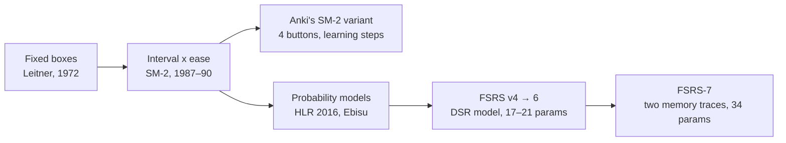
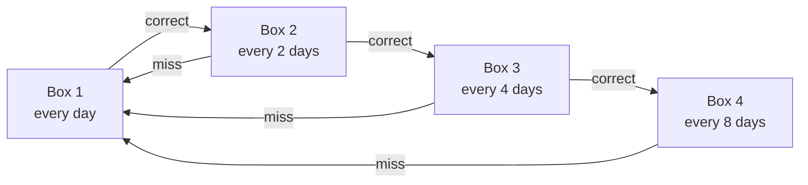
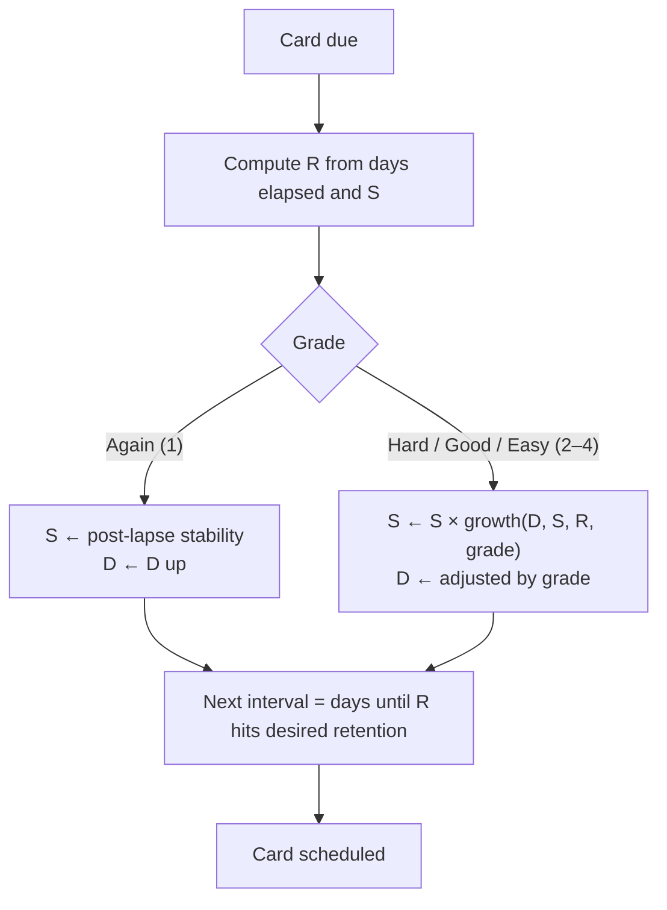
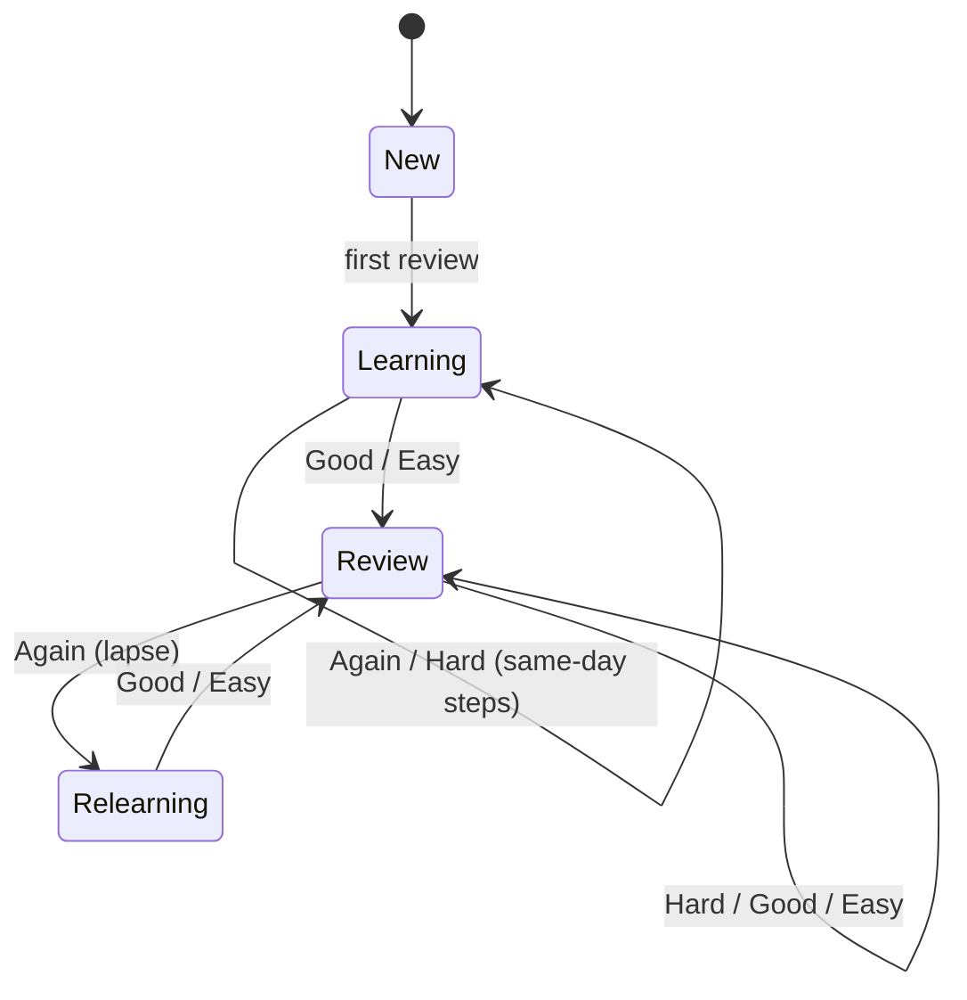

# 01 · Spaced repetition background

Status: done · Updated: 2026-10-22

## Summary

Spaced repetition schedules each card for review around the time you are about to forget it. The main families are box systems (Leitner), interval multipliers (SM-2 and Anki's variant), and memory models that predict recall probability (HLR, FSRS). FSRS is the current open state of the art. Its core fits on one page; its optimiser and its newest version (FSRS-7) do not.

## Problem

Uplink has to pick a scheduler. To pick well, the team needs a shared picture of what the options are, what each one optimises, what the evidence says, and how much machinery FSRS really involves. This doc is that picture. Doc 02 makes the recommendation.

## Goals

- Describe the schedulers worth knowing, with the arguments for and against each.
- Summarise the evidence: the learning-science base and the head-to-head benchmark.
- Explain FSRS on one page, with diagrams and code, and say where one page stops being enough.

## Non-goals

- Choosing the scheduler (doc 02).
- Card types and learning design (doc 03).
- Implementing anything. Plans only.

## Why spacing works at all

Two of the most robust findings in learning science carry the whole idea:

- **The spacing effect.** The same study time spread over several sessions beats one block. A meta-analysis of 317 experiments (Cepeda et al., 2006) found the effect across materials and ages, and that the best gap grows with how long you need to remember.
- **The testing effect (retrieval practice).** Trying to recall beats re-reading. In Roediger and Karpicke (2006), students who practised recall remembered more a week later than students who re-studied, even though re-studying felt better at the time.

A flashcard review is retrieval practice, and a scheduler is a spacing policy. Dunlosky et al. (2013) rated both "high utility" among ten common study techniques; highlighting and re-reading rated low.

## The systems



### Leitner boxes

Cards live in numbered boxes. A correct answer moves a card up one box; a miss sends it back to box 1. Box *n* is reviewed every 2ⁿ⁻¹ days (or on a similar schedule).



- **For:** trivially explainable, works on paper, no state beyond a box number. Easy to show a learner why a card is due.
- **Against:** every card in a box gets the same interval, whether it is easy or hard. A single miss throws away all progress. No notion of how likely you are to remember.

### SM-2 (SuperMemo, 1987, published 1990)

Each card has an ease factor EF (starts at 2.5) and a repetition count. Grades run 0–5.

```
I(1) = 1 day,  I(2) = 6 days,  I(n) = I(n-1) × EF
EF' = EF + (0.1 − (5 − q) × (0.08 + (5 − q) × 0.02)),  EF ≥ 1.3
q < 3  →  restart repetitions from I(1), EF unchanged
```

- **For:** about twenty lines of code, no parameters to fit, deterministic, decades of use. Per-card ease is a real improvement over Leitner.
- **Against:** it predicts no probability, so you cannot set a target retention or measure how well it is doing. Intervals are hand-tuned constants, not fitted. Difficulty only ratchets: repeated misses push EF to its 1.3 floor and keep it there, the problem Anki users call "ease hell".

### Anki's SM-2 variant

Anki's legacy scheduler keeps the interval × ease idea but changes most details:

- four buttons (Again, Hard, Good, Easy) instead of six grades, with one fail choice;
- configurable learning and relearning steps (for example 1 min, 10 min) instead of fixed 1 and 6 days;
- ease starts at 250%; Again −20 points, Hard −15, Easy +15, Good unchanged; floor 130%;
- late but correct answers earn a bonus for the extra time;
- Hard interval × 1.2, Easy bonus × 1.3, a global interval modifier.

- **For:** the most widely used scheduler in the world for over a decade. Learning steps fix SM-2's worst early behaviour.
- **Against:** still no recall probability, still ease hell, and a lot of knobs that users tune by folklore.

### Half-Life Regression (Duolingo, 2016)

HLR models recall as `p = 2^(−Δ/h)`, where the half-life *h* is a regression on features of the learner's history with an item (times seen, times right, times wrong). Settles and Meeder (2016) trained it on Duolingo's logs.

- **For:** the first widely published model that outputs a recall probability, and the idea that schedules should be learned from data.
- **Against:** designed for a platform with millions of learners and shared items. In the open benchmark it predicts individual users' recall much worse than FSRS (log loss 0.469 vs 0.346).

### Ebisu

A Bayesian model: each card's memory half-life is a probability distribution, updated after every review. Elegant, no fitted parameters, gives a calibrated-looking uncertainty. In the benchmark it scores below even a constant baseline on log loss (0.499 vs 0.395), so it is a good teaching example and a weak production choice.

### SuperMemo SM-15 to SM-18

SuperMemo's later algorithms model stability and retrievability, the same two quantities FSRS uses. They are closed source, so Uplink cannot use them. SuperMemo disputes the open benchmark's comparisons with its algorithms; treat cross-vendor claims in either direction with care.

### FSRS (Free Spaced Repetition Scheduler)

An open model by Jarrett Ye and the open-spaced-repetition community, derived from the DSR (difficulty, stability, retrievability) memory model and a KDD 2022 paper (Ye, Su and Cao). It became a built-in, opt-in scheduler in Anki 23.10 (2023). The current stable version is FSRS-6 (21 parameters); FSRS-7 (34 parameters) has a reference implementation and is the default on the main branches of the reference libraries.

- **For:** best predictions of any non-neural scheduler on the largest open dataset; a target retention you set directly; no ease hell; MIT/BSD reference implementations in TypeScript, Python, and Rust.
- **Against:** more parameters and more maths to explain; the parameters fit best after a few hundred reviews of your own history; same-day reviews were handled awkwardly before FSRS-7.

## Evidence: the open benchmark

The open-spaced-repetition `srs-benchmark` predicts each next review's outcome across Anki collections from 10,000 users (about 350 million evaluated reviews without same-day reviews). Lower log loss and RMSE are better; higher AUC is better. Selected rows, without same-day reviews:

| Model | Fitted params | Log loss | RMSE (bins) | AUC |
|---|---|---|---|---|
| FSRS-7 | 34 | 0.340 | 0.063 | 0.717 |
| FSRS-7, default params (no fitting) | 0 | 0.362 | 0.091 | 0.703 |
| FSRS-6 | 21 | 0.346 | 0.065 | 0.703 |
| FSRS-5 | 19 | 0.356 | 0.074 | 0.701 |
| FSRS-4.5 | 17 | 0.363 | 0.076 | 0.689 |
| Constant average (baseline) | 0 | 0.395 | 0.103 | 0.500 |
| HLR | 3 | 0.469 | 0.128 | 0.637 |
| Ebisu v2 | 0 | 0.499 | 0.163 | 0.605 |

What to take from it:

- **FSRS has improved steadily, and the gains between versions are small.** Moving from FSRS-6 to FSRS-7 buys about 0.006 log loss.
- **Default parameters are already good.** FSRS-7 with no per-user fitting matches fully fitted FSRS-4.5. That matters for a new app with no history.
- **SM-2 is not in the current tables.** SM-2 makes no probability prediction, so the benchmark has to bolt one on to score it. Earlier benchmark versions included a trainable SM-2, and forum reports of those results have FSRS-5 beating it in about 97% of collections; the current README no longer lists it, so treat that figure as second-hand.
- **Neural models (RWKV, GRU) predict better still** (log loss as low as 0.277), but they need pretraining on thousands of users. Out of scope.
- **Caveats.** The data is all Anki users, mostly language and medical students, with Anki's four buttons. Better prediction of the next answer is not the same as better long-term learning, though it is the best proxy anyone has measured at scale.

## FSRS on one page

### Three numbers per card

| Symbol | Name | Meaning | Range |
|---|---|---|---|
| **R** | Retrievability | Probability you recall the card right now | 0–1 |
| **S** | Stability | Days until R falls to 90% | > 0 days |
| **D** | Difficulty | How hard the card is for you; slows stability growth | 1–10 |

The learner grades each review: **1 Again**, **2 Hard**, **3 Good**, **4 Easy**. The app sets one number, **desired retention** *r* (default 0.9).

### One review



### The forgetting curve

Memory decays as a power law, not an exponential. With decay *d* (fitted, default about 0.15 in FSRS-6) and a factor chosen so that R = 0.9 when t = S:

```
R(t, S) = (1 + F · t / S) ^ (−d),     F = 0.9^(−1/d) − 1
```

Invert it to get the interval for a desired retention *r*:

```
I(r, S) = (S / F) · (r^(−1/d) − 1)        # I(0.9, S) = S
```

That inversion is the whole scheduler: model memory, then wait until predicted recall drops to the target.

### The update rules (FSRS-6, 21 weights w0…w20)

```typescript
// FSRS-6 core, after py-fsrs. G: 1 Again, 2 Hard, 3 Good, 4 Easy. t in days.
const decay = -w[20];
const factor = 0.9 ** (1 / decay) - 1;
const clampD = (d: number) => Math.min(10, Math.max(1, d));

const retrievability = (t: number, S: number) => (1 + factor * t / S) ** decay;
const interval = (S: number, r = 0.9) => (S / factor) * (r ** (1 / decay) - 1);

// First review: stability is a lookup, difficulty an exponential in the grade.
const initStability = (G: number) => w[G - 1];       // defaults ≈ 0.2, 1.3, 2.3, 8.3 days
const initDifficulty = (G: number) => clampD(w[4] - Math.exp(w[5] * (G - 1)) + 1);

// Difficulty: move by grade, damp near the ceiling, then pull gently back toward "Easy".
function nextDifficulty(D: number, G: number) {
  const delta = -w[6] * (G - 3);
  const damped = D + delta * (10 - D) / 9;            // linear damping
  return clampD(w[7] * initDifficulty(4) + (1 - w[7]) * damped);  // mean reversion
}

// Success: stability multiplies. Grows more when D is low, S is small, and R was low
// (a hard-won recall teaches more: the "desirable difficulty" in one term).
function recallStability(D: number, S: number, R: number, G: number) {
  const hard = G === 2 ? w[15] : 1;
  const easy = G === 4 ? w[16] : 1;
  return S * (1 + Math.exp(w[8]) * (11 - D) * S ** -w[9]
                * (Math.exp(w[10] * (1 - R)) - 1) * hard * easy);
}

// Lapse: stability resets to a fraction of what it was, capped so it never grows.
function forgetStability(D: number, S: number, R: number) {
  const longTerm = w[11] * D ** -w[12] * ((S + 1) ** w[13] - 1) * Math.exp(w[14] * (1 - R));
  return Math.min(longTerm, S / Math.exp(w[17] * w[18]));
}

// Same-day review (learning steps): small multiplicative nudge, never down on a pass.
function shortTermStability(S: number, G: number) {
  let inc = Math.exp(w[17] * (G - 3 + w[18])) * S ** -w[19];
  if (G >= 2) inc = Math.max(inc, 1);
  return S * inc;
}
```

About forty lines, and a learner can read every term. The three properties worth explaining in a demo:

1. **Stability grows less the more stable a card already is** (`S ** -w[9]`). Diminishing returns on reviewing what you know.
2. **Stability grows more when recall was harder** (`exp(w[10] * (1 - R)) - 1`). Reviewing a card the moment before you would forget it teaches more than reviewing it early.
3. **Difficulty slows growth** (`11 - D`) and reverts slowly toward a baseline, so one bad day does not doom a card forever. This is the fix for ease hell.

### Card lifecycle



The learning and relearning steps (minutes apart) are app policy, not part of the FSRS model. The reference libraries implement them the same way Anki does.

## Where the one-pager stops being enough

The section above is a complete, honest account of how FSRS-6 *schedules*. It is not enough for four things:

1. **Fitting the parameters.** The 21 weights come from gradient descent over a user's review log (the optimiser in `fsrs-rs`, exposed to Python and to JavaScript through WebAssembly bindings). Doing that well involves loss design, outlier filtering, parameter clipping, and recency weighting. Anki's manual warns that fitting with fewer than a few hundred reviews can make things worse. This is a separate project, not a page.
2. **Choosing desired retention.** Higher retention means many more reviews. Picking the retention that minimises workload per unit of knowledge is a simulation problem (the KDD 2022 paper treats it as a stochastic shortest path). The reference tooling now plots workload against retention rather than giving one "optimal" number.
3. **FSRS-7.** Each card carries two memory traces, one fast-decaying and one slow; the forgetting curve is a stability-weighted mix of two power laws that also depends on difficulty; intervals are continuous (ten minutes is 10/1440 days); and the curve has no closed-form inverse, so the next interval is a root-find. Post-lapse stability no longer depends on difficulty. It has 34 weights. It is explainable with a diagram, but its formulas do not fit on this page.
4. **Scheduling policy around the model.** Fuzz (randomly spreading due dates so cards added together do not come due together), load balancing, maximum intervals, what to do with overdue cards, and "review ahead" sessions. None of this is in the memory model, and all of it shapes what users see.

## What this means for Uplink

- The scheduler should store **every review** (card, time, grade, elapsed time, state before and after), not just the current state. Every model above can be recomputed from that log, so the choice of scheduler stays reversible. Doc 05 covers where review state lives.
- FSRS's three numbers give the app honest, explainable UI: "you have an 87% chance of remembering this today".
- Default parameters are good enough to launch; fitting is a later feature.

Doc 02 turns this into a recommendation.

## Open questions

- Should the app show R, S and D to learners, or only to curious ones (a "why is this due?" sheet)?
- Do code and system-design cards behave like the vocabulary and medical cards the benchmark measured? Our own review logs will be the only way to know.
- Is Anki's four-button scale right for understanding-type cards, or would two buttons (fail/pass) be more honest? FSRS supports both (Hard and Easy are simply never pressed). Doc 03 recommends two by default.

## Sources

- Cepeda, N. J., Pashler, H., Vul, E., Wixted, J. T., and Rohrer, D. (2006). Distributed practice in verbal recall tasks: a review and quantitative synthesis. *Psychological Bulletin*, 132(3), 354–380. https://doi.org/10.1037/0033-2909.132.3.354
- Roediger, H. L., and Karpicke, J. D. (2006). Test-enhanced learning: taking memory tests improves long-term retention. *Psychological Science*, 17(3), 249–255. https://doi.org/10.1111/j.1467-9280.2006.01693.x
- Dunlosky, J., Rawson, K. A., Marsh, E. J., Nathan, M. J., and Willingham, D. T. (2013). Improving students' learning with effective learning techniques. *Psychological Science in the Public Interest*, 14(1), 4–58. https://doi.org/10.1177/1529100612453266
- Leitner, S. (1972). *So lernt man lernen*. Herder.
- Wozniak, P. (1990). SuperMemo 2 algorithm description. https://super-memory.com/english/ol/sm2.htm
- Anki Manual: "What spaced repetition algorithm does Anki use?" https://docs.ankiweb.net/faqs/what-spaced-repetition-algorithm
- Anki Manual: Deck options (FSRS, desired retention, ease hell). https://docs.ankiweb.net/deck-options.html
- Settles, B., and Meeder, B. (2016). A trainable spaced repetition model for language learning. *ACL 2016*. https://doi.org/10.18653/v1/P16-1174
- Ye, J., Su, J., and Cao, Y. (2022). A stochastic shortest path algorithm for optimizing spaced repetition scheduling. *KDD 2022*. https://doi.org/10.1145/3534678.3539081
- open-spaced-repetition: The FSRS algorithm (wiki). https://github.com/open-spaced-repetition/awesome-fsrs/wiki/The-Algorithm
- open-spaced-repetition: srs-benchmark (results tables, read 2026-10-22). https://github.com/open-spaced-repetition/srs-benchmark
- open-spaced-repetition: py-fsrs scheduler source (FSRS-6 formulas and default parameters). https://github.com/open-spaced-repetition/py-fsrs
- Anki Forums: "FSRS vs SM2 in 2 separate profiles" (second-hand SM-2 benchmark figure). https://forums.ankiweb.net/t/fsrs-vs-sm2-in-2-seperate-profiles/52171
- haskell-fsrs package notes on FSRS-7 (two traces, 34 weights, root-find intervals). https://hackage-content.haskell.org/package/haskell-fsrs
