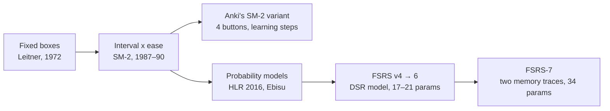
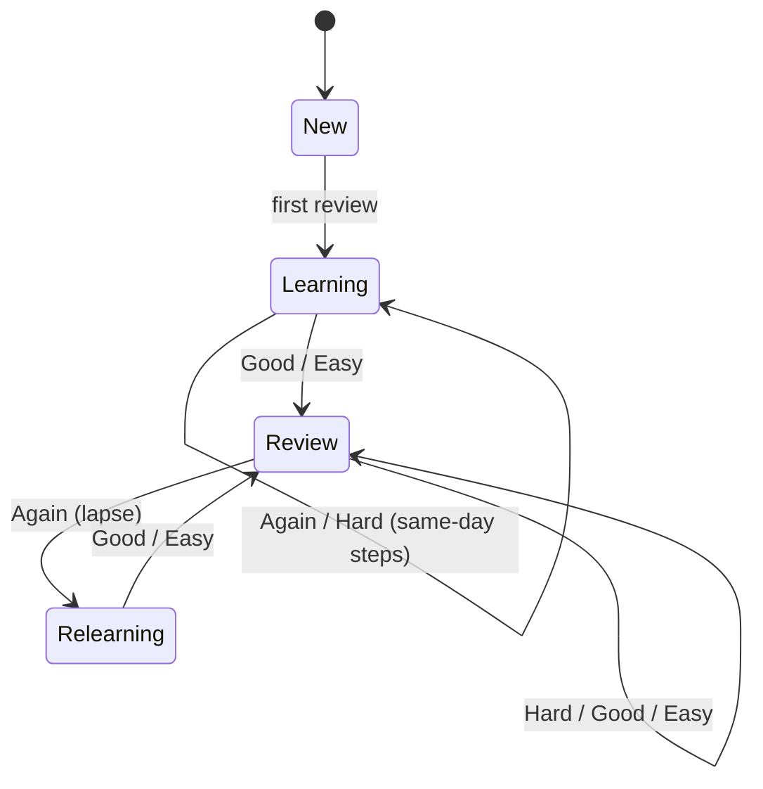

# 01 · Spaced repetition background

Status: done · Updated: 2026-10-22

## Summary

Spaced repetition schedules each card for review around the time you are about to forget it. The main families are box systems (Leitner), interval multipliers (SM-2 and Anki's variant), and memory models that predict recall probability (HLR, FSRS). FSRS is the current open state of the art. Its core fits on one page; its optimiser and its newest version (FSRS-7) do not.

## Problem

Uplink has to pick a scheduler. To pick well, the team needs a shared picture of the options, what each one optimises, what the evidence says, and how much machinery FSRS really involves. This doc is that picture. Doc 02 makes the recommendation.

## Goals and non-goals

- **Goals:** the schedulers worth knowing, with arguments for and against; the evidence; FSRS on one page, and where one page stops being enough.
- **Non-goals:** choosing the scheduler (doc 02), card design (doc 03), implementation.

## Why spacing works at all

Two robust findings from learning science carry the whole idea:

- **The spacing effect.** The same study time spread over several sessions beats one block. Cepeda et al. (2006) synthesised 839 comparisons from 317 experiments on verbal recall. Spacing helped, and the best gap grew with how long the material had to be remembered.
- **The testing effect (retrieval practice).** Trying to recall beats re-reading. In Roediger and Karpicke (2006), students who practised recall remembered more a week later than students who re-studied, even though re-studying felt better at the time.

A flashcard review is retrieval practice, and a scheduler is a spacing policy. Dunlosky et al. (2013) reviewed ten study techniques and rated practice testing and distributed practice the only two "high utility" ones. Highlighting and re-reading were rated low.

## The systems



### Leitner boxes

Cards live in numbered boxes. A correct answer moves a card up one box, and a miss sends it back to box 1. Box *n* is reviewed every 2ⁿ⁻¹ days, or on some similar schedule.

- **For:** trivially explainable, works on paper, and needs no state beyond a box number.
- **Against:** every card in a box gets the same interval, easy or hard. A single miss throws away all progress. It has no notion of how likely you are to remember.

### SM-2 (SuperMemo, 1987, published 1990)

Each card has an ease factor EF (starts at 2.5) and a repetition count. Grades run 0–5.

```
I(1) = 1 day,  I(2) = 6 days,  I(n) = I(n-1) × EF
EF' = EF + (0.1 − (5 − q) × (0.08 + (5 − q) × 0.02)),  EF ≥ 1.3
q < 3  →  restart repetitions from I(1), EF unchanged
```

- **For:** about twenty lines of code, no parameters to fit, deterministic, decades of use. Per-card ease is a real improvement over Leitner.
- **Against:** it predicts no probability, so you cannot set a target retention or measure how well it is doing. The intervals are hand-tuned constants, not fitted. Difficulty only ratchets: repeated misses push EF to its 1.3 floor and keep it there. Anki users call this "ease hell".

### Anki's SM-2 variant

Anki's legacy scheduler keeps the interval × ease idea but changes the details:

- four buttons (Again, Hard, Good, Easy) instead of six grades, with one fail button instead of three;
- configurable learning and relearning steps instead of the fixed 1 and 6 days;
- ease starts at 250%: Again −20 points, Hard −15, Good unchanged, Easy +15, floor 130%;
- late answers count toward the next interval;
- Hard interval × 1.2, Easy bonus × 1.3, and a global interval modifier (all defaults).

- **For:** the most widely used scheduler for over a decade. Learning steps fix SM-2's worst early behaviour.
- **Against:** still no recall probability, still ease hell, and many knobs that users tune by folklore.

### Half-Life Regression (Duolingo, 2016)

HLR models recall as `p = 2^(−Δ/h)`. The half-life *h* is a regression on features of the learner's history with an item: times seen, times right, times wrong. Settles and Meeder (2016) trained it on Duolingo's logs.

- **For:** the first widely published model that outputs a recall probability, and the idea that schedules should be learned from data.
- **Against:** designed for a platform with millions of learners and shared items. In the open benchmark it predicts individual users' recall much worse than FSRS (log loss 0.469 vs 0.346).

### Ebisu

A Bayesian model: each card's memory half-life is a probability distribution, updated after every review. It is elegant and has no fitted parameters. In the benchmark it scores worse on log loss than a constant baseline (0.499 vs 0.395). That makes it a good teaching example and a weak production choice.

### SuperMemo SM-15 to SM-18

SuperMemo's later algorithms model stability and retrievability, the same two quantities FSRS uses. They are closed source, so Uplink cannot use them. The benchmark compares against them in separate repositories. SuperMemo's own view of those comparisons is unverified here, so treat cross-vendor claims in either direction with care.

### FSRS (Free Spaced Repetition Scheduler)

FSRS is an open model by Jarrett Ye and the open-spaced-repetition community. It comes from the DSR (difficulty, stability, retrievability) memory model and a KDD 2022 paper (Ye, Su and Cao). Anki 23.10 (2023) added it as a built-in scheduler you opt into. The stable version is FSRS-6 (21 parameters): it is what `ts-fsrs` 5.4.2 on npm and `py-fsrs` implement. FSRS-7 (34 parameters) is the default on `ts-fsrs`'s main branch, library v6, which is not yet released on npm.

- **For:** the best predictions of any non-neural scheduler on the largest open dataset; a target retention you set directly; no ease hell; reference implementations in TypeScript (`ts-fsrs`, MIT), Python (`py-fsrs`, MIT), and Rust (`fsrs-rs`, BSD-3-Clause).
- **Against:** more parameters and more maths to explain. The parameters fit best after a few hundred of your own reviews. FSRS-6 and earlier model same-day reviews only roughly.

## Evidence: the open benchmark

The open-spaced-repetition `srs-benchmark` predicts the outcome of each next review across 9,999 Anki collections, one per user, with 349,923,850 reviews evaluated when same-day reviews are excluded. Lower log loss and RMSE are better, and higher AUC is better. Selected rows from the table without same-day reviews, read 2026-10-22:

| Model | Fitted params | Log loss | RMSE (bins) | AUC |
|---|---|---|---|---|
| FSRS-7 | 34 | 0.340 | 0.063 | 0.717 |
| FSRS-7, default params (no fitting) | 0 | 0.362 | 0.091 | 0.703 |
| FSRS-6 | 21 | 0.346 | 0.065 | 0.703 |
| FSRS-5 | 19 | 0.356 | 0.074 | 0.701 |
| FSRS-4.5 | 17 | 0.363 | 0.076 | 0.689 |
| Constant average (baseline) | 0 | 0.395 | 0.103 | 0.500 |
| HLR | 3 | 0.469 | 0.128 | 0.637 |
| Ebisu v2 | 0 | 0.499 | 0.163 | 0.605 |

What to take from it:

- **FSRS has improved steadily, but each version gains little.** Going from FSRS-6 to FSRS-7 buys about 0.006 log loss.
- **Default parameters are already good.** FSRS-7 with no per-user fitting matches fully fitted FSRS-4.5, which matters for a new app with no history. The table has no row for FSRS-6 with default parameters.
- **SM-2 is not in the results.** It makes no probability prediction, so scoring it means bolting one on. Forum reports of older benchmark runs have FSRS-5 beating a trainable SM-2 in about 97% of collections. That figure is second-hand.
- **Neural models predict better still.** RWKV reaches log loss 0.277, but it has 2.8 million parameters and needs pretraining on many users. Out of scope.
- **Caveats.** All the data comes from Anki users, with Anki's four buttons. Predicting the next answer better is not the same as learning better over the long term, though it is the best proxy anyone has measured at scale.

## FSRS on one page

### Three numbers per card

| Symbol | Name | Meaning | Range |
|---|---|---|---|
| **R** | Retrievability | Probability you recall the card right now | 0–1 |
| **S** | Stability | Days until R falls to 90% | > 0 days |
| **D** | Difficulty | How hard the card is for you; slows stability growth | 1–10 |

The learner grades each review **1 Again**, **2 Hard**, **3 Good**, or **4 Easy**. The app sets one number, the **desired retention** *r* (default 0.9). Each review computes R from the days elapsed and S. Again sets S to a post-lapse stability and raises D. Hard, Good, and Easy multiply S by a growth term and adjust D by grade. The next interval is the number of days until R falls to *r*.

### The forgetting curve

Memory decays as a power law, not an exponential. With decay *d* (fitted; the FSRS-6 default is 0.1542) and a factor chosen so that R = 0.9 when t = S:

```
R(t, S) = (1 + F · t / S) ^ (−d),     F = 0.9^(−1/d) − 1      # F ≈ 0.98 at the default d
I(r, S) = (S / F) · (r^(−1/d) − 1)                            # I(0.9, S) = S
```

The second line inverts the first: it gives the interval for a desired retention *r*. That inversion is the whole scheduler. Model memory, then wait until predicted recall drops to the target.

### The update rules (FSRS-6, 21 weights w0…w20)

The three properties worth explaining in a demo:

1. **Stability grows less the more stable a card already is** (`S ** -w[9]`). Reviewing what you already know has diminishing returns.
2. **Stability grows more when recall was harder** (`exp(w[10] * (1 - R)) - 1`). Reviewing a card just before you would forget it teaches more than reviewing it early.
3. **Difficulty slows growth** (`11 - D`) and reverts slowly toward a baseline, so one bad day does not doom a card forever. This is the fix for ease hell.

The code, about forty lines, is in the [Appendix](#appendix-fsrs-6-core-in-typescript).

### Card lifecycle



Learning and relearning steps, which are minutes apart, are app policy, not part of the FSRS model. The reference libraries implement them much as Anki does.

## Where the one-pager stops being enough

The section above explains how FSRS-6 *schedules*. It does not cover four things:

1. **Fitting the parameters.** The 21 weights come from gradient descent over a user's review log. `fsrs-rs` has an optimiser, with Python and Node.js bindings, and `py-fsrs` ships an optional one. Doing it well takes loss design, outlier filtering, parameter clipping, and recency weighting. Anki's manual lists "less than a few hundred" reviews as a reason FSRS may perform poorly. This is a separate project.
2. **Choosing desired retention.** Higher retention means many more reviews. Finding the retention that minimises workload per unit of knowledge is a simulation problem; the KDD 2022 paper treats it as a stochastic shortest path.
3. **FSRS-7.** Each card carries two memory traces, one fast-decaying and one slow. The forgetting curve is a stability-weighted mix of two power laws, and intervals are continuous: ten minutes is a fraction of a day. The curve has no closed-form inverse, so the next interval is a root-find. Post-lapse stability no longer depends on difficulty. It has 34 weights. A diagram can explain it, but its formulas do not fit on this page.
4. **Scheduling policy around the model.** Fuzz (spreading due dates so cards added together do not come due together), load balancing, maximum intervals, overdue cards, and "review ahead" sessions. None of this is in the memory model, and all of it shapes what users see.

## What this means for Uplink

- Store **every review** (card, time, grade, elapsed time, state before and after), not just the current state. Every model above can be recomputed from that log, so the choice of scheduler stays reversible. Doc 02 makes the log the source of truth, and doc 05 says where review state lives.
- FSRS's three numbers make honest, explainable UI possible: "you have an 87% chance of remembering this today."
- Default parameters are good enough to launch, so fitting can come later.

## Open questions

- Should the app show R, S, and D to every learner, or only on a "why is this due?" sheet?
- Do code and system-design cards behave like the cards the benchmark measured? Only our own review logs can tell.
- Grade buttons are settled in [doc 03](03-genuine-learning.md#grading-two-buttons-by-default): two by default. FSRS works when Hard and Easy are never pressed.

## Sources

- Cepeda, N. J., Pashler, H., Vul, E., Wixted, J. T., and Rohrer, D. (2006). Distributed practice in verbal recall tasks: a review and quantitative synthesis. *Psychological Bulletin*, 132(3), 354–380. https://doi.org/10.1037/0033-2909.132.3.354
- Roediger, H. L., and Karpicke, J. D. (2006). Test-enhanced learning. *Psychological Science*, 17(3), 249–255. https://doi.org/10.1111/j.1467-9280.2006.01693.x
- Dunlosky, J., et al. (2013). Improving students' learning with effective learning techniques. *Psychological Science in the Public Interest*, 14(1), 4–58. https://doi.org/10.1177/1529100612453266
- Leitner, S. (1972). *So lernt man lernen*. Herder.
- Wozniak, P. (1990). SuperMemo 2 algorithm description. https://super-memory.com/english/ol/sm2.htm
- Anki Manual: "What spaced repetition algorithm does Anki use?" (SM-2 changes, ease steps, 130% floor) and Deck options (FSRS in 23.10, defaults, "a few hundred" reviews, ease hell). https://docs.ankiweb.net/faqs/what-spaced-repetition-algorithm ; https://docs.ankiweb.net/deck-options.html
- Settles, B., and Meeder, B. (2016). A trainable spaced repetition model for language learning. *ACL 2016*. https://doi.org/10.18653/v1/P16-1174
- Ye, J., Su, J., and Cao, Y. (2022). A stochastic shortest path algorithm for optimizing spaced repetition scheduling. *KDD 2022*. https://doi.org/10.1145/3534678.3539081
- open-spaced-repetition: srs-benchmark (results, read 2026-10-22). https://github.com/open-spaced-repetition/srs-benchmark
- open-spaced-repetition: py-fsrs `scheduler.py` (FSRS-6 formulas and defaults, read 2026-10-22). https://github.com/open-spaced-repetition/py-fsrs
- open-spaced-repetition: ts-fsrs (main defaults to FSRS-7; npm `latest` is 5.4.2, MIT) and fsrs-rs (BSD-3-Clause, optimiser). https://github.com/open-spaced-repetition/ts-fsrs ; https://github.com/open-spaced-repetition/fsrs-rs
- Anki Forums: "FSRS vs SM2 in 2 separate profiles" (second-hand SM-2 figure). https://forums.ankiweb.net/t/fsrs-vs-sm2-in-2-seperate-profiles/52171
- haskell-fsrs package notes on FSRS-7 (two traces, 34 weights, root-find intervals). https://hackage-content.haskell.org/package/haskell-fsrs

## Appendix: FSRS-6 core in TypeScript

Transcribed from `py-fsrs`'s `scheduler.py` and checked against it line by line on 2026-10-22. **Not executed.** `w` is the 21-weight array, whose `py-fsrs` defaults start `0.212, 1.2931, 2.3065, 8.2956`.

```typescript
// FSRS-6 core, after py-fsrs. G: 1 Again, 2 Hard, 3 Good, 4 Easy. t in days.
const decay = -w[20];
const factor = 0.9 ** (1 / decay) - 1;
const clampD = (d: number) => Math.min(10, Math.max(1, d));

const retrievability = (t: number, S: number) => (1 + factor * t / S) ** decay;
// Libraries then round to whole days, floor at 1 day, and cap at a maximum interval.
const interval = (S: number, r = 0.9) => (S / factor) * (r ** (1 / decay) - 1);

// First review: stability is a lookup, difficulty an exponential in the grade.
const initStability = (G: number) => w[G - 1];        // defaults ≈ 0.2, 1.3, 2.3, 8.3 days
const rawInitDifficulty = (G: number) => w[4] - Math.exp(w[5] * (G - 1)) + 1;
const initDifficulty = (G: number) => clampD(rawInitDifficulty(G));

// Difficulty: move by grade, damp near the ceiling, then pull gently back toward "Easy".
function nextDifficulty(D: number, G: number) {
  const delta = -w[6] * (G - 3);
  const damped = D + delta * (10 - D) / 9;            // linear damping
  // The reversion target is the *unclamped* Easy difficulty (≈ −4.8 at defaults).
  return clampD(w[7] * rawInitDifficulty(4) + (1 - w[7]) * damped);
}

// Success: stability multiplies. Grows more when D is low, S is small, and R was low.
function recallStability(D: number, S: number, R: number, G: number) {
  const hard = G === 2 ? w[15] : 1;
  const easy = G === 4 ? w[16] : 1;
  return S * (1 + Math.exp(w[8]) * (11 - D) * S ** -w[9]
                * (Math.exp(w[10] * (1 - R)) - 1) * hard * easy);
}

// Lapse: stability resets to a fraction of what it was, capped so it never grows.
function forgetStability(D: number, S: number, R: number) {
  const longTerm = w[11] * D ** -w[12] * ((S + 1) ** w[13] - 1) * Math.exp(w[14] * (1 - R));
  return Math.min(longTerm, S / Math.exp(w[17] * w[18]));
}

// Same-day review (learning steps): small multiplicative nudge, never down on a pass.
function shortTermStability(S: number, G: number) {
  let inc = Math.exp(w[17] * (G - 3 + w[18])) * S ** -w[19];
  if (G >= 2) inc = Math.max(inc, 1);                 // Hard, Good, Easy
  return S * inc;
}
```

Fixed in this review: the earlier version pulled difficulty toward the *clamped* Easy value (1.0). At default weights that differs from `py-fsrs` by about 0.006 per review (w7 ≈ 0.001 × 5.8), and the gap compounds over a card's history. Golden vectors would have caught it (doc 02).
