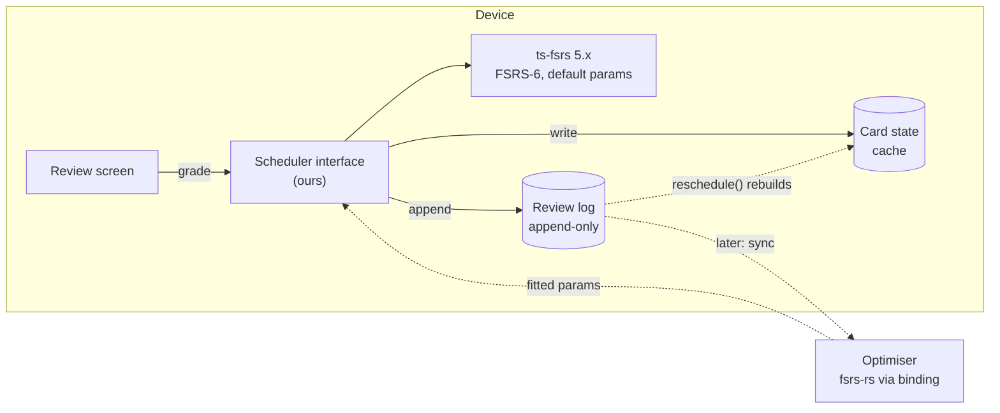

# 02 · Is FSRS the right tool for Uplink?

Status: done · Updated: 2026-10-22

## Summary

Yes. Use FSRS-6 from the first build, through the MIT-licensed `ts-fsrs` 5.x library, with default parameters and a desired retention of 0.9. Do not ship SM-2 first: through a library FSRS costs about the same to integrate, and switching later would cost more. Store every review in an append-only log so the scheduler can be swapped, refitted, or upgraded to FSRS-7 by recomputing state from history.

## Problem

Doc 01 shows FSRS predicts recall best among open schedulers. That is not the same as being right for a new app with no users, small decks, five-minute demos, and learners preparing for a fixed date. This doc tests FSRS against those constraints and picks a path.

## Goals

- Pick the v1 scheduler and the library that provides it.
- Settle cold start, small decks, demos, and parameter fitting.
- Keep the choice reversible.

## Non-goals

- The card format (doc 05) and app screens (doc 06), beyond the scheduler's data needs.
- Building a parameter optimiser.
- Deadline-aware scheduling (listed under Later).

## Users and use cases

| Use case | What the scheduler must do |
|---|---|
| A learner reviews daily on the phone, offline | Run entirely on device; no network to grade a card. |
| A learner imports a 30-card deck an LLM wrote this morning | Behave sensibly with no history: first intervals from the first grade. |
| A software engineer preparing for interviews in six weeks | Keep cards fresh until a date; never schedule a key card past it. |
| Someone shows the app in a five-minute demo | Make spacing visible without waiting days. |
| A long-time user with thousands of reviews | Fit parameters to their history, eventually. |

## Options

| Option | Integration cost | Predicts recall? | Target retention | Fitting | Reversible? |
|---|---|---|---|---|---|
| Leitner (own code) | ~1 hour | No | No | None | Yes, if reviews are logged |
| SM-2 (own code) | ~2 hours | No | No | None | Yes, if reviews are logged |
| Anki-style SM-2 (own code) | ~1 day: learning steps, four buttons, late bonus | No | No | None | Yes, if reviews are logged |
| **FSRS-6 via `ts-fsrs` 5.x** | **~half a day**, plus a Hermes check | **Yes** | **Yes** | Defaults now; optimiser later | Yes |
| FSRS-6 (own code) | 1–2 days: 40 lines of model plus learning steps, fuzz, and clamping, tested against `ts-fsrs` | Yes | Yes | Defaults only | Yes |
| FSRS-7 via `ts-fsrs` main | Unknown: not on npm yet, new API, Node ≥ 24 toolchain | Yes, best | Yes | Optimiser in binding | Yes |

## Recommendation

1. **FSRS-6 via `ts-fsrs` 5.x, pinned.** MIT, no runtime dependencies, ships ESM and CommonJS builds, and implements FSRS-6 with learning steps, relearning steps, fuzz, a maximum interval, `rollback`, `forget`, `reschedule` (rebuild state from a review log), and `get_retrievability`. It is maintained by the same group that maintains the model and the benchmark.
2. **Default parameters, desired retention 0.9.** In doc 01's benchmark, unfitted FSRS-7 defaults match fitted FSRS-4.5 and beat every fitted non-FSRS model. The current tables have no row for unfitted FSRS-6, so this is an inference for FSRS-6, not a measurement; our own logs will confirm or refute it. Retention is a per-deck setting, from 0.80 to 0.95, with a plain-English hint ("higher means more reviews").
3. **An append-only review log is the source of truth.** Card scheduling state (due, stability, difficulty, state) is a cache that our `replay` (built on `ts-fsrs`'s `reschedule`) can rebuild from the log at any time. Replay is deterministic: `ts-fsrs` seeds its fuzz from the review time, rep count, difficulty, and stability, not from a random source. This is what makes every later change (refitting, FSRS-7, a different model entirely) a recomputation rather than a migration.
4. **A thin `Scheduler` interface of our own** wraps the library, so the app never imports `ts-fsrs` types directly. `ts-fsrs` main already has a different API for its next major version (`DefaultScheduler`, `newCard`, `review`), so this wrapper pays for itself on the first upgrade.
5. **No SM-2 phase.** SM-2 would save perhaps half a day once and then cost a migration, and it gives the UI nothing honest to say ("you'll probably remember this" needs a probability). Its one advantage, explainability, is matched by doc 01's one-pager.
6. **No on-device fitting in v1.** Refit later, and only for users with enough history (see below).



## The scheduler interface (sketch)

```typescript
export type Grade = 1 | 2 | 3 | 4; // Again, Hard, Good, Easy

export interface ReviewEvent {
  id: string;           // ULID made on the device; makes multi-device merge a union (doc 08)
  cardId: string;       // the item key: id, id#r, or id#cN (doc 05)
  reviewedAt: string;   // ISO 8601, UTC
  grade: Grade;
  durationMs?: number;  // time to answer, for analytics only
  undoes?: string;      // set on an undo: the id of the event it cancels; replay skips both
}

export interface Scheduler {
  /** Next due date for each possible grade: drives the labels on the four buttons. */
  preview(state: CardState | null, now: Date): Record<Grade, { due: Date }>;
  /** Apply a grade. Returns the new state and the event to append to the log. */
  review(state: CardState | null, grade: Grade, now: Date): { state: CardState; event: ReviewEvent };
  /** Probability of recall right now, 0–1. Null for unseen cards. */
  retrievability(state: CardState | null, now: Date): number | null;
  /** Rebuild state from history: used after refitting, upgrades, or sync. */
  replay(events: ReviewEvent[]): CardState | null; // null if every event was undone
}
```

The interface knows nothing about FSRS; a Leitner implementation could satisfy it in a test.

## The hard cases

### Cold start

FSRS's starting memory comes from the first grade alone. FSRS-6's default weights `w0`–`w3` give an initial stability of 0.21 days for Again, 1.29 for Hard, 2.31 for Good, and 8.30 for Easy; same-day learning steps then nudge it. At desired retention 0.9 the interval equals the stability, so a card that graduates with Good comes back in about two days. That is sensible for a brand-new deck with no history and needs nothing from us beyond picking learning steps. Default proposal: learning steps 1 min and 10 min, relearning step 10 min, the defaults in `py-fsrs`.

### Small decks

FSRS models each card separately, so it does not need a large deck to work. A small deck simply produces few reviews a day. What does need volume is **fitting** the 21 parameters, and that uses the user's whole history across decks, not one deck. Small decks are not a reason to prefer SM-2.

### Parameter fitting

- Anki's manual lists "less than a few hundred" reviews as a reason FSRS may underperform, and says optimising "once every month is sufficient".
- The optimiser lives in `fsrs-rs` (BSD-3-Clause) and reaches JavaScript through `@open-spaced-repetition/binding` (MIT; 0.5.0 on `fsrs` 6.5.0; Node native addons plus a `wasm32-wasi` build). It is a training job, not something to run on a phone mid-review.
- Plan: v1 never fits. When sync exists (doc 08), the server can fit for users above a threshold (start at 1,000 reviews, tune from data), compare predicted log loss against defaults on held-out reviews, and only ship fitted parameters if they win. Then `replay` recomputes every card.

### Demos

A five-minute demo cannot show a card coming back in three days. Three features make spacing visible anyway:

1. **Interval labels on the grade buttons**, straight from `preview`. For a new card with the default steps they read "Again 1m · Hard 6m · Good 10m · Easy 8d": Hard is the rounded mean of the first two steps, and Easy graduates at S ≈ 8.3 days before fuzz (traced from the `ts-fsrs` source, not executed). This is the single best demo of what the scheduler does.
2. **A "why is this due?" sheet** showing R, S, and D with the one-line meaning of each (doc 01).
3. **A seeded demo deck** whose review log already spans weeks, so the stats screen and forgetting curves have something to show. Seeded through the same `replay` path.

A debug-only clock offset is useful for development but should not appear in demos: it is confusing to watch.

### Interviews and exams: a fixed date

FSRS optimises long-term retention at a target probability; it does not know that the learner needs a card on 2 December and less after. Two cheap mitigations, both ordinary FSRS settings:

- raise the deck's desired retention as the date approaches (0.9 → 0.95 shortens intervals);
- set the deck's maximum interval to the days left, updated daily, so no card is scheduled past the date.

A proper deadline mode (choose intervals to maximise recall *on* a date) is a real research problem and goes under Later.

### FSRS-7

FSRS-7 predicts better (doc 01) and models same-day reviews directly, where FSRS-6 only approximates them. As of 2026-10-22 it is the default on the `ts-fsrs` main branch, but the latest npm release is 5.4.2 (1 September), which implements FSRS-6; the next major version also requires Node 24 for its toolchain and changes the API. Adopt it when it is on npm and has been stable for a release or two. Because the review log is the source of truth, the upgrade is: bump the library, swap the wrapper, `replay` every card.

### Running on React Native

`ts-fsrs` 5.x is plain TypeScript with no runtime dependencies, so it should run on Hermes, React Native's JavaScript engine. We found no report either way (searched 2026-10-22), so it is the first task of the scheduler milestone: run the library's own scenarios plus a set of golden vectors (cards and grade sequences with expected stability, difficulty, and due dates, generated with `py-fsrs` with fuzz off on both sides, since `py-fsrs` fuzzes from an unseeded random source) inside the app on a device. If anything fails, the fallback is our own FSRS-6 core, tested against the same vectors.

### Day boundaries and time zones

FSRS measures elapsed time in days; the app must decide when a day ends. Proposal: store all timestamps in UTC, and treat a learner's day as rolling over at 04:00 local time (Anki's convention), so a late-night session counts as the same day. Travel across time zones shifts due dates by hours, which is acceptable.

## Requirements

**Must**
- FSRS-6 scheduling on device, offline, through our `Scheduler` interface.
- Append-only review log, never edited in place. Undo appends a tombstone event (`undoes`), so the log stays safe to merge once sync exists (doc 08).
- Card state is rebuildable from the log; a test proves `replay(log)` equals the stored state.
- Golden-vector tests run on a real device under Hermes.
- Per-deck desired retention and maximum interval.

**Should**
- Interval labels on grade buttons.
- "Why is this due?" sheet showing R, S, D.
- Two buttons (Again / Good) by default, four as a setting (decided in doc 03).

**Later**
- Server-side parameter fitting with a held-out check.
- FSRS-7 upgrade.
- Deadline mode.
- Workload-vs-retention chart for choosing desired retention.

## Licenses

| Project | Use | License | Compatible with Uplink (MIT)? |
|---|---|---|---|
| `ts-fsrs` | Scheduler in the app | MIT | Yes |
| `py-fsrs` | Generating golden test vectors (dev only) | MIT | Yes |
| `fsrs-rs` | Optimiser, later, server side | BSD-3-Clause | Yes; keep its notice |
| `@open-spaced-repetition/binding` | JS access to the optimiser, later | MIT (npm 0.5.0) | Yes |

## Open questions

- Use the library, or write our own FSRS-6 core tested against it? The library is the default here. Writing our own costs a day or two and teaches the model in depth; the risk sits in scheduling policy (learning steps, fuzz), not in the forty lines of maths. **Decided 2026-10-28: the library** behind our `Scheduler` interface (D3); the own core is kept on a separate branch for cross-checks.
- Should a learner see retrievability on every card, or only in the "why" sheet?
- What threshold, measured how, should gate server-side fitting?

## Sources

- open-spaced-repetition: `ts-fsrs` repository and README (MIT; main branch defaults to FSRS-7, Node ≥ 24). https://github.com/open-spaced-repetition/ts-fsrs
- `ts-fsrs` 5.4.2 package README (FSRS-6; `generatorParameters`, `rollback`, `forget`, `reschedule`, `get_retrievability`). https://github.com/open-spaced-repetition/ts-fsrs/blob/v5.4.2/packages/fsrs/README.md
- npm registry: `ts-fsrs` latest (5.4.2, MIT, no runtime dependencies), read 2026-10-22. https://registry.npmjs.org/ts-fsrs/latest
- `ts-fsrs` releases (5.4.2 on 1 September; binding 0.5.0 on 6 June, on `fsrs` 6.5.0). https://github.com/open-spaced-repetition/ts-fsrs/releases
- `ts-fsrs` 5.4.2 source: `strategies/learning_steps.ts` (Again = first step, Hard = rounded mean of the first two, Good = next step) and `strategies/seed.ts` (fuzz seed from time, reps, D × S). https://github.com/open-spaced-repetition/ts-fsrs/tree/v5.4.2/packages/fsrs/src/strategies
- npm registry: `@open-spaced-repetition/binding` latest (0.5.0, MIT, `wasm32-wasi` optional dependency), read 2026-10-22. https://registry.npmjs.org/@open-spaced-repetition/binding/latest
- open-spaced-repetition: `py-fsrs` `scheduler.py` (MIT; FSRS-6's 21 default parameters; learning steps 1m, 10m; relearning 10m; retention 0.9), read 2026-10-22. https://github.com/open-spaced-repetition/py-fsrs
- open-spaced-repetition: `fsrs-rs` (BSD-3-Clause; FSRS-6 and FSRS-7; `compute_parameters`). https://github.com/open-spaced-repetition/fsrs-rs
- open-spaced-repetition: srs-benchmark (default-parameter results). https://github.com/open-spaced-repetition/srs-benchmark
- Anki Manual: Deck options (desired retention default 90%; optimise "once every month"; "less than a few hundred" reviews). https://docs.ankiweb.net/deck-options.html
- Anki Manual: Preferences ("Next day starts at", default 4AM). https://docs.ankiweb.net/preferences.html
- Anki Manual: Anki's SM-2 variant (learning steps, ease rules). https://docs.ankiweb.net/faqs/what-spaced-repetition-algorithm
- Doc 01 in this folder for the model and the evidence.
