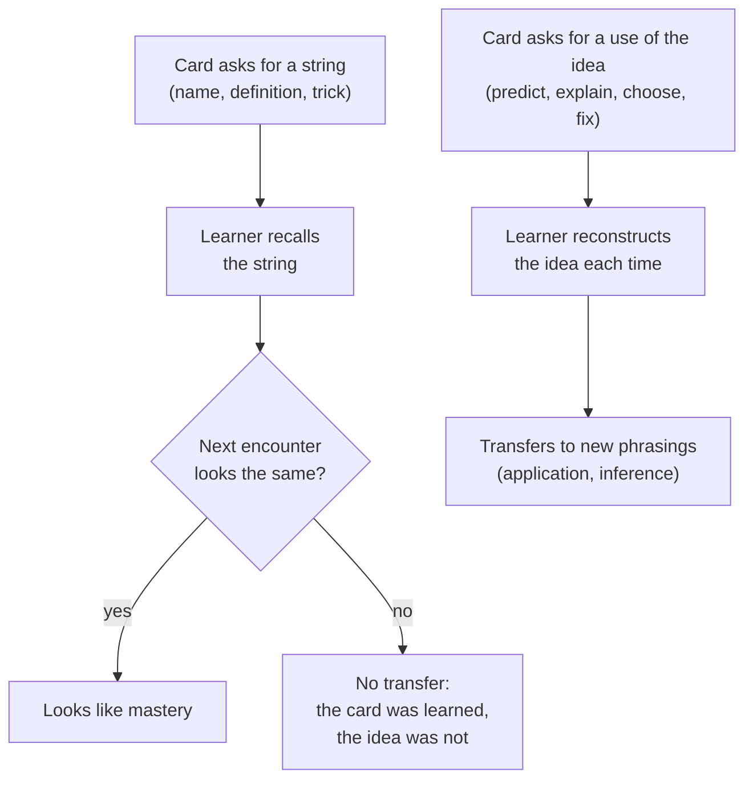

# 03 · Genuine learning vs rote memorisation

Status: draft · Updated: 2026-10-22

## Summary

Spaced retrieval builds understanding only when the cards ask for understanding; recall-only cards mostly train recall of those exact cards. Uplink should ship a small set of card types that make the learner explain, predict, diagnose, compare, and produce, alongside plain recall, and should judge a deck by whether it transfers. Position Uplink as a general learning tool whose first, best-served use is technical practice for software engineers. It should pass the Spanish test without any Spanish-specific code.

## Problem

Flashcards have a reputation: good for capitals, verbs, and drug names, bad for anything you have to *think* with. Technical interview prep makes the problem worse. It is easy to build a deck that maps problem titles to tricks ("Trapping Rain Water → two pointers") and score well on known problems. That is pattern recall, and it fails the first time a problem is phrased differently. An agent-written deck makes it worse again, because LLMs default to term ↔ definition cards.

Uplink has to answer two questions before the card format (doc 05) is fixed:

1. What should cards ask, so that reviewing them builds understanding and not just familiarity with the card?
2. Who is the product for: anyone learning anything, or engineers preparing for interviews?

## Goals

- Summarise what learning science says about retrieval, transfer, elaboration, interleaving, and difficulty, with the effect sizes and caveats.
- Define the card types v1 supports and why each earns its place.
- Decide how cards are graded (doc 02 left four buttons vs two open).
- Recommend a positioning, with the reverse option argued fairly.

## Non-goals

- The exact card syntax (doc 05). Examples here use a provisional shape.
- The practice-to-cards pipeline (doc 04), beyond what it implies for card types.
- Automatic grading of free-text answers by an LLM (listed under Later).

## Users and use cases

| Learner | Wants to | Risk of rote | What helps |
|---|---|---|---|
| A software engineer preparing for interviews | Solve unseen problems and explain trade-offs aloud | Memorising problem → trick | Discrimination, predict, explain-why, find-the-bug |
| A developer learning a new language or framework | Read and write idiomatic code | Memorising API names without semantics | Predict-the-output, cloze on code, compare |
| A student of system design | Reason about capacity, consistency, failure | Memorising "use Kafka" | Compare-trade-offs, explain-why, estimate |
| A Spanish learner | Understand and speak | Recognising words, unable to produce them | Production cards, sentence cloze, audio (later) |
| Anyone who imported an LLM-written deck | Learn the topic, not the deck | Surface prompts that reinforce wording | Lenses, review and edit before study, cards from own mistakes |

## What the evidence says

| Finding | Strength | What it means for Uplink |
|---|---|---|
| **Retrieval practice** beats restudy. Meta-analyses report about g = 0.50 (Rowland 2014, 159 effects) and g = 0.61 (Adesope et al. 2017, 272 effects), larger with feedback. | Strong; rated "high utility" by Dunlosky et al. 2013. | Every card is a question first, answer second. Always show the answer after the attempt (feedback). |
| **Spacing** beats massing across ages and materials. | Strong; also "high utility". | The scheduler (docs 01–02). |
| **Transfer** of retrieval practice to new questions is real but conditional: d = 0.40 overall (Pan & Rickard 2018, 192 effects), strongest for application and inference questions, and dependent on three moderators: the final test asks for the same *kind* of response, retrieval practice is elaborated, and initial performance is high. After correcting for publication bias, transfer often vanished when none of the three was present. Transfer to *untested* material was weakest. | Strong, and the most important row for this doc. | Recall cards mostly improve recall of those cards. To transfer, cards must ask for the response the learner will need later (explain, apply, predict), include an elaborated answer, and be answerable most of the time. A deck only teaches what is on it. |
| **Question type should match the goal.** Higher-order and mixed quizzes improved higher-order test performance; fact-only quizzes did not (Agarwal 2019). | Moderate–strong; classroom and lab. | "Learn the facts first, then think" is not a reason to delay understanding cards. Mix both from day one. |
| **Retrieval beats elaborative study** (concept mapping) on delayed tests, including inference questions (Karpicke & Blunt 2011). Repeated testing beat restudy on new inferential questions a week later (Butler 2010; replicated). | Strong. | Reading a good explanation is not enough; the explanation becomes a card. |
| **Elaborative interrogation and self-explanation** ("why is this true?", "how does this step follow?") help. | Moderate; Dunlosky et al. rate both "moderate utility". | The explain-why card type, and a short "why" under every answer. |
| **Interleaving** helps with a moderate overall effect (g = 0.42; Brunmair & Richter 2019), most for visually similar categories, less for maths, and **blocking beat interleaving for word lists**. The benefit grows when categories are similar to each other and varied inside. | Moderate, with clear moderators. | Interleave where the learner must *tell similar things apart* (which algorithm? ser or estar?). Do not force it on vocabulary. Rohrer & Taylor 2007 show the pattern well: mixed practice looked worse during practice and won a week later. |
| **Desirable difficulties**: spacing, interleaving, testing, and varied practice slow apparent progress and improve retention. A difficulty is undesirable when the learner lacks the background to respond (Bjork & Bjork 2011). | Strong as a framework. | Make cards effortful but tractable. Repeated failure is a signal to split or rewrite the card, not to try harder. |
| **Erroneous examples** (find, explain, and fix someone else's error) beat plain problem solving on a delayed test in one study (d = 0.62; Adams, McLaren et al. 2014) and did not in another classroom study. Students liked them less. | Mixed. | Find-the-bug is worth a card type, with a clear expected answer and an explanation, not as the main diet. |
| **Novice programmers** are often weak at tracing and predicting code before they are weak at problem solving (Lister et al. 2004, multi-national, 500+ students). | Moderate; a much-cited CS education study. | Predict-the-output cards train a prerequisite skill that problem-solving drills skip. |

Two practitioner sources fill in what the papers do not say about writing cards:

- **Wozniak's minimum information principle**: simple, single-answer items are retained far better than complex ones, even when one complex item covers many simple ones. Redundancy (the same fact from several angles) is welcome.
- **Matuschak's guide to prompts**: good prompts are focused, precise, consistent, tractable, and effortful. Conceptual understanding comes from asking about a concept through several *lenses*: attributes, similarities and differences, parts and wholes, causes and effects, significance. Long, oddly worded prompts and copy-pasted cloze deletions invite *pattern matching*: answering from the shape of the question. His notes also observe that LLMs write term ↔ definition prompts for conceptual material unless told exactly which kinds of prompt to write.

### Where rote comes from, concretely



Rote is not a property of flashcards. It is a property of a card whose answer can be produced without the idea. "What is the time complexity of binary search?" can be answered by a parrot. "This loop halves `hi - lo` each iteration; how many iterations for n = 1,000,000, and why?" cannot.

## Card types

Each type is defined by what the learner has to *do*, not by layout. All types share one review flow: show prompt → learner attempts (in their head, aloud, or typed) → reveal answer and "why" → self-grade.

| Type | The learner must | Good for | Checkable? |
|---|---|---|---|
| `basic` | Recall a fact or term | Vocabulary, definitions, syntax, constants | Exact |
| `cloze` | Fill one gap in context | Code idioms, sentences, formulas | Exact |
| `explain` | Say why something is true, or how a step follows | Invariants, design decisions, grammar rules | Against key points |
| `predict` | Trace code and give its output or final state | Language semantics, algorithms, concurrency | Exact |
| `bug` | Find what is wrong, say why, give the fix | Edge cases, off-by-one, common mistakes | Against key points |
| `compare` | Contrast two or more things on named axes | Data structures, databases, ser vs estar | Against key points |
| `choose` | Pick the approach for an unlabelled situation, and justify | Algorithm patterns, design choices, verb mood | Exact choice + key points |
| `produce` | Write a short artefact from a cue | A function signature, a SQL query, a Spanish sentence | Against a model answer |

"Checkable" means what the reveal shows: an exact answer, or a list of key points the learner ticks off. In v1 all grading is self-grading. Key-point answers make self-grading honest: the learner passes only if their answer hit every key point.

Not in v1: multiple choice (recognition is easier than recall and trains the wrong response), image occlusion, audio. Audio is the first thing Spanish needs and goes under Later.

### Examples (provisional shape; doc 05 owns the syntax)

A `predict` card that cannot be answered by memorising a name:

````markdown
---
type: predict
deck: java-fundamentals
tags: [java, strings, equality]
---
What does this print, and why?

```java
String a = "uplink";
String b = new String("uplink");
String c = b.intern();
System.out.println((a == b) + " " + (a == c) + " " + a.equals(b));
```

---
`false true true`

- `a` is a string literal, so it lives in the string pool.
- `new String(...)` always makes a new object, so `a == b` compares two different references.
- `intern()` returns the pooled instance, the same object as `a`.
- `equals` compares contents.
````

A `choose` card, written to discriminate between patterns rather than to name one:

````markdown
---
type: choose
deck: dsa-patterns
tags: [arrays, sliding-window, prefix-sums]
---
Given an array of integers **that may be negative**, count the subarrays that sum to `k`.
Sliding window, or prefix sums with a hash map? Why?

---
**Prefix sums with a hash map.**

- A sliding window needs the sum to move in one direction as the window grows; negative numbers break that.
- With prefix sums, a subarray `(i, j]` sums to `k` exactly when `prefix[j] - prefix[i] = k`, so count earlier prefixes equal to `prefix[j] - k`.
- O(n) time, O(n) space.
````

The same idea seen through two more lenses would be a `bug` card (a sliding-window solution that fails on `[1, -1, 1]`, k = 1) and an `explain` card ("why does the hash map start with `{0: 1}`?"). Three small cards on one idea is redundancy Wozniak welcomes; it is also how the idea survives a rephrased question.

A Spanish `choose` card, the same card type in a different domain:

```markdown
---
type: choose
deck: spanish-a2
tags: [ser-estar]
language: es
---
*La sopa ___ fría.* (The soup has gone cold.)
**es** or **está**? Why?

---
**está**: a state or condition, not an inherent characteristic.
*La sopa es fría* would mean it is a cold soup by nature, like gazpacho.
```

## Grading: two buttons by default

Doc 02 left this open. Recommendation: **Again / Good by default; Hard and Easy available as a setting.**

- Self-grading an explanation is already noisy; four options add a judgement that the evidence does not show helps.
- Key-point answers turn grading into a yes/no question: did I get every point?
- FSRS works with any subset of its four grades, so the choice is reversible and costs nothing in the scheduler.
- Learners coming from Anki can switch to four buttons.

## Interleaving and session order

- **Default review order mixes decks and card types** among the cards that are due. Due cards are naturally interleaved by the scheduler; the app should not re-sort them by deck.
- **`choose` cards need neighbours.** A deck of `choose` cards about sliding window is useless if every answer is "sliding window". Decks should hold contrasting cases, and doc 04's generator should produce them in pairs.
- **New vocabulary is the exception.** Brunmair & Richter found blocking better for word lists. A "learn new" session can stay within one deck; reviews mix.

## Who writes the cards

Matuschak's guide treats writing your own prompts as part of how they build understanding, and his notes find LLM-written prompts stay on the surface. Uplink's premise is that an agent writes them. Three mitigations, in order of importance:

1. **Cards from your own mistakes.** The strongest input is the learner's own practice notes and feedback (doc 04): the cards target errors the learner actually made, in their words.
2. **Prompt the agent with card types and lenses**, not "make flashcards about X". The deck spec (doc 05) and the MCP tool descriptions (doc 07) carry this guidance, so any agent gets it.
3. **Review before study.** An imported deck lands in a "to review" state; the learner skims, deletes, or edits before cards enter the schedule. Matuschak's advice applies: delete cards you no longer care about.

## Positioning: general tool, technical first

### Option A (recommended): a general learning tool; technical practice is the first, best-served use

- **Core is domain-free.** Card format, card types, scheduler, and import know nothing about programming. `language` means a programming *or* natural language.
- **Technical practice is where the product is best.** Syntax highlighting, predict and bug card types tuned for code, Mermaid, the practice-to-cards flow, and seeded decks for data structures, algorithms, Java, Python, TypeScript, and system design.
- **Why**: the learning science is domain-general, so the general core costs almost nothing extra. Code rendering and agent-written decks are where Uplink differs from Anki. Framing it as "learn things properly" keeps the design honest about understanding over pattern recall, which is exactly what interview prep tempts away from.

### Option B: an interview-prep tool that happens to work for other things

- **For**: a sharper story, an obvious first audience, and features such as deadline mode, problem-pattern decks, and mock-interview import that are easy to justify.
- **Against**: it pulls card design toward problem → trick recall; it ties the product to a hiring season; and "interview prep" invites the exact gaming this doc argues against. Most of its features are reachable from Option A as a seeded deck set and a deadline setting.

### The Spanish test

Could a learner use Uplink for Spanish with no Spanish-specific code? With Option A's v1:

| Spanish needs | v1 | Gap |
|---|---|---|
| Vocabulary in both directions | `basic` with a reverse flag (doc 05) | None |
| Conjugation and agreement in context | `cloze` on a sentence | None |
| Telling similar forms apart (ser/estar, preterite/imperfect, por/para) | `choose` with a reason | None |
| Producing sentences | `produce` against a model answer | Self-graded only |
| Accents and ñ in typed answers | Typed answers are optional in v1 | Accent-tolerant matching, later |
| Listening and pronunciation | No | Audio on cards, later; the biggest gap |

Verdict: usable for reading-and-writing Spanish in v1, missing audio. That is a pass for the positioning: nothing in the core is code-only.

## Requirements

**Must (v1)**
- Card types `basic`, `cloze`, `explain`, `predict`, `bug`, `compare`, `choose`, `produce`, each with a prompt, an answer, and an optional "why".
- Answers can be exact or a list of key points; the reveal shows them as a checklist.
- Self-grading with Again / Good by default; four buttons as a setting.
- Due cards reviewed in mixed order across decks and types.
- Imported decks start in a "to review" state, with per-card delete and edit before study.
- A card-writing guide (card types, lenses, minimum information, contrasting cases) published with the format, written for agents as much as for people.

**Should**
- A "split this card" hint after repeated lapses on one card (Bjork's undesirable difficulty).
- Per-card-type statistics, so a learner sees whether they pass `predict` cards less often than `basic` ones.
- Typed answers for `basic`, `cloze`, and `predict`, compared exactly.

**Later**
- LLM-assisted grading of `explain`, `bug`, `compare`, and `produce` against key points, always overridable by the learner.
- Audio on cards (text-to-speech and recorded), then speaking practice.
- Accent-tolerant matching for typed answers.
- A deck "transfer check": held-out questions the deck never asked, to measure whether it teaches the idea.

## Open questions

- Is two buttons the right default for people coming from Anki? Watch whether learners switch.
- Should `choose` cards always show the option list, or sometimes ask the learner to name the approach unprompted? The second is harder and closer to an interview; the first is more tractable.
- How strict should "to review" be: block study until reviewed, or allow "trust this deck"?
- Positioning is a product decision. **Decision needed**: Option A (recommended) or Option B.

## Sources

- Dunlosky, Rawson, Marsh, Nathan & Willingham (2013), "Improving students' learning with effective learning techniques", *Psychological Science in the Public Interest* 14(1). Summary: https://www.psychologicalscience.org/news/releases/which-study-strategies-make-the-grade.html
- Rowland (2014), "The effect of testing versus restudy on retention", *Psychological Bulletin* 140(6); Adesope, Trevisan & Sundararajan (2017), "Rethinking the use of tests", *Review of Educational Research* 87(3). Effect sizes as reported in secondary summaries; not checked against the papers. https://education.wsu.edu/documents/2018/01/rethinking-use-tests.pdf/
- Pan & Rickard (2018), "Transfer of test-enhanced learning: Meta-analytic review and synthesis", *Psychological Bulletin* 144(7), doi:10.1037/bul0000151. Abstract via Semantic Scholar. https://api.semanticscholar.org/graph/v1/paper/DOI:10.1037/bul0000151?fields=title,abstract
- Agarwal (2019), "Retrieval practice & Bloom's taxonomy", *Journal of Educational Psychology* 111(2). https://www.learningscientists.org/blog/2019/6/27-1
- Karpicke & Blunt (2011), "Retrieval practice produces more learning than elaborative studying with concept mapping", *Science* 331. https://www.purdue.edu/newsroom/research/2011/110120KarpickeScience.html
- Butler (2010), "Repeated testing produces superior transfer of learning relative to repeated studying", *JEP: LMC*. https://profiles.wustl.edu/en/publications/repeated-testing-produces-superior-transfer-of-learning-relative-/ ; replication record: https://forrt.org/flora-replication-atlas/doi/10.1037/a0019902/
- Brunmair & Richter (2019), "Similarity matters: A meta-analysis of interleaved learning and its moderators", *Psychological Bulletin*, doi:10.1037/bul0000209. https://www.psychologie.uni-wuerzburg.de/fileadmin/06020400/2019/Brunmair_Richter_in_press__2019_META-ANALYSIS_OF_INTERLEAVED_LEARNING.pdf
- Rohrer & Taylor (2007), "The shuffling of mathematics problems improves learning", *Instructional Science*. https://www.gwern.net/doc/psychology/spaced-repetition/2007-rohrer.pdf
- Bjork & Bjork (2011), "Making things hard on yourself, but in a good way: Creating desirable difficulties to enhance learning". https://bjorklab.psych.ucla.edu/wp-content/uploads/sites/13/2016/04/EBjork_RBjork_2011.pdf
- Adams, McLaren et al. (2014), erroneous examples in decimals, and a non-replicating classroom study. https://www.learningscientists.org/blog/2023/7/27 ; https://www.dfki.de/web/forschung/projekte-publikationen/publikation/8598
- Lister et al. (2004), "A multi-national study of reading and tracing skills in novice programmers", ITiCSE working group. https://opus.cloud1.lib.uts.edu.au/handle/10453/4126
- Wozniak (1999), "Effective learning: Twenty rules of formulating knowledge"; minimum information principle. https://supermemo.guru/wiki/20_rules ; https://supermemo.guru/wiki/minimum_information_principle
- Matuschak (2020), "How to write good prompts: using spaced repetition to create understanding". https://andymatuschak.org/prompts/
- Matuschak, "In prompt generation, LLMs lack prompt-writing patterns for complex conceptual material" (working note). https://notes.andymatuschak.org/zmrbnm683nVZi9ut63vsr8BwYKEtATA6e4B3
- Matuschak, "Spaced repetition memory systems can be used to develop conceptual understanding" (working note). https://notes.andymatuschak.org/z9Vi7YVx7NzxU2wawNgsJbk
- Docs 01 and 02 in this folder for the scheduler.
