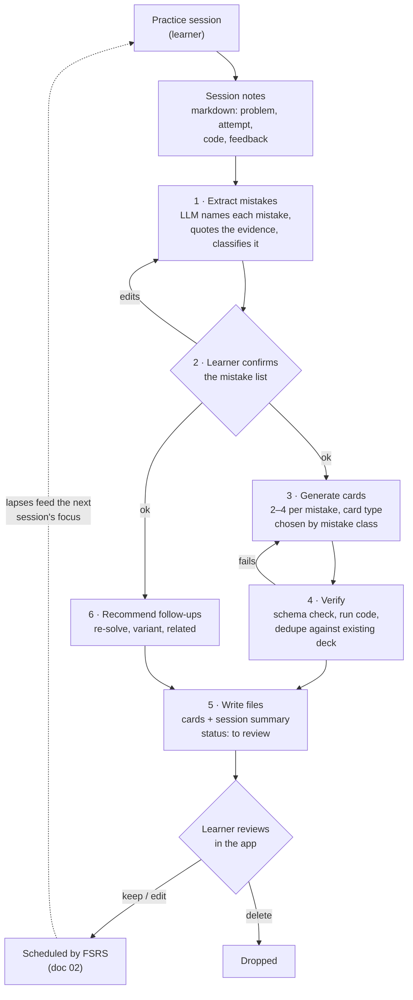

# 04 · Core use case: practice session → feedback → cards

Status: done · Updated: 2026-10-22

## Summary

A learner finishes a coding, algorithms, or system-design practice session and has notes: what they tried, where they got stuck, what feedback they got. An LLM of their choice turns those notes into a short list of named mistakes, a handful of cards that target each mistake (using doc 03's card types), and one or two follow-up practice sessions. The cards land in the learner's deck as files, marked "to review", with a link back to the session. This is the use case that makes Uplink more than another flashcard app.

## Problem

Practice produces the most valuable learning signal a learner has: their own mistakes, in context. It usually evaporates. Notes sit in a file, feedback is read once, and the same mistake shows up two weeks later. Writing good cards from notes is slow, so nobody does it.

LLMs can do the slow part, but left alone they write surface cards (doc 03): term ↔ definition, "what pattern solves X". The pipeline has to aim the model at the mistakes and at card types that test understanding, and it has to catch the model's own plausible-but-wrong output before it becomes something the learner memorises.

## Goals

- Define the flow end to end, from raw notes to reviewed cards and follow-up sessions.
- Define what goes in (minimum useful notes) and what comes out (cards, follow-ups, a session summary).
- Work with any capable LLM, starting with the learner's own agent and no Uplink server.
- Make generated cards verifiable: every card traces to a mistake, and code in cards is executed.

## Non-goals

- The card file syntax (doc 05). Examples here follow it and leave out `id`; `uplink check --fix` or `propose_cards` assigns one.
- The MCP server and other transports (doc 07).
- Running or grading the practice session itself. Uplink consumes notes; it is not a judge or an interview simulator.

## Users and use cases

| Learner | Practice | Notes they have | What they want back |
|---|---|---|---|
| A software engineer preparing for interviews | Timed algorithm problem | Problem, their code, where it failed, time taken, a mock interviewer's feedback | Cards on the exact misunderstanding; a variant to try in a few days |
| The same engineer | System-design mock | Their diagram, the questions they could not answer, feedback | Compare-trade-off and explain cards; one narrower design to practise |
| A developer learning a language | Kata or small project | Compiler errors, review comments | Predict and bug cards on the semantics they got wrong |
| A Spanish learner | Conversation with a tutor | The tutor's corrections | Cloze and choose cards on the corrected forms |

The last row is doc 03's litmus test: nothing in the flow is code-specific.

## The flow



1. **Extract.** The model reads the notes and returns a list of mistakes. Each has a one-line name, the evidence quoted from the notes, and a class (table below). This step is separate from card writing because naming the mistake correctly is the hard part, and a wrong name produces confident, wrong cards.
2. **Confirm.** The learner sees the list and can edit, merge, or delete mistakes before any cards exist. This is cheap (thirty seconds) and is where most bad output is caught. Skippable, but on by default.
3. **Generate.** For each confirmed mistake, 2–4 cards of the types the class calls for, written to doc 03's guide: focused, tractable, one idea per card, contrasting cases for `choose` cards.
4. **Verify.** Mechanical checks before anything is written: the card parses against the spec; code in `predict` and `bug` cards runs and the stated output matches the real output; no card duplicates one already in the deck.
5. **Write.** Cards go into the deck as files, each with `source` pointing at the session and `mistake` naming what it targets, status "to review". A session summary goes alongside.
6. **Follow-ups.** One to three practice sessions, each with a reason and a suggested day: re-solve the same problem cold, try a variant that tests the same idea in a new shape, or try a related problem that needs the contrasting approach.

### Mistake classes and the cards they call for

| Class | Looks like | Card types (doc 03) |
|---|---|---|
| **Concept gap** | Did not know or misunderstood an idea | `explain`, `compare`, `basic` for the vocabulary |
| **Misrecognition** | Knew the technique, picked the wrong one, or did not see it applied | `choose` in contrasting pairs |
| **Edge case** | Correct idea, failed an input (empty, duplicates, negatives, overflow) | `bug`, `predict` on the failing input |
| **Implementation slip** | Off-by-one, wrong API, mutated while iterating | `predict`, `cloze` on the corrected line |
| **Communication** | Did not state the approach, complexity, or trade-off; went quiet | `produce` ("say it in one sentence") |
| **Time** | Right answer, too slow | No card. A follow-up session with a time box |

Not every mistake deserves a card. Time pressure and communication habits are trained by practice, so they mostly become follow-ups. A card is right when the mistake is about *knowing* something.

### Why errors are good material

Learning-science support for building on the learner's own errors:

- Making an error and then getting corrective feedback improves memory for the correct answer compared with error-free learning, especially when the error is related to the target (Metcalfe 2017 review).
- **Hypercorrection**: errors made with high confidence are *more* likely to be corrected after feedback than low-confidence ones (Butterfield & Metcalfe 2001; replicated with delayed tests and multiple-choice formats). A "but I was sure" mistake from a practice session is the best possible card material.
- Doc 03's transfer evidence applies: the cards should ask for the response the learner will need next time (spot the edge case, choose the approach), not restate the correction.

## Example

### Input: session notes

The learner writes these in any editor, or dictates them to their agent. The only required parts are what the problem was, what they did, and what went wrong.

````markdown
# Practice · 2026-10-21 · longest substring without repeating characters

Time: 38 min (target 25). Language: Python.

## Attempt
Sliding window with a dict of last-seen index. Passed the examples, failed "abba"
(returned 3, expected 2). Took 10 minutes to find it.

```python
def longest_unique(s: str) -> int:
    last = {}
    left = best = 0
    for i, ch in enumerate(s):
        if ch in last:
            left = last[ch] + 1
        last[ch] = i
        best = max(best, i - left + 1)
    return best
```

## Feedback (mock interviewer)
- Didn't state the window invariant before coding; the bug is a broken invariant.
- Good instinct to use last-seen index over a set, but couldn't explain why it's
  `if` not `while` here when the set version needs `while`.
- Complexity stated only when asked.

## Me
I was sure moving `left` to `last[ch] + 1` was right. Never thought about an
old index that's already left of the window.
````

### Step 1 output: mistakes

| # | Mistake | Evidence | Class |
|---|---|---|---|
| 1 | `left` can move backwards when the repeated character's last index is already outside the window | "failed 'abba'", "never thought about an old index" | Edge case (high confidence) |
| 2 | Did not state the window invariant before coding | Feedback, first bullet | Concept gap |
| 3 | Could not explain jump (`if`, last-index map) vs step (`while`, set) shrinking | Feedback, second bullet | Misrecognition |
| 4 | Complexity not volunteered | Feedback, third bullet | Communication |
| 5 | 38 min against a 25 min target | Time line | Time |

### Step 3 output: cards

Five cards for mistakes 1–4. The outputs stated in the `predict` and `bug` cards were checked by tracing the code by hand; in the real pipeline, step 4 runs it.

````markdown
---
type: bug
deck: dsa-patterns
tags: [sliding-window, hash-map, edge-case]
source: practice/2026-10-21-longest-unique.md
mistake: left-moves-backwards
---
This returns 3 for `"abba"`; the answer is 2. Find the bug, say why it happens, and fix it.

```python
def longest_unique(s: str) -> int:
    last = {}
    left = best = 0
    for i, ch in enumerate(s):
        if ch in last:
            left = last[ch] + 1
        last[ch] = i
        best = max(best, i - left + 1)
    return best
```

---
**Bug:** `left = last[ch] + 1` can move `left` backwards.

- At `i = 3` (`'a'`), `last['a'] = 0`, which is already left of the window `[2, 2]`.
- Setting `left = 1` re-admits the second `'b'`, so the window `"bba"` is counted as length 3.

**Fix:** `left = max(left, last[ch] + 1)`. The window's left edge only ever moves right.
````

````markdown
---
type: predict
deck: dsa-patterns
tags: [sliding-window, hash-map]
source: practice/2026-10-21-longest-unique.md
mistake: left-moves-backwards
---
With the fix `left = max(left, last[ch] + 1)`, what does `longest_unique("tmmzuxt")` return?
What is `left` when the loop reaches the final `'t'`?

---
**5**, and `left` stays **2**.

The second `'m'` moves `left` to 2. At the final `'t'`, `last['t'] + 1 = 1`, which is behind
`left`, so `max` keeps 2. The window is `"mzuxt"`. Without `max`, `left` would drop to 1
and the answer would wrongly be 6.
````

````markdown
---
type: explain
deck: dsa-patterns
tags: [sliding-window, invariants]
source: practice/2026-10-21-longest-unique.md
mistake: invariant-not-stated
---
In the longest-substring-without-repeats window `s[left..i]`, what invariant holds after
each iteration, and which line is responsible for keeping it?

---
- **Invariant:** `s[left..i]` contains no repeated character.
- `left = max(left, last[ch] + 1)` restores it when `ch` repeats inside the window.
- `best` is only updated after the invariant holds, so every length it sees is valid.
````

````markdown
---
type: compare
deck: dsa-patterns
tags: [sliding-window, hash-map, set]
source: practice/2026-10-21-longest-unique.md
mistake: jump-vs-step
---
Shrinking a no-repeats window: a **set** of characters needs a `while` loop; a **map of
last-seen index** needs only an `if`. Why the difference, and what does each cost?

---
- **Set:** knows *whether* `ch` is in the window, not *where*. Step `left` forward one at a
  time, removing characters, until `ch` is gone: `while`.
- **Last-index map:** knows exactly where the earlier `ch` was, so jump `left` past it in
  one step: `if` (with `max`, see the bug card).
- Both are O(n) time overall; the set does up to 2n pointer moves, the map does n.
  Space is O(min(n, alphabet)) for both.
````

````markdown
---
type: produce
deck: interview-habits
tags: [communication, sliding-window]
source: practice/2026-10-21-longest-unique.md
mistake: complexity-not-volunteered
---
Before writing any sliding-window code, say out loud, in three short sentences:
the window invariant, what moves each pointer, and the time and space complexity.
(Practise on: longest substring without repeating characters.)

---
- "The window `s[left..i]` never contains a repeat."
- "`i` advances every step; `left` jumps past the previous copy of `s[i]` when it is inside the window."
- "O(n) time, O(min(n, alphabet)) space."
````

### Step 6 output: follow-ups and summary

```markdown
# Session summary · 2026-10-21 · longest substring without repeating characters

Mistakes: 5 (1 edge case, 1 concept gap, 1 misrecognition, 1 communication, 1 time).
Cards: 5, in dsa-patterns (4) and interview-habits (1). Status: to review.

## Follow-ups
1. **2026-10-23 · Re-solve cold, 25 min.** State the invariant before coding. Tests: mistakes 1, 2, 4, 5.
2. **2026-10-26 · Variant: longest substring with at most k distinct characters.** Same window,
   but a last-index jump no longer works; you need counts and a `while`. Tests: mistake 3.
3. **2026-10-30 · Mixed set of three window problems, one of which is not a sliding window.**
   Tests: recognising when the pattern does not apply.
```

Follow-up 2 is deliberately the case where the learner's preferred tool fails. That is the contrasting case doc 03 asks `choose` cards to provide, applied to practice.

## Where it runs

| Stage | Who runs the LLM | How cards reach the app | Uplink builds |
|---|---|---|---|
| **v1** | The learner's own agent (Claude Code, ChatGPT, any other) | Files in a deck folder or repo, or pasted, imported by the app (doc 06) | A published prompt, the card guide, an Agent Skill, and a CLI check for the verify step (4) |
| **Stage 3** | The learner's agent, through a local Uplink MCP server | `propose_cards` writes validated files into the deck folder (doc 07) | The `cards_from_notes` MCP prompt (this flow) and the tools `search_cards`, `check_cards`, `propose_cards` |
| **v2** | The learner's agent, through the hosted MCP server | `propose_cards` puts cards in the account's inbox; synced to the app (docs 07, 08) | The same tools and prompt, hosted |
| **Later, opt-in** | Uplink's backend calls a model API | Synced to the app (doc 08) | A server pipeline with structured outputs for steps 1 and 3 |

Through stage 3 and v2, Uplink never runs a model and holds no model API key. The learner's agent already has the notes and the deck. Uplink supplies the instructions, the checks, and somewhere to put the result. MCP 2026-07-28 deprecates sampling, so an MCP server cannot borrow the client's model anyway (doc 07).

If the opt-in hosted pipeline is ever built, steps 1 and 3 should use schema-constrained output (Claude's structured outputs with a JSON schema, or strict tool inputs; other providers have equivalents) so the result parses every time. The schema enforces shape, not truth; step 4 still runs.

### The v1 prompt (sketch)

```text
You turn practice-session notes into Uplink cards.

1. List the mistakes in the notes. For each: a short kebab-case id, one line naming the
   mistake, the exact quote from the notes that shows it, and a class from:
   concept-gap, misrecognition, edge-case, implementation-slip, communication, time.
   Stop and show me the list. Wait for my edits.
2. For each confirmed mistake except `time`, write 2–4 cards following CARD-GUIDE.md.
   Choose card types by class (table in the guide). One idea per card. Every card has
   `source` and `mistake` in its frontmatter. Answers to explain/bug/compare cards are
   short key-point lists.
3. For every predict or bug card, run the code and check the stated output. Fix the card
   if they differ.
4. Before writing, check the deck for cards that test the same thing; skip duplicates.
5. Write cards as files in the deck folder and a session summary with 1–3 follow-up
   sessions, each with a date, a reason, and the mistakes it tests.
```

`CARD-GUIDE.md` is the card-writing guide from doc 03's requirements, published in the deck format docs.

## Verifying generated cards

Plausible-but-wrong is the main risk. The defences, from cheapest:

1. **Traceability.** Every card names a mistake, and every mistake quotes the notes. A card that cannot point at evidence is cut.
2. **Learner confirmation** of the mistake list, before generation.
3. **Execution.** Code in `predict` and `bug` cards is run (by the agent in v1; in a sandbox on the server later). Stated outputs are compared with real ones. This alone catches the most damaging error: a confident wrong answer the learner then memorises.
4. **Dedupe.** Compare new cards with existing ones in the deck. Matuschak reports that a capable model can judge whether two prompts are functionally equivalent; in v1 the agent does this by reading the deck.
5. **"To review" status.** Nothing is scheduled until the learner has seen it (doc 03).

Evidence on LLM-written cards is thin. We found no peer-reviewed head-to-head study of retention from LLM-written vs human-written cards. A small 2026 study of a research prototype found learners valued automation but needed editable, transparent output to keep ownership of their learning. Uplink should measure its own: lapse rate and deletion rate per card, split by generated vs hand-written.

## Requirements

**Must (v1)**
- A documented notes format with three required parts (problem, attempt, what went wrong) and optional code, feedback, and reflection.
- A published prompt and card-writing guide that any capable LLM can follow.
- Cards carry `source` and `mistake` in frontmatter; the app shows both on the card's back.
- Generated cards import as "to review".
- A session summary file format with follow-ups (date, reason, mistakes tested).
- A CLI check that validates card files and runs the code in `predict` and `bug` cards in Java, Python, and TypeScript.

**Should**
- The app groups to-review cards by session, so the learner reviews one session's output together.
- The app shows follow-ups due today next to the review queue.
- A "this card is wrong" action on any card that records why, for measuring generator quality.

**Later**
- This flow as the `cards_from_notes` MCP prompt over `propose_cards` (doc 07, stage 3); an opt-in hosted pipeline (doc 08).
- Follow-ups as schedulable items with their own spacing.
- Notes captured from audio (a dictated debrief after a mock interview).
- Per-learner mistake history across sessions: "third time this month you missed an empty-input case".

## Open questions

- Should follow-ups be scheduled by FSRS as a kind of card (`exercise`), or stay a plain list in v1? Spacing whole problems is common practice among engineers preparing for interviews, but grading a 25-minute session with one button loses information. Proposal: plain list in v1, revisit with data.
- How much of the learner's code should a card include? Their own buggy code is the most memorable prompt, but long code breaks the minimum information principle. Proposal: 15 lines maximum; trim to the relevant part.
- Is the confirmation step worth its friction for a learner who trusts their agent? Measure how often learners edit the list.
- Notes may contain private material (a company's problem, a mentor's name). In v1 everything stays in the learner's files and their chosen LLM; doc 08 must keep that true for hosted decks.

## Sources

- Metcalfe (2017), "Learning from errors", *Annual Review of Psychology* 68. https://wesleyan.edu/ofcd/resources/OFCD%20Resource%20Docs/Learning%20from%20Errors.pdf
- Butterfield & Metcalfe (2001) and follow-ups on the hypercorrection effect. https://pmc.ncbi.nlm.nih.gov/articles/PMC3079415 ; https://dukespace.lib.duke.edu/items/d6ab09ca-f55c-4efb-9d32-2788bc5838b2
- Matuschak, "GPT-4 can probably estimate whether two flashcards are functionally equivalent" (working note). https://notes.andymatuschak.org/z3r1Lqmf4W9KPU2scVDSdbafthRBisJgv3G6a
- Matuschak, "In prompt generation, LLMs lack prompt-writing patterns for complex conceptual material" (working note). https://notes.andymatuschak.org/zmrbnm683nVZi9ut63vsr8BwYKEtATA6e4B3
- "'I Spend All My Energy Preparing': Balancing AI automation and agency for self-regulated learning in SmartFlash" (arXiv 2602.14431; 6 participants). https://arxiv.org/abs/2602.14431
- Comparing GPT-4, GPT-3.5 and local LLMs at generating flashcards (blog rating study, 2024; no human baseline). https://www.r-bloggers.com/2024/01/comparing-gpt-4-3-5-and-some-offline-local-llms-at-the-task-of-generating-flashcards-for-spaced-repetition-e-g-anki/
- Anthropic, Claude API: Structured outputs (JSON outputs and strict tool use). https://platform.claude.com/docs/en/build-with-claude/structured-outputs
- Doc 03 in this folder for card types and the evidence on transfer; doc 02 for scheduling.
