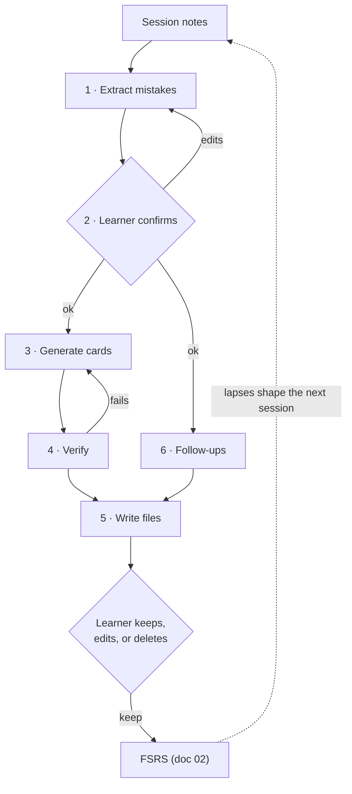

# 04 · Core use case: practice session → feedback → cards

Status: done · Updated: 2026-10-22

## Summary

A learner finishes a coding, algorithms, or system-design practice session with notes: what they tried, where they got stuck, the feedback they got.
The learner's own LLM turns the notes into named mistakes (which the learner confirms), 2–4 cards per mistake using doc 03's card types, and one to three follow-up sessions.
Cards land in the deck as files, "to review", each linked to its session and mistake; code in cards is checked by running it.

## Problem

Practice gives a learner their best signal: their own mistakes, in context. It usually evaporates. Notes sit in a file, and the same mistake shows up two weeks later, because writing good cards from notes is slow.

LLMs can do the slow part, but left alone they write surface cards (term ↔ definition; doc 03). The pipeline has to aim the model at the mistakes and at card types that test understanding, and catch the model's plausible-but-wrong output before the learner memorises it.

## Goals and non-goals

- **Goals:** the flow from raw notes to reviewed cards and follow-ups; the minimum useful input and the outputs; works with any capable LLM, starting with the learner's own agent and no Uplink server; every card traces to a mistake, and code in cards runs.
- **Not here:** the card syntax (doc 05; examples follow it and omit `id`, which `uplink check --fix` or `propose_cards` assigns); the MCP server and transports (doc 07); running or grading the practice itself. Uplink consumes notes; it is not a judge or an interview simulator.

## Users

An engineer after a timed algorithm problem or a system-design mock (code, failures, interviewer feedback → cards on the exact misunderstanding and a variant to try); a developer after a kata (compiler errors, review comments → `predict` and `bug` cards); a Spanish learner after a tutor session (corrections → `cloze` and `choose` cards). The last is doc 03's litmus test: nothing in the flow is code-specific.

## The flow



1. **Extract.** The model lists mistakes: a kebab-case id, a one-line name, the evidence quoted from the notes, and a class (table below). This is separate from card writing because naming the mistake is the hard part; a wrong name produces confident, wrong cards.
2. **Confirm.** The learner edits, merges, or deletes mistakes before any card exists. About thirty seconds, and where most bad output is caught. On by default, skippable.
3. **Generate.** 2–4 cards per confirmed mistake, of the types its class calls for, written to the card guide (doc 03): one idea per card, contrasting cases for `choose`.
4. **Verify.** `uplink check` (doc 05): the card parses; `run` fences execute and must match their `output` fence. Then dedupe against the deck.
5. **Write.** Card files with `source` (the notes file) and `mistake` (the id) in frontmatter, plus a session summary. The app imports them as "to review".
6. **Follow-ups.** One to three sessions, each with a date and a reason: re-solve cold, a variant that tests the same idea in a new shape, or a related problem that needs the contrasting approach.

### Mistake classes and the cards they call for

| Class | Looks like | Card types (doc 03) |
|---|---|---|
| **Concept gap** | Did not know or misunderstood an idea | `explain`, `compare`, `basic` for vocabulary |
| **Misrecognition** | Knew the technique, picked the wrong one, or did not see it applied | `choose` in contrasting pairs |
| **Edge case** | Right idea, failed an input (empty, duplicates, negatives, overflow) | `bug`, `predict` on the failing input |
| **Implementation slip** | Off-by-one, wrong API, mutated while iterating | `predict`, `cloze` on the corrected line |
| **Communication** | Did not state approach, complexity, or trade-off | `produce` ("say it in one sentence") |
| **Time** | Right answer, too slow | No card; a time-boxed follow-up |

Not every mistake deserves a card. Time and communication habits are trained by practice, so they mostly become follow-ups. A card is right when the mistake is about *knowing* something.

### Why errors are good material

- Errors followed by corrective feedback can help memory for the correct answer more than error-free study (Metcalfe 2017 review). The review reports the benefit mainly when errors are close to the target; we have that from secondary summaries and did not re-read the full text.
- **Hypercorrection:** errors made with high confidence are *more* likely to be corrected after feedback (Butterfield & Metcalfe 2001; replicated by Metcalfe & Finn 2011, where the multiple-choice result was weaker). After a week the effect remains, but uncorrected high-confidence errors tend to come back (Butler, Fazio & Marsh 2011). Spaced review is the natural follow-up, and an "I was sure" mistake is the best card material.
- Doc 03's transfer evidence applies: cards ask for the response needed next time (spot the edge case, choose the approach), not a restatement of the correction.

## Example

### Input: session notes

Written in any editor or dictated to an agent. Required: the problem, what they did, what went wrong.

````markdown
# Practice · 2026-10-21 · longest substring without repeating characters

Time: 38 min (target 25). Language: Python.

## Attempt
Sliding window with a dict of last-seen index. Passed the examples, failed "abba"
(returned 3, expected 2). Took 10 minutes to find it.
[my code: the function shown in the bug card below]

## Feedback (mock interviewer)
- Didn't state the window invariant before coding; the bug is a broken invariant.
- Good instinct to use last-seen index over a set, but couldn't explain why it's
  `if` not `while` here when the set version needs `while`.
- Complexity stated only when asked.

## Me
I was sure moving `left` to `last[ch] + 1` was right. Never thought about an
old index that's already left of the window.
````

### Step 1 output: mistakes

| # | Id | Mistake | Evidence | Class |
|---|---|---|---|---|
| 1 | `left-moves-backwards` | `left` jumps back when the repeat's last index is already outside the window | "failed 'abba'", "never thought about an old index" | Edge case (high confidence) |
| 2 | `invariant-not-stated` | Did not state the window invariant before coding | Feedback, bullet 1 | Concept gap |
| 3 | `jump-vs-step` | Could not explain jump (`if`, last-index map) vs step (`while`, set) shrinking | Feedback, bullet 2 | Misrecognition |
| 4 | `complexity-not-volunteered` | Complexity not volunteered | Feedback, bullet 3 | Communication |
| 5 | `over-time` | 38 min against a 25 min target | Time line | Time |

### Step 3 output: cards

Five cards for mistakes 1–4, written into the `dsa-patterns` and `interview-habits` deck folders (so no `deck` key; doc 05). Outputs were traced by hand, not executed; in the pipeline `uplink check` runs the `run` fences. The full `bug` card:

````markdown
---
type: bug
tags: [sliding-window, hash-map, edge-case]
source: practice/2026-10-21-longest-unique.md
mistake: left-moves-backwards
---
This prints 3; the answer is 2. Find the bug, say why it happens, and fix it.

```python run
def longest_unique(s: str) -> int:
    last = {}
    left = best = 0
    for i, ch in enumerate(s):
        if ch in last:
            left = last[ch] + 1
        last[ch] = i
        best = max(best, i - left + 1)
    return best

print(longest_unique("abba"))
```

```output
3
```

---
**Bug:** `left = last[ch] + 1` can move `left` backwards.

- At `i = 3` (`'a'`), `last['a'] = 0`, already left of the window `s[2..2]`.
- `left` drops to 1, re-admitting the `'b'` at index 1, so `"bba"` counts as length 3.

**Fix:** `left = max(left, last[ch] + 1)`. The left edge only ever moves right.
````

The other four, same frontmatter shape:

| Type | Mistake | Front | Back |
|---|---|---|---|
| `predict` | 1 | The fixed function in a `run` fence ending `print(longest_unique("tmmzuxt"))`: what does it print? | `output` fence `5`. Why: at the final `'t'`, `last['t'] + 1 = 1` is behind `left = 2`, so `max` keeps 2 (`"mzuxt"`); without `max` it prints 6. |
| `explain` | 2 | In the window `s[left..i]`, what invariant holds after each iteration, and which line keeps it? | No repeated character in `s[left..i]`; the `max` line restores it; `best` is updated only after it holds. |
| `compare` | 3 | A set needs `while` to shrink the window; a last-index map needs only `if`. Why, and what does each cost? | The set knows *whether* `ch` is in the window, not *where*, so `left` steps; the map knows where, so `left` jumps. Both O(n) time (set: each character added and removed at most once), O(min(n, alphabet)) space. |
| `produce` | 4 | Before coding a sliding window, say in three sentences: the invariant, what moves each pointer, the complexity. | "`s[left..i]` never repeats." "`i` advances every step; `left` jumps past the previous copy of `s[i]` when it is inside the window." "O(n) time, O(min(n, alphabet)) space." |

### Step 6 output: follow-ups and summary

```markdown
# Session summary · 2026-10-21 · longest substring without repeating characters

Mistakes: 5 (edge case, concept gap, misrecognition, communication, time).
Cards: 5, in dsa-patterns (4) and interview-habits (1). Status: to review.

## Follow-ups
1. **2026-10-23 · Re-solve cold, 25 min.** State the invariant first. Tests: 1, 2, 4, 5.
2. **2026-10-26 · Variant: longest substring with at most k distinct characters.**
   The single last-index jump no longer carries over; the usual solution keeps counts
   and shrinks with a `while`. Tests: 3.
3. **2026-10-30 · Three window problems, one of which is not a sliding window.**
   Tests: recognising when the pattern does not apply.
```

Follow-up 2 is deliberately where the learner's preferred tool stops working: doc 03's contrasting case, applied to practice.

## Where it runs

| Stage | Who runs the LLM | How cards reach the app | Uplink builds |
|---|---|---|---|
| **v1** | The learner's agent (Claude Code, ChatGPT, others) | Files in a deck folder or repo, or pasted (doc 06) | The prompt below, `CARD-GUIDE.md`, an Agent Skill, `uplink check` |
| **Stage 3** | The learner's agent, via a local MCP server | `propose_cards` writes validated files into the deck folder (doc 07) | The `cards_from_notes` prompt (this flow); `search_cards`, `check_cards`, `propose_cards` |
| **v2** | The learner's agent, via the hosted MCP server | `propose_cards` into the account's inbox, synced (docs 07, 08) | The same tools and prompt, hosted |
| **Later, opt-in** | Uplink's backend calls a model API | Synced (doc 08) | A server pipeline; steps 1 and 3 use schema-constrained output (e.g. Claude structured outputs), which fixes shape, not truth, so step 4 still runs |

Through v2, Uplink runs no model and holds no model API key: the learner's agent already has the notes and the deck, and Uplink supplies instructions, checks, and a place to put the result. MCP sampling is deprecated, so the server could not borrow the client's model anyway (doc 07).

### The v1 prompt (sketch)

```text
You turn practice-session notes into Uplink cards.

1. List the mistakes in the notes. For each: a short kebab-case id, one line naming the
   mistake, the exact quote from the notes that shows it, and a class from:
   concept-gap, misrecognition, edge-case, implementation-slip, communication, time.
   Stop and show me the list. Wait for my edits.
2. For each confirmed mistake except `time`, write 2–4 cards following CARD-GUIDE.md.
   Choose card types by class (table in the guide). One idea per card. Every card has
   `source` and `mistake` in its frontmatter. Answers to explain/bug/compare cards are
   short key-point lists. Put runnable code in `run` fences with an `output` fence.
3. Run `uplink check --fix` on the new files. Fix every card it rejects.
4. Before writing, check the deck for cards that test the same thing; skip duplicates.
5. Write the cards into the deck folder and a session summary with 1–3 follow-up
   sessions, each with a date, a reason, and the mistakes it tests.
```

`CARD-GUIDE.md` is doc 03's card-writing guide, published with the format (doc 09, task 1.5).

## Verifying generated cards

Plausible-but-wrong is the main risk. Defences, cheapest first:

1. **Traceability.** Every card names a mistake; every mistake quotes the notes. A card with no evidence is cut.
2. **Learner confirmation** of the mistake list, before generation.
3. **Execution.** `uplink check` runs `run` fences and compares stdout with the `output` fence (by the agent's shell in v1; in a server sandbox later). This catches the most damaging error: a confident wrong answer the learner then memorises. It only covers code; prose answers rely on 1, 2, and 5.
4. **Dedupe.** In v1 the agent reads the deck (or calls `search_cards` from stage 3). Matuschak suggests a capable model can judge whether two prompts are functionally equivalent; his note calls the method rough, so treat it as unvalidated.
5. **"To review."** Nothing is scheduled until the learner has seen it (doc 03).

Evidence on LLM-written cards is thin. We found no peer-reviewed study comparing retention from LLM-written and human-written cards. A 2026 study of a prototype with six students found they welcomed automation but wanted editable, transparent output to keep ownership of their learning. Matuschak's notes find LLM prompts for conceptual material stay on terms and definitions without detailed guidance, which is what the classes and the guide supply. Uplink should measure its own: lapse and deletion rate per card, generated vs hand-written.

## Requirements

**Must (v1)**
- A documented notes format: problem, attempt, what went wrong (required); code, feedback, reflection (optional).
- The published prompt and `CARD-GUIDE.md`, usable by any capable LLM.
- `source` and `mistake` in frontmatter; the app shows both on the back.
- Generated cards import as "to review".
- A session summary format with follow-ups (date, reason, mistakes tested).
- `uplink check` runs `run` fences in Java, Python, and TypeScript (doc 05).

**Should:** the app groups to-review cards by session; shows follow-ups due today next to the queue; has a "this card is wrong" action that records why, to measure generator quality.

**Later:** `cards_from_notes` over `propose_cards` (doc 07, stage 3); an opt-in hosted pipeline (doc 08); follow-ups with their own spacing; notes from audio (a dictated debrief); mistake history across sessions ("third time this month you missed an empty-input case").

## Open questions

- Follow-ups as FSRS-scheduled `exercise` items, or a plain list? One button loses information about a 25-minute session. Proposal: plain list in v1, revisit with data.
- How much of the learner's code goes on a card? Their own buggy code is the most memorable prompt, but long code breaks minimum information. Proposal: 15 lines maximum, trimmed to the relevant part.
- Is confirmation worth its friction for a learner who trusts their agent? Measure how often the list is edited.
- Notes may contain private material (a company's problem, a mentor's name). In v1 everything stays in the learner's files and chosen LLM; doc 08 must keep that true for hosted decks.

## Sources

Re-checked 2026-10-22 unless marked.

- Metcalfe (2017), "Learning from errors", *Annual Review of Psychology* 68, 465–489. doi:10.1146/annurev-psych-010416-044022 (citation re-checked; the relatedness claim is from secondary summaries).
- Butterfield & Metcalfe (2001), "Errors committed with high confidence are hypercorrected", *JEP: Learning, Memory, and Cognition* 27(6) (not re-read).
- Metcalfe & Finn (2011), "People's hypercorrection of high-confidence errors: did they know it all along?", *JEP: LMC* 37(2), 437–448. https://pmc.ncbi.nlm.nih.gov/articles/PMC3079415
- Butler, Fazio & Marsh (2011), "The hypercorrection effect persists over a week, but high-confidence errors return", *Psychonomic Bulletin & Review*. https://pubmed.ncbi.nlm.nih.gov/21989771/
- Matuschak, "GPT-4 can probably estimate whether two flashcards are functionally equivalent" (working note). https://notes.andymatuschak.org/z3r1Lqmf4W9KPU2scVDSdbafthRBisJgv3G6a
- Matuschak, "In prompt generation, LLMs lack prompt-writing patterns for complex conceptual material" (working note). https://notes.andymatuschak.org/zmrbnm683nVZi9ut63vsr8BwYKEtATA6e4B3
- Li et al. (2026), "'I Spend All My Energy Preparing': Balancing AI automation and agency for self-regulated learning in SmartFlash", arXiv 2602.14431 (six participants). https://arxiv.org/abs/2602.14431
- Gossmann (2024), comparing GPT-4, GPT-3.5, and local LLMs at generating flashcards: one rater, 100 cards, no retention data. https://www.r-bloggers.com/2024/01/comparing-gpt-4-3-5-and-some-offline-local-llms-at-the-task-of-generating-flashcards-for-spaced-repetition-e-g-anki/
- Anthropic, Claude API: Structured outputs (JSON outputs and strict tool use). https://platform.claude.com/docs/en/build-with-claude/structured-outputs
- Docs 02 (scheduling), 03 (card types, transfer), 05 (format, `uplink check`), 07 (MCP) in this folder.
