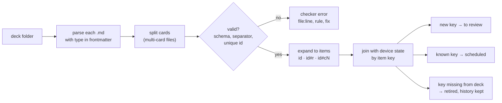
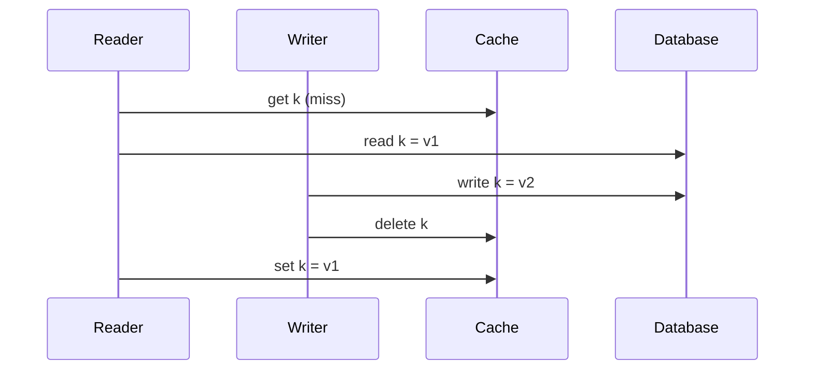

# 05 · Card format

Status: done · Updated: 2026-10-22

## Summary

A card is a markdown file: YAML frontmatter, a front, a `---` line, a back. A deck is a folder of those files plus a `deck.md`. Code uses ordinary fenced blocks with a language tag, Mermaid uses a `mermaid` fence, and cloze uses Anki's `{{c1::…}}` syntax. Every card has a stable `id` in its frontmatter, so edits and renames keep its history. Review state never goes in the files; it lives on the device, keyed by that `id`. One card per file is the canonical form agents write; multi-card files are allowed for people.

## Problem

Docs 03 and 04 need a card shape for their examples. Before any app or tooling exists, the format has to be fixed, because everything reads or writes it: the learner's agent (doc 04), the CLI check, the app (doc 06), the MCP server (doc 07), and the backend (doc 08). A format that is awkward to write gets written wrong by agents; one that mixes content with review state breaks sharing; one without stable IDs loses a learner's progress every time they fix a typo.

## Goals

- A format a person can write in any editor and an LLM can write without a tool, that renders sensibly on GitHub.
- Express all eight card types from doc 03, with code in any language and Mermaid diagrams.
- Card identity that survives edits, renames, and moves.
- Content and review state fully separate, so decks can be shared, published, and regenerated.
- Mechanically checkable: a schema for frontmatter and rules a CLI can enforce, including running code.

## Non-goals

- Rendering on the phone (doc 06) beyond what the format requires.
- How files reach the app (docs 06 and 07).
- Sync of review state between devices (doc 08).
- Audio, images beyond plain markdown images, and LaTeX (listed under Later).

## Users and use cases

| Who writes | How | What the format must make easy |
|---|---|---|
| The learner's agent (Claude Code, ChatGPT, any other) | Writes files into a deck folder, following a prompt and the card guide | One self-contained file per card; no IDs to coordinate; a checker that says exactly what is wrong |
| A person in an editor or on GitHub | Types cards by hand, often several on one topic | Little ceremony; several cards in one file; looks right in a markdown preview |
| A deck author sharing a deck | Publishes a git repo | No personal data in files; stable IDs so learners' progress survives updates |
| The app | Parses decks on device, offline | One unambiguous grammar; cheap to parse; a clear key for each reviewable item |

## Prior art

| System | Card syntax | Identity | Review state | Lesson for Uplink |
|---|---|---|---|---|
| **Anki** | Fields in a database; cloze `{{c1::text::hint}}`, one card per cloze number, nesting since 2.1.56 | Note GUID; text import otherwise matches on the first field, which surprises users | Database | Reuse the cloze syntax; it is the de facto standard. Do not match on content. |
| **Mochi** | Markdown; `---` on its own line separates sides; cloze `{{text}}` and `{{1::text}}` groups | Database; markdown export loses review history | Database | `---` as the side separator is familiar. |
| **Obsidian Spaced Repetition** | `Q::A`, `Q:::A` (reversible), `?` / `??` multi-line, cloze by `==highlight==`, `**bold**`, or `{{…}}` | The card's text | HTML comment written into the note after each review, e.g. `<!--SR:!2024-08-16,51,230-->` | Review state in content files makes every review a file change and every shared note carry someone's schedule. Avoid. |
| **hashcards** | `Q:` / `A:` lines; `C:` cloze with `[brackets]`; many cards per file, separated by blank lines | Hash of the card's text | SQLite next to the decks | Plain files in git work well. Content hashing means any edit, even a typo fix, makes a new card and its progress resets. |
| **carddown** | Markers such as `#flashcard` in ordinary notes | Content hash, said to survive moves and edits (mechanism undocumented) | SQLite, outside the notes | Keep state outside the notes. |

Uplink takes the side separator from Mochi, cloze from Anki, files-in-git and state-outside-content from hashcards, and replaces content hashing with an explicit ID.

## The format

### Deck layout

```text
dsa-patterns/                 a deck is a folder
├── deck.md                   deck metadata (required)
├── sliding-window/           subfolders are sub-decks
│   ├── abba-left-moves-back.md
│   └── set-vs-last-index.md
├── prefix-sums-negatives.md
└── assets/                   images referenced by cards (optional)
```

`deck.md`:

```markdown
---
uplink: 1                       # format version
id: 01M5EVPMQZ4W8T2KXN6BDC9RFA
name: DSA patterns
language: python                # default for cards that do not set one
toolchains: { python: "3.12", java: "21", typescript: "5" }
---
Patterns for arrays, strings, and graphs, with cards that ask you to choose,
predict, and fix rather than name.
```

`deck.md` holds content only. Desired retention, maximum interval, and button count are the learner's settings and live on the device (doc 02).

### A card

```text
---                 frontmatter (YAML)
id: …
type: predict
---
Front: markdown.

---                 side separator: a line of exactly three hyphens,
                    with a blank line before it
Back: markdown.
```

Rules:

1. A file is a card file if it starts with frontmatter containing `type`. Other `.md` files (`README.md`, notes) are ignored, and `uplink check` lists them so a missing `type` is not silent.
2. The **first** line of exactly `---` outside a code fence, after the frontmatter, separates front from back. The blank line before it is required: in CommonMark, `---` directly under a line of text turns that text into a heading. A checker that sees text-then-`---` reports it rather than guessing. Horizontal rules inside a card use `***`.
3. `cloze` cards may omit the back; if present, it is extra explanation shown after the reveal.
4. UTF-8, LF line endings. File names are free; a short slug is recommended. Moving or renaming a file changes nothing, because identity is the `id`.

GitHub renders leading frontmatter as a small table and the rest as normal markdown, so a one-card file reads well in a repo browser.

### Frontmatter

```typescript
// The schema the CLI and the app validate against (published as JSON Schema).
interface CardFrontmatter {
  id: string;            // ULID. Required once imported; `uplink check --fix` assigns one.
  type: "basic" | "cloze" | "explain" | "predict" | "bug" | "compare" | "choose" | "produce";
  deck?: string;         // Only for a loose card (pasted, shared); inside a deck folder the folder wins.
  tags?: string[];
  language?: string;     // What the card is about, if it is a language:
                         // a BCP 47 tag ("es", "es-MX") or a code fence tag ("java").
  created?: string;      // ISO 8601 date.
  source?: string;       // Where the card came from: a path in the repo or a URL (doc 04).
  mistake?: string;      // Kebab-case id of the mistake it targets (doc 04).
  reverse?: boolean;     // basic only: also review back → front.
}
```

Unknown keys are allowed and preserved (prefix `x-` recommended), so tools can add fields without a format bump. There is no `status` field: whether a card is new, to review, active, or suspended is the learner's state, not the deck's (see Review state).

`language` follows doc 03: a card can be about Spanish or about Java, and the core does not care which. For a natural language it drives text-to-speech and accent-tolerant matching later; for a programming language it is the default tag for untagged fences and a filter in stats. Each code fence still names its own language.

### Answers, key points, and "why"

Doc 03 gives every card type a prompt, an answer, and an optional "why", and splits types into exact answers and key-point answers. The back is read like this:

| Types | Answer | Key points | Why |
|---|---|---|---|
| `basic`, `cloze`, `predict` (exact) | The first block of the back (a paragraph, or an `output` block for `predict`) | None | Everything after the answer |
| `explain`, `bug`, `compare`, `choose`, `produce` (key points) | Any text before the first top-level list (the headline, e.g. **Prefix sums with a hash map.**) | The first top-level bulleted list; the app shows it as a checklist | Everything after that list |

This needs no extra syntax and is what the examples in docs 03 and 04 already do.

### Cloze

```text
{{c1::answer}}               numbered deletion; each number is one reviewable item
{{c1::answer::hint}}         the hint shows in place of the gap: [hint]
{{answer}}                   unnumbered: same as c1
\{{                          a literal {{
```

- Each distinct number becomes a sibling item with its own schedule; deletions sharing a number are hidden together. Same rules as Anki, so cloze decks round-trip to Anki later.
- No nested clozes in v1.
- **In code**, clozes are recognised only in fences marked `cloze` (` ```typescript cloze `). Many languages use `{{` (templates, Rust format strings, Java array initialisers like `new int[][]{{1, 2}}`), so unmarked fences are never scanned.
- The gap renders as a highlighted box the width of the hint, or of the answer if there is no hint, so the layout does not give the answer away in either direction.

### Reviewable items and their keys

A card file produces one or more **items**, the unit the scheduler sees:

| Card | Items | Keys |
|---|---|---|
| Any non-cloze type | 1 | `<id>` |
| `basic` with `reverse: true` | 2 | `<id>`, `<id>#r` |
| `cloze` with groups c1…cN | N | `<id>#c1` … `<id>#cN` |

The review log (doc 02's `ReviewEvent.cardId`) stores the item key. Adding `c3` to a cloze keeps `c1` and `c2` history; removing `reverse` retires `#r`.



### Code

Ordinary fenced code blocks. The first word of the info string is the language (GitHub's convention, so it highlights there too); the following words are Uplink attributes, which other renderers ignore.

| Attribute | Meaning |
|---|---|
| *(none)* | Must compile or parse; not run. |
| `run` | The checker runs it. If the next block is an `output` fence, stdout must match it exactly (trailing whitespace and final newline ignored). The next block may be across the side separator, which is the usual shape for `predict`: code on the front, output on the back. |
| `cloze` | Contains cloze deletions. The checker substitutes the answers and checks the full code. |
| `snippet` | A fragment (one line, an elided body). Highlighted, not checked. |
| `expect-error` | Must *fail* to compile, for cards about compile errors. The checker confirms it fails. |

**Languages.** v1 must highlight and check Java, Python, and TypeScript; it should highlight JavaScript, Kotlin, SQL, Bash, JSON, YAML, Go, and C++, unchecked.

| Language | Fence tag | Parse / compile check | Run (`run`) | Lint and format (should, warnings only) |
|---|---|---|---|---|
| Java | `java` | `jshell` for statement snippets (default imports include `java.util.*`), `javac` for files with a class | `jshell`, or the single-file launcher `java Card.java` | `javac -Xlint:all`; google-java-format for whole classes |
| Python | `python` (`py`) | `ast.parse` | `python3` | `ruff check`, `ruff format --check` |
| TypeScript | `typescript` (`ts`) | `tsc --noEmit --strict` | Node's built-in type stripping, or `tsx` | `tsc` strict errors; `prettier --check` |

Toolchain versions come from `deck.md`'s `toolchains`, defaulting to current LTS releases. Lint findings are warnings, not errors, because bug cards contain bugs on purpose; `bug` cards should pass the compile check unless marked `expect-error`.

**Width.** A phone in portrait shows roughly 40–50 monospace characters at a readable size (estimate: about 360 points of usable width at 7–8 points per character). Code lines should be at most 50 characters; the checker warns above 60. Longer lines scroll sideways in the app rather than wrap, because wrapped code misleads, especially Python. Doc 04 also caps card code at about 15 lines.

### Mermaid

A fence tagged `mermaid`, as on GitHub. v1 must render `flowchart`, `sequenceDiagram`, `stateDiagram-v2`, and `classDiagram`; other diagram types fall back to showing the source. Diagrams should stay within about 12 nodes or 6 participants to be legible on a phone. The checker validates syntax with Mermaid's own parser. How the app renders it (WebView, server-rendered SVG, or native) is doc 06's decision.

### Multi-card files

Allowed, for people writing by hand; generators write one card per file. Cards are separated by a line `<!-- card -->`, which renders invisibly. The file's leading frontmatter is a default for every card in it; each card may add its own frontmatter block (which must include `id`) straight after the marker. Example 8 below shows one.

hashcards' argument for many cards per file is real: neighbouring cards are usually related and get edited together. The case for one file per card is stronger for an agent-written product: an agent can create, rewrite, or delete one card without touching others, diffs and merge conflicts stay per card, and a dedupe check can compare files.

## Identity and edits

**IDs are explicit, not content hashes.** A ULID (26 characters, sortable by creation time, no coordination needed) in frontmatter. Writers may omit it; `uplink check --fix` and the app's importer assign one and write it back to the file where they can (a git-backed deck), or keep a path → id map where they cannot (a read-only share).

How each change is handled:

| Change | Result |
|---|---|
| Typo fix, rewording, added explanation | Same `id`: history and schedule kept. The app marks the card "edited since last review". |
| The question now asks something different | Learner taps "reset progress" on the card, or the author gives it a new `id`. Only a person can tell a rewording from a new question, so v1 never guesses. |
| File renamed or moved between sub-decks | Nothing changes. |
| Agent regenerates a card and keeps its `id` | Treated as an edit; flagged "changed" so the learner can look. |
| New `id` | New item, status "to review" (doc 03). |
| `id` disappears from the deck | Item retired, history kept; restored if the `id` comes back. |
| Two files share an `id` (copy-paste) | Checker error. `--fix` re-IDs the file with the later `created`, then the later path. |

The app stores a hash of each card's normalised content with its state, which is how it knows a card was edited. The hash is a change detector, never the identity.

## Review state lives elsewhere

The deck folder contains no review data: no due dates, no counts, no "seen" flags. On the device, keyed by item key, the app keeps:

- the append-only review log (doc 02), the source of truth;
- the scheduler state cache (stability, difficulty, due), rebuildable from the log;
- item status: to review, active, suspended, retired;
- the content hash from the last time the learner saw the card.

Reasons: decks are shared and often public, and a learner's lapses are private; reviewing should not create file changes that conflict in git (Obsidian Spaced Repetition's inline comments show the cost); and agents rewrite card files freely, which would clobber state stored inside them. Moving the log between devices is doc 08's problem. The format reserves a `.uplink/` folder at the deck root for local tool data; it should be git-ignored.

## Examples

Eight complete cards: three programming languages, seven card types, one diagram, one multi-card file, and Spanish. Outputs were traced by hand for this draft; the CLI check will run them.

### 1 · `predict`, Java

````markdown
---
id: 01M5EVPMR07XK2D9QF4TNB8WZC
type: predict
tags: [java, boxing, equality]
language: java
created: 2026-10-21
---
What does this print, and why?

```java run
Integer a = 127, b = 127;
Integer c = 128, d = 128;
System.out.println((a == b) + " " + (c == d) + " " + c.equals(d));
```

---

```output
true false true
```

- Autoboxing calls `Integer.valueOf`, which returns cached objects for -128 to 127.
- 127 comes from the cache, so `a` and `b` are the same object.
- 128 does not (with default JVM settings), so `c` and `d` are two objects and `==` compares references.
- `equals` compares values.
````

### 2 · `bug`, Python

````markdown
---
id: 01M5EVPMR1H3GS6YAJ0PVE5MRD
type: bug
tags: [python, functions, mutability]
language: python
created: 2026-10-21
---
The second call should print `['later']`. Find the bug, say why it happens, and fix it.

```python run
def add_tag(tag, tags=[]):
    tags.append(tag)
    return tags


print(add_tag("urgent"))
print(add_tag("later"))
```

```output
['urgent']
['urgent', 'later']
```

---
**The default list is created once, when `def` runs, and shared by every call.**

- Default values are evaluated at definition time, not per call.
- `tags.append` mutates that one shared list.
- Fix: default to `None` and create the list inside.

```python
def add_tag(tag, tags=None):
    if tags is None:
        tags = []
    tags.append(tag)
    return tags
```
````

### 3 · `cloze` on code, TypeScript

````markdown
---
id: 01M5EVPMR2Q8NC1TW7KZ4XBF2G
type: cloze
tags: [typescript, unions, exhaustiveness]
language: typescript
created: 2026-10-21
---
Make the compiler fail here if someone adds a new `Shape` and forgets a case.

```typescript cloze
type Shape =
  | { kind: "circle"; r: number }
  | { kind: "square"; side: number };

function area(s: Shape): number {
  switch (s.kind) {
    case "circle":
      return Math.PI * s.r ** 2;
    case "square":
      return s.side ** 2;
    default: {
      const unreachable: {{c1::never::type}} = s;
      throw new Error(`unknown shape: ${unreachable}`);
    }
  }
}
```

---
After both cases, `s` is narrowed to `never`. Add a `triangle` to `Shape` and
`s` is no longer `never` in `default`, so the assignment fails to compile.
````

### 4 · `explain` with a diagram, system design

````markdown
---
id: 01M5EVPMR3DV5JR9E0SAHM6PYT
type: explain
tags: [system-design, caching, consistency]
created: 2026-10-21
---
Writes update the database, then delete the cache key. How can the cache
still serve the old value until the key's TTL expires?



---
**The reader's `set` of the old value lands after the writer's `delete`.**

- The reader read `v1` before the write, but cached it after the delete.
- Nothing removes it again, so `v1` is served until the TTL expires.
- The window is small, so it shows up under load, not in tests.

Fixes: a short TTL bounds the damage; a lease or version check on `set`
rejects stale fills (Facebook's memcache paper uses leases for this).
````

### 5 · `compare`, Python

````markdown
---
id: 01M5EVPMR42BZW8KQ4GNX1CT7F
type: compare
tags: [python, data-structures, queues]
language: python
created: 2026-10-21
---
For a FIFO queue in Python, compare `list` with `collections.deque`:
cost of adding, cost of removing from the front, and cost of indexing.

---
- **Add at the back:** both O(1) (amortised for `list`).
- **Remove from the front:** `list.pop(0)` is O(n), every element shifts;
  `deque.popleft()` is O(1).
- **Index into the middle:** `list` is O(1); `deque` is O(n) towards the middle.
- Use `deque` for queues, `list` for stacks and random access.
````

### 6 · `produce`, Java

````markdown
---
id: 01M5EVPMR5MS0YE6HD3VJA9RPK
type: produce
tags: [java, comparators, sorting]
language: java
created: 2026-10-21
---
Sort `words` by length, then alphabetically, in one statement,
without writing a lambda.

```java
List<String> words =
    new ArrayList<>(List.of("pear", "fig", "apple", "kiwi"));
```

---

```java run
List<String> words =
    new ArrayList<>(List.of("pear", "fig", "apple", "kiwi"));
words.sort(Comparator.comparingInt(String::length)
    .thenComparing(Comparator.naturalOrder()));
System.out.println(words);
```

```output
[fig, kiwi, pear, apple]
```

- `Comparator.comparingInt(String::length)` for the primary key.
- `.thenComparing(Comparator.naturalOrder())` breaks ties.
- `List.sort` sorts in place; `List.of` alone is immutable, hence the copy.
````

### 7 · `cloze`, Spanish

```markdown
---
id: 01M5EVPMR6TF7C2NW5BQ8ZKX1H
type: cloze
tags: [preterite-imperfect]
language: es
created: 2026-10-21
---
Cuando {{c1::era::ser}} niño, {{c2::vivía::vivir}} en Sevilla.

---
*When I was a child, I lived in Seville.* Both verbs are **imperfect**:
background and ongoing states in the past, with no start or end in view.
```

Two items, `…#c1` and `…#c2`, each with its own schedule.

### 8 · Multi-card file, Spanish `basic` with `reverse`

```markdown
---
type: basic
tags: [restaurant]
language: es
created: 2026-10-21
---
<!-- card -->
---
id: 01M5EVPMR79GAK4PDY0EMV3SJR
reverse: true
---
la cuenta *(en un restaurante)*

---
the bill, the check
<!-- card -->
---
id: 01M5EVPMR85RXH1BT6ZWC2NQ8D
---
¿Me trae la cuenta, por favor?

---
Could you bring me the bill, please?
*Me trae…* is the usual polite request in a restaurant; *traer* = to bring.
```

Three items: the first card both ways (`…SJR`, `…SJR#r`), the second one way.

## Requirements

**Must (v1)**
- The grammar above: frontmatter with `type`; `---` side separator after a blank line; `<!-- card -->` for multi-card files; `deck.md` per deck.
- The frontmatter schema, published as JSON Schema; unknown keys preserved.
- ULID `id` per card; item keys `id`, `id#r`, `id#cN`; review state keyed by item key, never stored in deck files.
- Cloze `{{cN::answer::hint}}`, Anki-compatible; recognised in code only in `cloze` fences.
- Code fences with `run`, `output`, `cloze`, `snippet`, `expect-error`; highlighting and checks for Java, Python, TypeScript.
- `mermaid` fences for the four diagram types listed.
- `uplink check`: validates schema and grammar, detects duplicate IDs, compiles and runs code as marked, validates Mermaid, reports `file:line` with a fix; `--fix` assigns missing IDs.
- One TypeScript parser shared by the CLI and the app, so they never disagree.
- The card-writing guide (doc 03) shipped with the spec, with these examples.

**Should**
- Lint and format warnings per language; line-width warnings.
- Highlighting for the second-tier languages.
- "Edited since last review" marker and "reset progress" action.
- Images from the deck's `assets/` folder.

**Later**
- LaTeX math (`$…$`, KaTeX, as Mochi does).
- Audio on cards (`language` already tells text-to-speech what to speak).
- Anki import and export (`.apkg`), helped by the shared cloze syntax.
- Nested clozes; image occlusion.

## Open questions

- ULIDs are 26 characters of noise in every file. A shorter random ID (10–12 characters of base32) is enough for one learner's decks; ULIDs are safer once decks are shared and merged. Proposal: ULID. **Decision needed.**
- Should the importer write IDs back into files, or always keep a separate path → id map? Writing back is simpler and survives renames; it means the app modifies the learner's repo. Proposal: write back via the CLI or the learner's agent; the app keeps a map for decks it cannot write.
- `language` carries two meanings (natural or programming). Two fields (`lang` and `code`) would be cleaner but doc 03 argues for one domain-free field. Keep one unless it causes real confusion.
- How strict is the 50-character line guideline? Revisit after the app's code view exists (doc 06).

## Sources

- Anki Manual, Editing: cloze syntax, hints, numbering, nested clozes. https://docs.ankiweb.net/editing.html
- Anki Manual, Text files (GUID column, first-field matching), and forum reports of first-field updates. https://docs.ankiweb.net/importing/text-files.html ; https://forums.ankiweb.net/t/update-deck-via-extended-csv-with-new-synonyms-avoiding-old-duplicates/41772
- Mochi docs, Advanced formatting (side separator `---`, cloze groups, KaTeX) and Exporting (markdown export drops review history). https://mochi.cards/docs/markdown/advanced-formatting/ ; https://mochi.cards/docs/import-and-export/exporting/
- Obsidian Spaced Repetition: README (card syntax) and Data storage (inline `<!--SR:…-->` comments). https://github.com/st3v3nmw/obsidian-spaced-repetition ; https://stephenmwangi.com/obsidian-spaced-repetition/data-storage/
- Borretti, "Hashcards: A Plain-Text Spaced Repetition System" (syntax, content-hash identity, SQLite state). https://borretti.me/article/hashcards-plain-text-spaced-repetition
- carddown (content hashing, SQLite state). https://www.linuxlinks.com/carddown-spaced-repetition-markdown-notes/
- ULID specification. https://github.com/ulid/spec
- CommonMark spec: setext headings and fenced code info strings. https://spec.commonmark.org/
- GitHub Docs, Creating and highlighting code blocks (language tags, Mermaid). https://docs.github.com/en/get-started/writing-on-github/working-with-advanced-formatting/creating-and-highlighting-code-blocks
- Python docs, `collections.deque` (O(1) appends and pops at either end; list `pop(0)` is O(n)). https://docs.python.org/3/library/collections.html#collections.deque
- Nishtala et al. (2013), "Scaling Memcache at Facebook", NSDI (leases against stale sets). https://www.usenix.org/conference/nsdi13/technical-sessions/presentation/nishtala
- Docs 02 (review log), 03 (card types, grading), and 04 (`source`, `mistake`, verification) in this folder.
