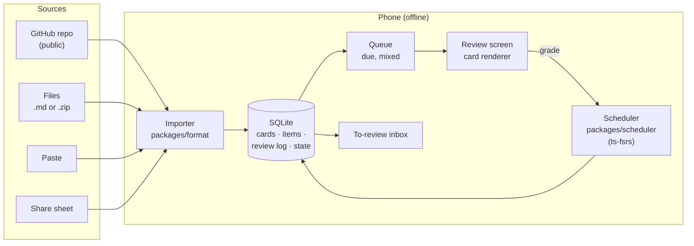
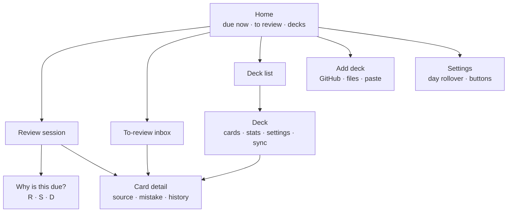
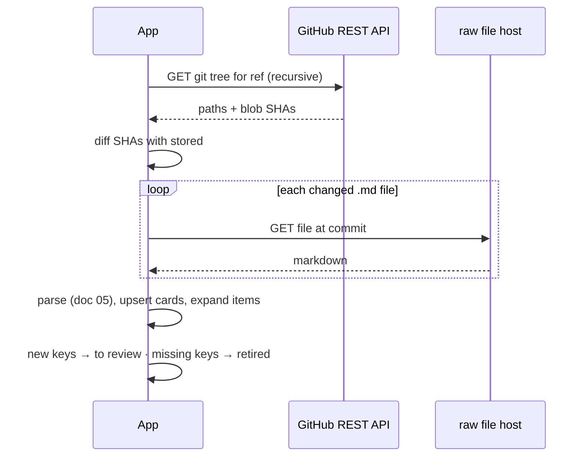
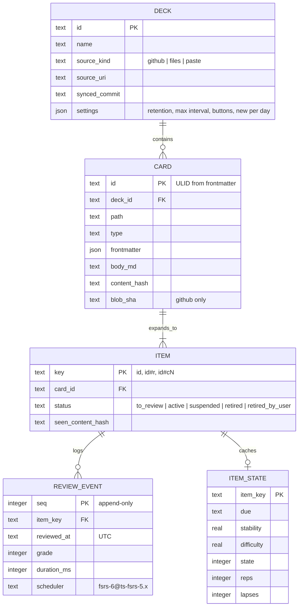

# 06 · v1 mobile app (React Native)

Status: draft · Updated: 2026-10-22

## Summary

v1 is a single-user, offline-first phone app that loads decks in the doc 05 format, schedules them with FSRS (doc 02), and reviews them with code and Mermaid rendered well. Decks arrive four ways: a public GitHub repo, files, pasted text, and the share sheet. Everything lives in on-device SQLite; there is no Uplink server. The one decision left for a person is Expo or bare React Native; both are laid out below. The recommended rendering approach is one long-lived web view for card content, chosen for fidelity and to share a renderer with the website, and checked by a measured spike before the review screen is built.

## Problem

Docs 01–05 settle what a card is, how it is scheduled, and where cards come from. None of that is usable until a learner can open a phone, see what is due, and review it in a few minutes on a train, offline. The app also has to make the agent-written workflow feel natural: a learner's agent writes cards into a repo or a chat, and they should be on the phone a minute later, waiting in a "to review" pile.

## Goals

- Review due cards offline, with good code highlighting and diagrams, at the speed of tapping.
- Import decks a learner generated with their own LLM, with as little ceremony as possible.
- Implement docs 02–05 faithfully: review log, two-button default, mixed order, to-review inbox, item keys.
- Demo well in five minutes (doc 02's demo features).
- Keep the shared logic (parser, scheduler wrapper) in plain TypeScript packages usable by the CLI and, later, the website.

## Non-goals

- Accounts, sync between devices, sharing, or any backend (doc 08).
- An MCP server (doc 07).
- Writing cards on the phone beyond small edits to local decks.
- Tablets, web, and desktop builds; app-store release (a person decides when to publish).
- Native Android or iOS rewrites (a later stage).

## Users and use cases

| Learner | Moment | What the app must do |
|---|---|---|
| A software engineer preparing for interviews | Ten minutes on a commute, no signal | Show today's due cards, mixed across decks; grade with one thumb |
| The same engineer, after a practice session | Their agent just pushed five cards to their deck repo | Pull, show "5 to review from today's session", keep or delete each |
| A developer using ChatGPT on the phone | Asked it for cards on Python generators; it printed markdown | Paste, preview, import into a deck |
| A Spanish learner | Got a `.md` deck from a friend in a chat app | Share the file to Uplink, import |
| Someone being shown the app | Five minutes | Interval labels on buttons, "why is this due?", a seeded deck with history |

## Scope of v1



| In v1 | Not in v1 |
|---|---|
| Doc 05 parser and validation, with errors shown per file | Card authoring beyond small edits |
| Four import paths (below) | Private repos with OAuth (a token is a Should) |
| Review with two or four buttons, interval labels, key-point checklist | LLM grading of free-text answers |
| To-review inbox grouped by `source` | Follow-ups as scheduled items |
| Deck settings: retention, maximum interval, buttons, new cards a day | Parameter fitting |
| "Why is this due?" sheet, basic stats | Audio, images beyond deck `assets/` |
| A seeded demo deck with weeks of history | Notifications (Should) |

## Screens



- **Home.** Three numbers: due now, to review, follow-ups due today (Should, from session summaries, doc 04). One big "Review" button. Decks below.
- **Review session.** Front; tap to reveal; back with the answer, the key-point checklist for key-point types (doc 05), and "why". Grade buttons show the next interval for each grade from `preview` (doc 02). Overflow menu: why is this due, card detail, suspend, "this card is wrong" (records a reason, doc 04), open source. Undo for the last grade.
- **To-review inbox.** New items not yet scheduled, grouped by `source` (one practice session's cards together, doc 04 Should) or by import. Each card: keep, delete, edit (local decks) or open in GitHub (repo decks). "Keep all" per group; per-deck "trust this deck" setting (doc 03 open question; default off).
- **Deck.** Cards with filters by type and tag, sync status and last error, settings, stats: reviews a day, retention achieved vs target, pass rate per card type (doc 03 Should).
- **Card detail.** Rendered card, frontmatter, `source` and `mistake`, review history, "edited since last review" marker, reset progress (doc 05).
- **Add deck.** The four import paths.

Editing in v1: for decks imported from files or paste, a plain markdown text editor with live validation. For GitHub decks, "Edit" opens the file's edit page on GitHub in the browser, because the repo is the source of truth and v1 does not push. Deleting from a GitHub deck hides the card locally (status `retired_by_user`, which a later pull does not undo).

## Getting decks in

| Path | How | Expo Go? | Cost | v1 |
|---|---|---|---|---|
| **GitHub repo** | Paste `owner/repo` (optionally a folder and branch). The app reads the tree once, fetches changed files, and pulls again on refresh | Yes | ~1 session | Must |
| **Files** | Document picker: one or more `.md` files, or a `.zip` of a deck folder (unzipped in JS) | Yes | Small | Must |
| **Paste** | Text box; paste one card or a multi-card file (doc 05's `<!-- card -->`); preview; choose a deck | Yes | Small | Must |
| **Share sheet** | Share a `.md` file or text from another app to Uplink | No: needs a development build and a config plugin (e.g. `expo-share-intent`) | Medium; iOS share extensions are fiddly | Should |

Paste matters more than it looks: an agent in a phone chat can print cards in doc 05 format, and copy-paste is the shortest path from chat to deck with no integration at all.

### GitHub sync



- One API request per sync for the tree; files are fetched only if their blob SHA changed. Unauthenticated REST calls are rate-limited per IP (60 an hour at the time of writing), which is ample for manual pulls.
- Pinned to a commit per sync, so a half-pushed batch of cards is never read mixed.
- Read-only. v1 never writes to the repo. `uplink check --fix` (doc 05) assigns missing IDs in the repo; if the app finds a card without `id`, it keeps a path → id map and shows "run the checker" on the deck.
- Private repos: a fine-grained, read-only personal access token stored in the secure keychain (Should). OAuth device flow later.
- Alternatives considered: cloning with a JavaScript git implementation (`isomorphic-git` over an `fs` shim such as `expo-fs`) gives real git semantics but adds weight and a filesystem shim with known gaps; downloading the repo archive is one request but re-downloads everything. The tree-plus-changed-files approach is the cheapest that is incremental.

## Data model

All on-device, in SQLite. The review log is the source of truth for progress (doc 02); everything about content is a cache of the deck source.



- **`REVIEW_EVENT` is insert-only.** Undo deletes only the newest row for that item and recomputes state (doc 02). A test replays the whole log and compares with `ITEM_STATE`.
- **`scheduler` on each event** records which algorithm produced the state at the time, for audits after upgrades.
- **Queue query:** active items with `due <= now`, across all decks, ordered by due then a stable shuffle, plus up to N new items a day per deck (default 10). The shuffle keeps doc 03's mixed order without re-sorting by deck.
- **Day boundary:** 04:00 local, timestamps in UTC (doc 02).
- **Size:** 10,000 cards and 100,000 review events is a few megabytes; SQLite handles it without special indexing beyond `ITEM_STATE(due)` and `REVIEW_EVENT(item_key)`.

### Storage options

| Option | What it is | For | Against |
|---|---|---|---|
| **`expo-sqlite`** | Expo's SQLite module | In the Expo SDK, works in Expo Go, maintained with each SDK; works with Drizzle ORM for typed queries and migrations | Not the fastest binding; SDK 58 removed its libSQL sync, which we did not plan to use |
| `op-sqlite` | JSI SQLite binding | Fast; good for large batch imports | Development build only; one more native dependency to track |
| MMKV | Key-value store | Very fast for settings | Not relational; the queue and the log want SQL |
| JSON files | Plain files | Simplest | No transactions; corrupts on a crash mid-write |

Recommendation: `expo-sqlite` (it is also usable from a bare app), with MMKV or AsyncStorage only for UI preferences. Revisit if importing a large deck is slow.

## Rendering cards

The hard part of v1. A card is markdown with code (Shiki-quality highlighting is the goal), cloze gaps, key-point checklists, and Mermaid diagrams, on a 390-point-wide screen.

### Options

| | A · Native markdown | B · One web view per card body | C · Native text, web view only for diagrams |
|---|---|---|---|
| How | A native markdown renderer (e.g. `react-native-markdown-display`) with custom rules: code via `react-native-shiki-engine` (native Oniguruma, MIT) or `prism-react-renderer`; Mermaid in a small web view | The card body is a React web component (`react-markdown`, Shiki's JavaScript engine, Mermaid) rendered in a web view: an Expo DOM component (`'use dom'`) or `react-native-webview` in bare | A, but every `mermaid` block is a web view |
| Fidelity | Good; every markdown feature is a custom rule | Highest: the same renderer as GitHub-style web markdown | Mixed |
| Code highlighting | Shiki through a native module (needs the New Architecture), or Prism tokens in `Text` spans | Shiki on the web side, no native module | As A |
| Mermaid | Needs a web view anyway (Mermaid needs a DOM) | Same web view | Web view per diagram |
| Speed | Fastest; native text, native scrolling | One web view kept alive across cards; first paint after app start is slower (web views start slower than Hermes bytecode); later cards are a prop update | Fast except diagrams |
| Accessibility, Dynamic Type, text selection | Native | Web view equivalents; needs explicit work to follow system font size | Native except diagrams |
| Reuse | Mobile only | The same component renders cards on the website (doc 08), in a CLI preview, and later inside a native Android or iOS app's web view | Partial |
| Risk | Many custom rules; two renderers to keep in sync once the website exists | Web view memory, gesture conflicts, measuring height (`matchContents`) | Both sets of risks, smaller |

### Recommendation: B, gated by a spike

Render the card body in **one long-lived web view** that receives the next card as a prop, so web-view start-up is paid once per session, not per card. Grade buttons, navigation, and the rest of the UI stay native. Reasons: Mermaid forces a web view regardless; Shiki runs on the web side with no native module; and one renderer serves the app, the website, and any later native app.

The spike (one session, before the review screen): render 50 real cards (long Java, a Mermaid sequence diagram, a cloze in code) on a mid-range Android phone and an iPhone, and measure first paint after cold start, card-to-card time, memory, and scrolling feel. Pass: card-to-card under 100 ms, first card under 1 s after the app opens, no jank scrolling a 15-line code block. If B fails, fall back to C.

### Rendering details that apply to any option

- **Code:** monospace with ligatures off; horizontal scroll, never wrap (doc 05); line numbers off by default; one light and one dark theme matching the system.
- **Cloze:** the gap is a box sized to the hint, or to the answer when there is no hint (doc 05), revealed in place.
- **Key points:** the checklist on the back is tappable; ticking every point suggests Good, any missing suggests Again. The learner still chooses.
- **Mermaid:** rendered once per card and cached as SVG in SQLite keyed by content hash, so later reviews do not re-run layout. Mermaid is a large bundle; load it only when a card has a diagram.
- **Offline:** every renderer asset is bundled in the app binary. No CDN.

## Expo or bare React Native

Both are viable for v1. **Decision needed.** The React Native team recommends starting new apps with a framework and names Expo as the one it recommends; bare React Native is still supported.

| | Expo (managed, Continuous Native Generation) | Bare React Native (React Native Community CLI) |
|---|---|---|
| Native projects | Generated by `expo prebuild` from `app.json` and config plugins; `android/` and `ios/` not checked in | Checked in and maintained by hand |
| Upgrades | Bump the SDK, regenerate; Expo calls this close to upgrading a JavaScript app | Upgrade native files by hand with the upgrade helper; the most common React Native pain point |
| v1 libraries | SQLite, file system, document picker, secure store, web views and DOM components all first-party | Same libraries work (Expo modules install into bare apps), with manual linking steps |
| Native code when needed | Config plugins or local Expo modules; editing generated files is lost on regeneration | Edit any file directly |
| Builds | EAS Build (hosted) or local builds | Local Gradle and Xcode, or any CI |
| Quick device demos | Expo Go for features without custom native code; development builds otherwise (share sheet needs one) | Debug build on a device |
| What it shows about the team | Modern, pragmatic React Native practice | Comfort with Gradle, Xcode, and native modules; a direct path into a later Kotlin or Swift rewrite |
| Current versions (2026-10-22) | SDK 58 (15 October; React Native 0.88). Expo Go for SDK 58 is still rolling out, so `create-expo-app` makes SDK 57 projects until it lands | The same React Native line as SDK 58 (0.88); check the latest stable patch at project start |

Notes for the decision:

- Expo with CNG is not a lock-in: `prebuild` produces ordinary native projects that can be checked in at any time, which turns the app into a bare app with Expo modules.
- The share sheet, the Shiki native engine (option A), and `op-sqlite` all need a development build on Expo; Expo Go alone will not cover v1's Should list.
- A later native rewrite reads the same SQLite schema and the same deck format either way; the choice here affects build and upgrade cost, not the migration.

## Project layout

```text
uplink/
├── packages/
│   ├── format/        doc 05 parser, schema, item expansion (shared: app, CLI, web)
│   ├── scheduler/     the Scheduler interface over ts-fsrs (doc 02)
│   └── card-render/   the web card renderer (option B; reused by the website)
├── apps/
│   ├── mobile/        the React Native app
│   └── cli/           uplink check (doc 05)
└── decks/demo/        the seeded demo deck
```

Plain TypeScript in `packages/` keeps the parser and scheduler testable in Node and identical across app, CLI, and website.

## Testing

- `packages/format` and `packages/scheduler`: unit tests in Node, plus doc 02's golden vectors run on a device under Hermes.
- Replay test: random review sequences; `replay(log)` equals stored state.
- Import tests: a fixture deck repo with edits, renames, duplicate IDs, and deleted cards, checked against doc 05's identity table.
- End-to-end: three flows on a simulator (import a GitHub deck, review five cards, triage the to-review inbox) with a mobile UI test runner such as Maestro.

## Requirements

**Must**
- Import from a public GitHub repo, files (`.md`, `.zip`), and paste; parse and validate with `packages/format`, showing errors per file.
- SQLite storage as in the data model; insert-only review log; replay test.
- Review screen: reveal, key-point checklist, Again/Good default, four buttons as a setting, interval labels, undo.
- Mixed due queue across decks, new-cards-a-day limit, 04:00 day rollover.
- To-review inbox grouped by `source`; keep, delete, edit (local) or open in GitHub (repo decks).
- Code highlighting for Java, Python, and TypeScript; cloze gaps in prose and code; Mermaid for doc 05's four diagram types; all offline.
- Deck settings: desired retention, maximum interval, buttons, new per day.
- "Why is this due?" sheet; a seeded demo deck with history.
- The rendering spike, run and written up before the review screen is built.

**Should**
- Share-sheet import.
- Private repos with a read-only token in secure storage.
- Stats: reviews a day, retention achieved, pass rate per card type.
- "This card is wrong" with a reason; "edited since last review" marker; reset progress.
- Follow-ups due today on Home (doc 04).
- A daily reminder notification at a time the learner picks.

**Later**
- Writing back to repos (assigning IDs, edits) through the GitHub API.
- OAuth device flow for GitHub.
- Tablet layout; web build of the app.
- Audio.

## Open questions

- **Expo or bare React Native.** Both laid out above. **Decision needed.**
- Rendering B or C: decided by the spike's numbers, not taste.
- Should the to-review inbox block a deck's new cards until triaged, or let "keep all" be one tap? Proposal: one tap, with the inbox count visible on Home.
- New cards a day: 10 is Anki-like; agent-written decks arrive in bursts of 5–30. Should a burst from one practice session bypass the limit? Proposal: yes for cards with a `source` from the last 48 hours.
- How should a learner see GitHub sync errors (an invalid card) without being nagged? Proposal: a badge on the deck, details on its screen.

## Sources

- Expo changelog: SDK 58 (15 October 2026), SDK 57 (30 June 2026), Expo Go timing. https://expo.dev/changelog ; https://expo.dev/changelog/sdk-58.md ; https://expo.dev/changelog/sdk-57.md
- Expo docs, DOM components (`'use dom'`, `@expo/dom-webview` from SDK 56, serializable props, `matchContents`, slower start than Hermes bytecode, works in Expo Go). https://docs.expo.dev/guides/dom-components/
- Expo docs, Continuous Native Generation and prebuild. https://docs.expo.dev/workflow/continuous-native-generation/
- React Native blog, "Use a framework to build React Native apps" (2024). https://reactnative.dev/blog/2024/06/25/use-a-framework-to-build-react-native-apps
- `react-native-shiki-engine` 0.4.0 (MIT; native Oniguruma for Shiki). https://registry.npmjs.org/react-native-shiki-engine/latest ; https://github.com/skiniks/react-native-shiki-engine
- Bluesky social-app issue 5895: Shiki on React Native, Hermes regex support, the native engine. https://github.com/bluesky-social/social-app/issues/5895
- `prism-react-renderer` (Prism tokens via render props; works with React Native). https://github.com/FormidableLabs/prism-react-renderer
- `react-native-markdown-display` (native-component markdown renderer). https://github.com/RonRadtke/react-native-markdown-display
- `expo-share-intent` (receive shared files and text; needs a development build). https://github.com/achorein/expo-share-intent
- `expo-fs` (Node-style `fs` over Expo FileSystem, for `isomorphic-git`; stubbed modes, no symlinks). https://www.npmjs.com/package/expo-fs
- Expo docs, `expo-sqlite`. https://docs.expo.dev/versions/latest/sdk/sqlite/
- GitHub REST API: Git trees, and rate limits for unauthenticated requests. https://docs.github.com/en/rest/git/trees ; https://docs.github.com/en/rest/using-the-rest-api/rate-limits-for-the-rest-api
- Docs 02 (scheduler, review log, demos), 03 (card types, grading, inbox), 04 (`source`, follow-ups), and 05 (format, identity, items) in this folder.
