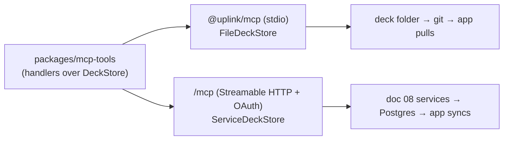

# 07 · Getting LLM-made cards into the app

Status: done · Updated: 2026-10-22

## Summary

v1 needs no Uplink integration: coding agents commit card files to a deck repo, guided by an Agent Skill and `uplink check`, and chat assistants print cards to paste.
Stage 3 adds a local stdio MCP server that writes into a deck folder; v2 hosts the same tool code with OAuth (MCP 2026-07-28), which is what reaches Claude and ChatGPT on the web and phone.
The server never calls a model and cannot schedule, grade, or delete: an agent can only **propose** cards into the learner's to-review inbox.

## Problem

Doc 04's flow ends with "write cards into the deck". How depends on where the learner's agent runs:

- **A coding agent** (Claude Code, Codex, Cursor, any agent with a shell) already writes files and runs commands. It needs the card guide and a checker, not a new protocol.
- **A chat assistant** (Claude or ChatGPT on the web or phone) cannot write to the learner's repo or phone. Its only path today is printing markdown to copy: manual, unchecked, and tiresome beyond a handful of cards.
- **Any agent** writing blind duplicates cards already in the deck, gets the format slightly wrong, and cannot aim at weak spots unless handed them.

MCP answers the second and third cases, but not for free: a remote server needs hosting, accounts, and OAuth; a write tool a model can call raises consent questions; and the protocol changed substantially in its 2026-07-28 revision. This doc decides which mechanism serves which agent, and designs the server so a model can only do what the learner would agree to.

## Goals and non-goals

**Goals**
- A path from every common agent to the app, starting with paths that need no Uplink infrastructure.
- One set of tools, written once, that runs locally (stdio, files) and hosted (HTTP, accounts).
- Agents read what they need to write good cards (guide, deck, optionally weak spots) and can only add cards to the inbox.
- Every write is validated by the same `packages/format` parser as the app and the CLI (doc 05).
- Built on MCP 2026-07-28, without features it deprecates.

**Non-goals:** the backend itself (doc 08); running an LLM on Uplink's side (generation happens in the learner's agent, on their account); grading or rescheduling from an agent (review state belongs to the device, docs 02 and 05); listings in any assistant's app directory (a person decides when to publish).

## Users and use cases

| Learner and agent | Moment | Best path |
|---|---|---|
| Engineer in Claude Code next to their practice repo | Finished a timed problem; notes in `sessions/2026-10-22.md` | Skill + `uplink check` + git (v1); local MCP (stage 3) |
| The same engineer in the Claude phone app | Debriefing a mock interview by voice | Paste (v1); remote MCP connector (v2) |
| Developer in ChatGPT on the web | "Make me cards on Python generators" | Paste or file (v1); remote MCP (v2) |
| Spanish learner with a tutor's corrections in a chat | Wants ten cloze cards | Paste (v1); remote MCP (v2) |
| A script or custom agent | Bulk-generating a deck from course notes | Files in a repo (v1); HTTP API (v2) |

## Options

| Mechanism | How cards travel | Who can use it | Validation | Uplink infrastructure | Stage |
|---|---|---|---|---|---|
| **Paste** | Agent prints doc 05 markdown; learner pastes into the app | Any agent | App on import | None | v1 (doc 06) |
| **Files / share sheet** | Agent produces `.md` or `.zip`; learner opens it with Uplink | Chat apps that make downloadable files; coding agents | App on import | None | v1 (doc 06) |
| **GitHub-backed deck** | Agent writes files and commits; app pulls | Coding agents; people | `uplink check` before commit; app on pull | None (GitHub) | v1 (doc 06) |
| **Agent Skill** | Not a transport: a `SKILL.md` folder with the guide, the prompt, and checker usage | Clients supporting the Agent Skills format | `uplink check` | None | v1 |
| **Local MCP (stdio)** | Agent calls tools; server writes files into a local deck folder | Clients that launch local servers (Claude Code, Claude Desktop, Codex, Cursor, VS Code) | `packages/format`, and code runs, on every write | None (npm package) | Stage 3 |
| **Remote MCP (HTTP + OAuth)** | Agent calls tools; server writes to the learner's account; app syncs | Claude (web, desktop, mobile), ChatGPT (where plan and workspace allow), any MCP client | Same, server-side; code runs need a sandbox (Later) | Backend and auth (doc 08) | v2 |
| **HTTP API** | `POST` cards with a personal API key | Scripts, custom agents | Same | Backend (doc 08) | v2 (Should) |
| **Import from URL** | Agent publishes a gist; learner pastes the URL | Agents that can publish | App on import | None | Later |

Ruled out: a watched cloud folder (iCloud Drive, Dropbox), because background folder access on iOS is awkward and GitHub already covers "files the agent wrote"; email-in, which needs a backend for a path paste already covers.

### Recommendation

1. **v1 ships no protocol.** Paste, files, and GitHub decks (doc 06) cover every agent. The **Agent Skill** is the cheapest big win for coding agents: one folder, published from the repo, teaching the guide and the checker. For an agent that already writes files and runs commands, MCP adds little beyond validation on write.
2. **Stage 3 builds the MCP server locally first**, written against a storage interface whose first adapter is the filesystem (`npx @uplink/mcp --decks ~/decks`). It can be built, tested in MCP Inspector, and demoed ("I know kung fu") with no backend, accounts, or OAuth.
3. **v2 hosts the same tools** with a backend storage adapter and OAuth. This is the path that matters for chat assistants and phones, and it cannot exist before doc 08's accounts.
4. **The HTTP API is the backend's ordinary API** (doc 08) with a personal key; the MCP server is a thin adapter over the same service functions.

## MCP server design

### Protocol baseline

Target **MCP 2026-07-28**. Four changes shape the design:

- **Stateless.** No `initialize` handshake and no `Mcp-Session-Id`; every request carries its protocol version and client capabilities in `_meta`, and servers must answer `server/discover`. The hosted server runs behind a plain load balancer. State spanning calls uses explicit handles passed as tool arguments.
- **Sampling is deprecated** (the suggested migration is to call a model provider directly). Uplink's server **does not generate cards**: the learner's model generates them, guided by an MCP prompt and the guide; the server validates and stores. Doc 04's flow becomes the `cards_from_notes` prompt.
- **Roots are deprecated.** In local mode the deck folder is server configuration (`--decks <path>`), one of the spec's suggested migrations.
- **Elicitation goes through Multi Round-Trip Requests**: the server returns `resultType: "input_required"` with `inputRequests` and an opaque `requestState`; the client retries with `inputResponses`. Uplink uses it once (first write to a deck, below), and never sends it to clients that do not declare elicitation support, as the spec requires.

**SDK:** the TypeScript SDK v2 split packages (`@modelcontextprotocol/server`, `…/client`) went stable with 2.0.0 on 2026-07-27; `latest` is 2.3.1. Its license changed from MIT to Apache-2.0 at 2.3.0; both are permissive. Use 2.x behind a thin wrapper, since the server is small.

### Where it runs



The handlers are written against one interface (a sketch, not compiled):

```typescript
// The only thing that differs between local and hosted.
interface DeckStore {
  listDecks(): Promise<DeckSummary[]>;
  searchCards(q: { deck?: string; text: string; limit: number }): Promise<CardHit[]>;
  propose(batch: ProposedBatch): Promise<ProposalReceipt>; // atomic; idempotent per user + batchId
  reviseProposed(cardId: string, markdown: string): Promise<CardReceipt>;
  weakSpots?(q: { deck?: string; sinceDays: number }): Promise<WeakSpot[]>; // hosted only
}
// FileDeckStore: writes `<deck>/<slug>.md`, assigns ULIDs, never touches git.
// ServiceDeckStore: calls doc 08's services as the authenticated learner.
```

Locally a "proposal" is just a new card file: the app treats any new `id` as "to review" (docs 05 and 06), so no extra machinery. Hosted proposals are inbox rows that sync to the phone the same way.

### Tools

Deliberately few. Every write is additive, and nothing touches review state.

| Tool | What it does | Annotations | Scope (hosted) |
|---|---|---|---|
| `uplink_guide` | The card-writing guide and format summary (docs 03, 05), versioned. Other tool descriptions say to call it first | read-only | none |
| `list_decks` | Decks with name, card count, default language, tags | read-only | `decks:read` |
| `search_cards` | Full-text search over a deck, for dedupe (doc 04). Ids, types, and fronts only | read-only | `decks:read` |
| `check_cards` | Validates cards with `packages/format`; per-card errors with line, rule, fix. Local mode also runs `run` fences (doc 05); hosted parses only until a sandbox exists | read-only | none |
| `propose_cards` | Adds a batch (max 30) to a deck's inbox. All or nothing: if any card fails, nothing is written and errors come back ([appendix](#appendix-propose_cards)) | not read-only, not destructive, idempotent by `batch_id` | `cards:propose` |
| `revise_proposed` | Replaces a card **still in the inbox**; fails for kept cards | destructive (overwrites), idempotent | `cards:propose` |
| `get_weak_spots` | Lapse counts by tag and `mistake` over N days, for planning the next session (doc 04). Never card text or the raw log | read-only | `stats:read` (opt-in) |
| `record_session` | Stores a session summary with follow-ups (doc 04) next to the batch | not destructive, idempotent | `cards:propose` (Should) |

No tool deletes, edits kept cards, suspends, grades, reschedules, or reads the review log; those are the learner's actions in the app. This is the main consent decision: the worst a confused or manipulated model can do is put bad cards in an inbox, where the learner sees them before anything is scheduled. Since `tools/list` may vary by granted scope, `get_weak_spots` is listed only to clients holding `stats:read`.

**Prompt.** `cards_from_notes(notes, deck)` is doc 04's prompt as an MCP prompt: extract mistakes, stop for confirmation, write 2–4 typed cards per mistake, check, dedupe, propose. Where clients do not surface prompts, `uplink_guide` carries the same instructions.

**Resources.** `uplink://guide`, `uplink://format/schema.json` (doc 05's JSON Schema), and the template `uplink://decks/{id}/cards/{cardId}`. Clients vary in how they use resources, which is why the guide is also a tool.

### Preview in the chat (MCP Apps, Should)

MCP Apps is the official extension (spec version 2026-01-26) that lets a tool render an interactive view in a sandboxed iframe from a `ui://` resource named in the tool's `_meta.ui`. Claude, ChatGPT, VS Code, and Goose added support around its release, per secondary sources. `propose_cards` links to `ui://uplink/batch-preview`, which renders the batch with **the same `packages/card-render` component the phone uses** (doc 06, option B), so cards appear highlighted and diagrammed in the chat. Its one control, "discard" on a card, calls an app-only tool, `discard_proposed` (`visibility: ["app"]`), which the model never sees. Calling tools from the view was reported missing in ChatGPT at launch (unverified now); hosts without it, or without MCP Apps, show the text result.

### Consent and scopes

- **Scopes:** `decks:read`, `cards:propose`, `stats:read`. The default grant is the first two; `stats:read` is a separate opt-in, because lapse patterns are the most private data Uplink holds.
- **Host confirmation:** the spec says there SHOULD be a human in the loop able to deny tool calls, and Claude and ChatGPT ask before write actions depending on settings. Uplink does not rely on that; the inbox is the real consent boundary.
- **First-write confirmation:** the first `propose_cards` from a client into a deck returns `input_required` with an elicitation ("Add up to 30 cards to 'DSA patterns'?"). The pending batch rides in `requestState`, HMAC-protected and bound to the user, the tool and a digest of its arguments, with a five-minute expiry: the spec requires integrity protection when the state affects business logic and recommends the bindings and a short expiry; five minutes is our choice. Clients without elicitation get no prompt and the batch lands in the inbox as usual. It is a courtesy, not a security control.
- **Per-client view:** the account page lists connected clients, what each proposed, and a revoke button.

### Authentication (hosted)

The MCP server is an OAuth 2.1 resource server; doc 08's auth service is the authorization server.

- Serve Protected Resource Metadata (RFC 9728) at `/.well-known/oauth-protected-resource`, with `scopes_supported: ["decks:read", "cards:propose"]`, the minimal set; `stats:read` is requested by step-up. A 401 carries `WWW-Authenticate` with `resource_metadata` and `scope`; missing scope at runtime is a 403 with `insufficient_scope`.
- Authorization code + PKCE, resource indicators (RFC 8707), `iss` in authorization responses (RFC 9207, a SHOULD), refresh tokens.
- Client registration: **Client ID Metadata Documents**, the spec's preferred method; keep **Dynamic Client Registration** too, deprecated but still used by some hosts, and accept the `application_type` clients now send so desktop and CLI `localhost` redirects work.
- Validate token audience on every request; never accept or pass on any other token (so a learner's GitHub token never travels through MCP).
- Local stdio mode has no OAuth: per the spec it takes credentials from the environment, and a local folder needs none.

### Prompt injection

Uplink's tools combine private data (stats, the learner's decks) with untrusted content (cards in shared decks, returned by `search_cards`). Willison's "lethal trifecta" is private data, untrusted content, and a way to send data out; Uplink provides the first two, so it must never provide the third:

- No tool sends data anywhere except the learner's own account; no URL-fetching or sharing tool.
- `search_cards` returns fronts only, truncated, marked as deck content, and only from decks the learner imported.
- `get_weak_spots` returns counts and tags, not card text.
- The host may pair Uplink with tools that do send data out (web fetch, email). That is outside Uplink's control, one more reason `stats:read` is opt-in.

## How each agent uses it

**Claude Code (or Codex, Cursor), v1, no server.** Copy the skill into the practice repo, e.g. `.claude/skills/uplink-cards/` (the skill's `name` must match the folder). After a session: "make cards from `sessions/2026-10-22.md` into `decks/dsa`". The agent follows the prompt, writes files, runs `uplink check decks/dsa --fix`, and commits; the learner pulls on the phone. The CLI's npm name is not chosen yet; until it is reserved, the skill must not tell agents to `npx` an unscoped name that could resolve to someone else's package.

**Claude Code, stage 3, local MCP.**

```bash
claude mcp add --transport stdio uplink -- npx -y @uplink/mcp --decks ~/code/decks
```

The agent gets `propose_cards` with validation on write and `search_cards` for dedupe. Committing stays with the agent or learner; the server never runs git, so it never surprises anyone with a push.

**Claude on web, desktop, or phone, v2.** Add a custom connector with the server URL in settings, then sign in to Uplink in the browser. Custom connectors are on every Claude plan (one on Free). Claude connects from Anthropic's cloud, so the server must be publicly reachable; connections work in every client including the mobile apps, while adding a connector is documented on the web. A voice debrief on the phone can end in "propose these as cards", and they appear in the app's inbox.

**ChatGPT, v2.** At chatgpt.com/plugins: plus, "Add custom MCP server", URL and authentication, then "Create as a plugin". Account and workspace policies apply; availability by plan, on mobile, and for write actions was inconsistent across OpenAI's pages in 2026. **Check at build time.** Until then paste is the ChatGPT path, and it works on every plan.

**Scripts, v2.** `POST /v1/decks/{deck}/proposals` with a personal API key, the same body as `propose_cards` (doc 08).

## Requirements

**Must (v1)**
- The Agent Skill: `SKILL.md` with the guide, doc 04's prompt, and `uplink check` usage, in the repo, installable by copying a folder.
- A guide precise enough that a model printing cards for paste gets most right first time. Measure the share of pasted cards that parse.

**Must (stage 3: local MCP)**
- `packages/mcp-tools` with `DeckStore` and the tools `uplink_guide`, `list_decks`, `search_cards`, `check_cards`, `propose_cards`, `revise_proposed`; the `cards_from_notes` prompt.
- `@uplink/mcp` stdio server with `FileDeckStore`: deck path from configuration, no Roots, no git.
- MCP 2026-07-28: `server/discover`, `ttlMs` and `cacheScope` on list results, annotations and output schemas as above, deterministic tool order.
- All-or-nothing, idempotent `propose_cards` with structured errors.
- A contract test suite run against both stores; an end-to-end run in MCP Inspector and Claude Code.

**Must (v2: hosted)**
- Stateless Streamable HTTP over doc 08's services with `ServiceDeckStore`.
- OAuth as above: Protected Resource Metadata, PKCE, resource indicators, audience validation, CIMD with DCR fallback.
- Proposals sync to the phone's inbox grouped by `source` (doc 06); connected-clients page with revoke.
- Rate limits per user and per client (the spec says servers MUST rate-limit tool calls).

**Should:** MCP Apps preview with app-only `discard_proposed`; first-write elicitation; `get_weak_spots` behind `stats:read`; `record_session`; HTTP API with personal keys.

**Later:** running `run` fences server-side in a sandbox; writing proposals into a GitHub-backed deck through a GitHub App (a branch the learner merges); import from URL; app-directory listings (a person's decision).

## Open questions

- **Does local MCP earn its place, given the skill?** Its value is validation on write, an MCP demo without a backend, and a harness for the hosted server. Proposal: build it (stage 3's demo, mostly reused in v2); drop it if the skill alone proves enough.
- **All-or-nothing batches** are simpler to triage and retry, but one bad card blocks nine good ones. Proposal: keep them, with errors precise enough for a one-retry fix; measure retries.
- **Should an agent revise a kept card** (e.g. a reported typo)? Proposal: no in v2; it proposes a replacement and the app offers "replace the original, keep its history" (doc 05's same-`id` edit).
- **npm names** for the CLI and `@uplink/mcp`: the scope is not reserved. A person decides before anything is published.
- **ChatGPT availability** by plan and on mobile: re-check before v2 planning.

## Sources

Re-checked 2026-10-22 unless noted.

- MCP 2026-07-28: changelog (stateless core, `server/discover`, MRTR, cacheable lists, deprecation of Roots, Sampling, Logging, and DCR). https://modelcontextprotocol.io/specification/2026-07-28/changelog
- MCP 2026-07-28, Tools (human in the loop, scope-dependent `tools/list`, `isError`, stateful handles, MUST rate-limit). https://modelcontextprotocol.io/specification/2026-07-28/server/tools
- MCP 2026-07-28, Multi Round-Trip Requests (`requestState` integrity MUST, bindings and expiry SHOULD; no elicitation to clients without the capability). https://modelcontextprotocol.io/specification/2026-07-28/basic/patterns/mrtr
- MCP 2026-07-28, Authorization (RFC 9728, 8707, 9207, CIMD preferred, DCR deprecated, audience validation, stdio credentials from the environment). https://modelcontextprotocol.io/specification/2026-07-28/basic/authorization
- npm registry: `@modelcontextprotocol/server` (2.0.0 on 2026-07-27, `latest` 2.3.1, Apache-2.0 from 2.3.0) and `@modelcontextprotocol/sdk` 1.32.1 (MIT). https://registry.npmjs.org/@modelcontextprotocol/server
- MCP Apps overview (`ui://`, `_meta.ui`, sandboxed iframes, app-only visibility). https://apps.extensions.modelcontextprotocol.io/api/documents/overview.html ; host support and ChatGPT gaps at launch from Alpic (secondary). https://alpic.ai/blog/mcp-apps-goes-official-claude-chatgpt-support
- Claude Help Center, custom connectors using remote MCP (plans, cloud connections, mobile). https://support.claude.com/en/articles/11175166-get-started-with-custom-connectors-using-remote-MCP
- Claude Code docs, MCP (`claude mcp add`; not re-checked). https://code.claude.com/docs/en/mcp
- OpenAI Apps SDK, Connect from ChatGPT. https://developers.openai.com/apps-sdk/deploy/connect-chatgpt ; plan availability (not re-checked): https://help.openai.com/en/articles/12584461-developer-mode-and-mcp-apps-in-chatgpt
- Agent Skills specification (`SKILL.md`, `name` matches folder). https://agentskills.io/specification ; client adoption list from secondary sources, not re-checked.
- Willison, "The lethal trifecta for AI agents" (2025; not re-checked). https://simonwillison.net/2025/Jun/16/the-lethal-trifecta/

## Appendix: `propose_cards`

Not executed. Tool definition:

```json
{
  "name": "propose_cards",
  "title": "Propose cards for review",
  "description": "Add cards to a deck's to-review inbox. The learner keeps or deletes each one in the Uplink app; nothing is scheduled until they do. Call uplink_guide first and search_cards to avoid duplicates. Each card is one markdown file in Uplink format (frontmatter with type; a blank line, then '---', between front and back). Omit id: the server assigns one. Reuse the same batch_id when retrying.",
  "inputSchema": {
    "type": "object",
    "properties": {
      "deck": { "type": "string", "description": "Deck id from list_decks" },
      "batch_id": { "type": "string", "description": "Any unique string; makes retries safe" },
      "source": { "type": "string", "description": "Where the cards came from, e.g. a session file path or 'chat 2026-10-22'" },
      "cards": { "type": "array", "minItems": 1, "maxItems": 30,
                 "items": { "type": "string", "description": "One complete card file" } }
    },
    "required": ["deck", "batch_id", "cards"],
    "additionalProperties": false
  },
  "outputSchema": {
    "type": "object",
    "properties": {
      "batch": { "type": "string" },
      "accepted": { "type": "array", "items": { "type": "object",
        "properties": { "id": { "type": "string" }, "type": { "type": "string" }, "front": { "type": "string" } } } },
      "errors": { "type": "array", "items": { "type": "object",
        "properties": { "card": { "type": "integer", "description": "1-based index into cards" },
                        "line": { "type": "integer" }, "rule": { "type": "string" }, "fix": { "type": "string" } } } }
    },
    "required": ["batch", "accepted", "errors"]
  },
  "annotations": { "readOnlyHint": false, "destructiveHint": false, "idempotentHint": true, "openWorldHint": false },
  "_meta": { "ui": { "resourceUri": "ui://uplink/batch-preview" } }
}
```

A failed check is a tool execution error, so the model can fix and retry with the same `batch_id`. The structured result still matches `outputSchema`. The spec says a structured result SHOULD also be serialised in a text block for older clients; here the text block is a readable summary, and a real server would add the JSON too.

```json
{
  "resultType": "complete",
  "isError": true,
  "content": [{ "type": "text", "text": "Nothing written. Card 3, line 9: text directly above '---' becomes a heading; add a blank line before the separator." }],
  "structuredContent": {
    "batch": "b_7f3e", "accepted": [],
    "errors": [{ "card": 3, "line": 9, "rule": "separator-blank-line", "fix": "Insert an empty line before line 9." }]
  }
}
```

The 30-card cap matches the burst sizes in doc 06. A model wanting more sends several batches, each triaged as a group.
