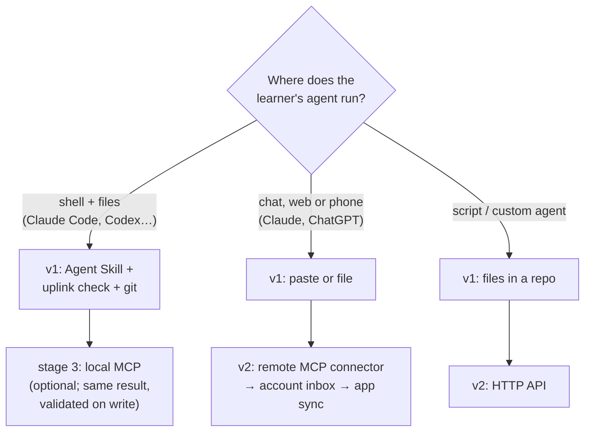
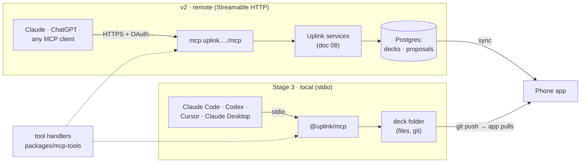
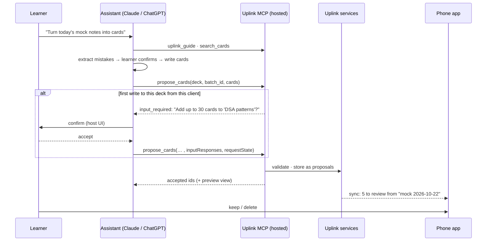

# 07 · Getting LLM-made cards into the app

Status: done · Updated: 2026-10-22

## Summary

v1 needs no Uplink integration. An agent that can write files commits cards to a deck repo. An agent in a chat window prints cards for the learner to paste, and an Agent Skill packages the card guide and `uplink check` for coding agents. Stage 3 adds an Uplink MCP server that runs locally over stdio and writes into a deck folder. The same tool code is then hosted on the v2 backend as a remote MCP server with OAuth, which is what gets cards from Claude or ChatGPT on the web and phone into the app. The server never calls a model and cannot schedule, grade, or delete. An agent can only **propose** cards into the learner's to-review inbox, and the learner decides what happens to them.

## Problem

Doc 04's flow ends with "write cards into the deck". How that happens depends on where the learner's agent runs:

- **A coding agent** (Claude Code, Codex, Cursor, any agent with a shell) can already write files and run commands. It needs the card guide and a checker, not a new protocol.
- **A chat assistant** (Claude or ChatGPT on the web or phone) cannot write to the learner's repo or phone. Today its only path is printing markdown for the learner to copy. That works, but it is manual and unchecked, and it falls apart beyond a handful of cards.
- **Any agent** writing cards blind duplicates cards already in the deck. It also gets the format slightly wrong and has no way to aim at the learner's weak spots without being handed them.

MCP is the obvious answer for the second and third cases, but it is not free. A remote server needs hosting, accounts, and OAuth. A write tool that a model can call raises consent questions. The protocol also changed substantially in its 2026-07-28 revision. This doc decides which mechanism serves which agent, and designs the MCP server so that a model can only do what the learner would agree to.

## Goals

- A path from every common agent to the app, starting with paths that need no Uplink infrastructure.
- One set of tools, written once, that runs both locally (stdio, files) and hosted (HTTP, accounts).
- Agents can read what they need to write good cards (the guide, the deck, optionally weak spots) and can only add cards to a to-review inbox.
- Every write is validated by the same `packages/format` parser as the app and the CLI (doc 05).
- Built on the current MCP revision (2026-07-28), without features it deprecates.

## Non-goals

- The backend itself (accounts, storage, sync): doc 08. This doc covers only the MCP and API surface on top of it.
- Running an LLM on Uplink's side. Generation happens in the learner's agent, on the learner's account.
- Grading reviews or changing schedules from an agent. Review state belongs to the learner's device (docs 02 and 05).
- App-store distribution, or a listing in any assistant's app directory (a person decides when to publish).

## Users and use cases

| Learner and agent | Moment | Best path |
|---|---|---|
| A software engineer preparing for interviews, in Claude Code next to their practice repo | Finished a timed problem; notes are in `sessions/2026-10-22.md` | Agent Skill + `uplink check`, files committed to the deck repo (v1); local MCP (stage 3) |
| The same engineer on their phone, in the Claude app | Debriefing a mock interview by voice on the way home | Remote MCP connector (v2); paste (v1) |
| A developer in ChatGPT on the web | "Make me cards on Python generators" | Remote MCP connector (v2); paste or file download (v1) |
| A Spanish learner with a tutor's corrections in a chat | Wants ten cloze cards | Paste (v1); remote MCP (v2) |
| A script or a custom agent | Bulk-generating a deck from course notes | Files in a repo (v1); HTTP API (v2) |

## Options

| Mechanism | How cards travel | Agents that can use it | Validation | Uplink infrastructure | Stage |
|---|---|---|---|---|---|
| **Paste** | Agent prints doc 05 markdown; learner copies it into the app | Any | App parses on import and shows errors | None | v1 (doc 06) |
| **Files / share sheet** | Agent produces a `.md` or `.zip`; learner opens it with Uplink | Chat apps that can produce downloadable files; any coding agent | App parses on import | None | v1 (doc 06) |
| **GitHub-backed deck** | Coding agent writes files and commits; app pulls the tree | Coding agents; people | `uplink check` before commit; app on pull | None (GitHub) | v1 (doc 06) |
| **Agent Skill** | Not a transport: a `SKILL.md` folder with the card guide, prompt, and `uplink check` instructions, so a coding agent writes good files | Clients that support the open Agent Skills format (Claude Code, Codex, Cursor, Gemini CLI, and others) | `uplink check` | None (published files) | v1 |
| **Local MCP server (stdio)** | Agent calls tools; server writes card files into a local deck folder | MCP clients that launch local servers: Claude Code, Claude Desktop, Codex, Cursor, VS Code | Server runs `packages/format` (and code, locally) on every write | None (npm package) | Stage 3 |
| **Remote MCP server (HTTP + OAuth)** | Agent calls tools; server writes to the learner's Uplink account; app syncs | Claude (web, desktop; phone uses connectors added on web), ChatGPT (where the plan allows custom MCP), any MCP client | Same, server-side; code execution needs a sandbox (Later) | Backend, auth server (doc 08) | v2 |
| **HTTP API** | `POST` cards with an API key | Scripts, custom agents, anything that speaks OpenAPI | Same | Backend (doc 08) | v2 (Should) |
| **Import from URL** | Agent publishes a gist or raw file; learner pastes the URL | Agents that can publish somewhere public | App on import | None | Later (small) |

Ruled out: a synced cloud folder (iCloud Drive, Dropbox) watched by the app, because background folder access on iOS is awkward and GitHub already covers "files the agent wrote". Also ruled out: email-in (`cards@…`), which needs a backend for a path that paste already covers.

### Recommendation



1. **v1 ships no protocol.** Paste, files, and GitHub decks (doc 06) cover every agent. The **Agent Skill** is the cheapest big win for coding agents. It is one folder, published from the format repo, that teaches the agent the guide and the checker. It is also honest about where MCP adds value: for an agent that already writes files and runs commands, MCP adds little beyond validation on write.
2. **Stage 3 builds the MCP server locally first.** The tool code is written against a storage interface. The first adapter is the filesystem: `npx @uplink/mcp --decks ~/decks`. This lets the server be built, tested with MCP Inspector, and demoed ("I know kung fu") with no backend, accounts, or OAuth.
3. **v2 hosts the same tools remotely** with a backend storage adapter and OAuth. This is the path that matters for chat assistants and phones. It cannot exist before doc 08's accounts.
4. **The HTTP API is the backend's ordinary API** (doc 08) with a personal key. The MCP server is a thin adapter over the same service functions, so offering both costs little.

## MCP server design

### Protocol baseline

Target **MCP 2026-07-28**. It matters here in four ways:

- **Stateless.** No `initialize` handshake and no `Mcp-Session-Id`. Every request carries its protocol version and capabilities in `_meta`. The hosted server can run behind a plain load balancer with no session affinity. State that must span calls (a batch of proposed cards) uses an explicit handle the model passes back, as the spec recommends.
- **Sampling is deprecated.** A server cannot rely on borrowing the client's model. Uplink's server therefore **does not generate cards**. The learner's model generates them, guided by an MCP prompt and the guide, and the server validates and stores. Doc 04's flow becomes the `cards_from_notes` prompt, not a set of generating tools.
- **Roots are deprecated.** In local mode, the deck folder is server configuration (`--decks <path>`), not something negotiated with the client. That is the migration the spec suggests.
- **Elicitation now uses Multi Round-Trip Requests** (`resultType: "input_required"`, then a retry with `inputResponses`). Uplink uses it in one place: confirming a write into a deck the learner has not used with this client before. It degrades gracefully when the client lacks elicitation support (below).

SDK: the TypeScript SDK's v2 line (split `@modelcontextprotocol/server` and `client` packages) targets 2026-07-28. It was in beta in mid-2026, and the latest stable v1 package on npm is `@modelcontextprotocol/sdk` 1.32.1 (MIT). Use v2 if it is stable when stage 3 starts. Otherwise use v2 beta behind a thin wrapper, because the server is small.

### Where it runs



`packages/mcp-tools` holds the tool definitions and handlers, written against one interface:

```typescript
// The only thing that differs between local and hosted.
interface DeckStore {
  listDecks(): Promise<DeckSummary[]>;
  searchCards(q: { deck?: string; text: string; limit: number }): Promise<CardHit[]>;
  propose(batch: ProposedBatch): Promise<ProposalReceipt>;   // atomic, idempotent by batchId
  reviseProposed(cardId: string, markdown: string): Promise<CardReceipt>;
  weakSpots?(q: { deck?: string; sinceDays: number }): Promise<WeakSpot[]>; // hosted only
}
// FileDeckStore: writes `<deck>/<slug>.md`, assigns ULIDs, never touches git.
// ServiceDeckStore: calls doc 08's services as the authenticated learner.
```

In local mode a "proposal" is simply a new card file. The app already treats any new `id` as "to review" (docs 05 and 06), so the inbox needs no extra machinery. Hosted proposals are rows in an inbox table that sync to the phone the same way.

### Tools

The tools are deliberately few. Every write is additive, and nothing touches review state.

| Tool | What it does | Annotations | Scope (hosted) |
|---|---|---|---|
| `uplink_guide` | Returns the card-writing guide and format summary (doc 03, doc 05), versioned. Tool descriptions say to call it first | read-only | none |
| `list_decks` | Decks with name, card count, default language, tags | read-only | `decks:read` |
| `search_cards` | Full-text search over a deck's cards, for dedupe before writing (doc 04 step 4). Returns ids, types, and the front only | read-only | `decks:read` |
| `check_cards` | Validates markdown cards with `packages/format`; returns per-card errors with line, rule, and fix. Local mode also runs `run` fences (doc 05); hosted mode parses only until a sandbox exists | read-only | none |
| `propose_cards` | Adds a batch of cards to a deck's to-review inbox. All or nothing: if any card fails the check, nothing is written and the errors come back | not read-only, not destructive, idempotent by `batch_id` | `cards:propose` |
| `revise_proposed` | Replaces a card that is **still in the inbox**. Fails for cards the learner has kept | destructive (overwrites), idempotent | `cards:propose` |
| `get_weak_spots` | Aggregated lapses by tag and `mistake` over the last N days, for "plan my next session" (doc 04 follow-ups). Counts only, never the raw review log | read-only | `stats:read` (off by default) |
| `record_session` | Stores a session summary with follow-ups (doc 04's format) next to the batch | not destructive, idempotent | `cards:propose` (Should) |

There are no tools to delete cards, edit kept cards, suspend, grade, reschedule, or read the review log. Those are the learner's actions, taken in the app. This is the main consent decision. The worst a confused or manipulated model can do is put bad cards in an inbox, where the learner sees them before anything is scheduled.

**Prompt.** `cards_from_notes(notes, deck)` is doc 04's v1 prompt as an MCP prompt: extract mistakes, stop for confirmation, generate 2–4 typed cards per mistake, check, dedupe, propose. Clients that surface prompts show it as a command. Elsewhere, `uplink_guide` carries the same instructions.

**Resources.** `uplink://guide`, `uplink://format/schema.json` (doc 05's JSON Schema), and a template `uplink://decks/{id}/cards/{cardId}`. Clients vary in how they use resources, which is why the guide is also a tool.

### `propose_cards` in full

```json
{
  "name": "propose_cards",
  "title": "Propose cards for review",
  "description": "Add cards to a deck's to-review inbox. The learner keeps or deletes each one in the Uplink app; nothing is scheduled until they do. Call uplink_guide first and search_cards to avoid duplicates. Each card is one markdown file in Uplink format (frontmatter with type; '---' line between front and back). Omit id: the server assigns one. Reuse the same batch_id when retrying.",
  "inputSchema": {
    "type": "object",
    "properties": {
      "deck": { "type": "string", "description": "Deck id from list_decks" },
      "batch_id": { "type": "string", "description": "Any unique string; makes retries safe" },
      "source": { "type": "string", "description": "Where the cards came from, e.g. a session file path or 'chat 2026-10-22'" },
      "cards": {
        "type": "array", "minItems": 1, "maxItems": 30,
        "items": { "type": "string", "description": "One complete card file" }
      }
    },
    "required": ["deck", "batch_id", "cards"],
    "additionalProperties": false
  },
  "outputSchema": {
    "type": "object",
    "properties": {
      "batch": { "type": "string" },
      "accepted": { "type": "array", "items": { "type": "object",
        "properties": { "id": { "type": "string" }, "type": { "type": "string" }, "front": { "type": "string" } } } },
      "errors": { "type": "array", "items": { "type": "object",
        "properties": { "card": { "type": "integer" }, "line": { "type": "integer" },
                        "rule": { "type": "string" }, "fix": { "type": "string" } } } }
    },
    "required": ["batch", "accepted", "errors"]
  },
  "annotations": { "readOnlyHint": false, "destructiveHint": false, "idempotentHint": true, "openWorldHint": false },
  "_meta": { "ui": { "resourceUri": "ui://uplink/batch-preview" } }
}
```

A failed check is a tool execution error (`isError: true`) with the same structured errors, so the model can fix and retry with the same `batch_id`:

```json
{
  "resultType": "complete",
  "isError": true,
  "content": [{ "type": "text", "text": "Nothing written. Card 3, line 9: text directly above '---' becomes a heading; add a blank line before the separator." }],
  "structuredContent": {
    "batch": "b_7f3e", "accepted": [],
    "errors": [{ "card": 3, "line": 9, "rule": "separator-blank-line", "fix": "Insert an empty line before line 9." }]
  }
}
```

The 30-card limit matches doc 06's burst size. A model that wants more sends several batches, each of which the learner can triage as a group.

### Preview in the chat (MCP Apps, Should)

MCP Apps is the official extension, stable since its 2026-01-26 version, that lets a tool result render an interactive view in a sandboxed iframe. It is supported by Claude, ChatGPT, VS Code, and Goose. `propose_cards` links to `ui://uplink/batch-preview`, which renders the batch with **the same `packages/card-render` component the phone uses** (doc 06, option B). The learner sees the cards highlighted and diagrammed in the chat, not as raw markdown. The view has one control: "discard" on a card. It calls an app-only tool, `discard_proposed`, with `visibility: ["app"]`, so the model never sees it and cannot call it. Hosts without MCP Apps show the text result. This reuse is a strong argument for doc 06's option B.

### Consent and scopes



- **Scopes**: `decks:read`, `cards:propose`, `stats:read`. The default grant is the first two. `stats:read` is a separate opt-in, because lapse patterns are the most private data Uplink holds.
- **Host confirmation**: MCP says hosts should keep a human in the loop for tool calls, and both Claude and ChatGPT ask before write actions depending on settings. Uplink does not rely on that. The inbox is the real consent boundary.
- **First-write confirmation** through elicitation, as above. The server encodes the pending batch in an integrity-protected `requestState` (HMAC, bound to the user, the tool, a digest of the arguments, and a five-minute expiry, as the spec requires). If a client does not support elicitation, the server writes anyway, and the batch lands in the inbox as usual. The step is a courtesy, not a security control.
- **Per-client view**: the account page lists connected clients, what each has proposed, and a revoke button.

### Authentication (hosted)

Follow MCP's authorization spec for 2026-07-28. The MCP server is an OAuth 2.1 resource server, and the backend's auth service (doc 08) is the authorization server:

- Serve Protected Resource Metadata (RFC 9728) at `/.well-known/oauth-protected-resource`, naming the authorization server and `scopes_supported: ["decks:read", "cards:propose"]`. A 401 carries `WWW-Authenticate` with `resource_metadata` and `scope`.
- Authorization server: authorization code + PKCE, resource indicators (RFC 8707), `iss` in responses (RFC 9207), refresh tokens.
- Client registration: support **Client ID Metadata Documents**, the spec's preferred method. Keep **Dynamic Client Registration** as well, because it is deprecated but still what some hosts use. Honour `application_type` so desktop and CLI clients with `localhost` redirects work.
- Validate the token audience on every request. Never accept or forward any other token. If the learner's deck is also on GitHub, the server never receives their GitHub token through MCP.
- Local stdio mode has no OAuth. Per the spec it takes credentials from the environment, and it needs none for a local folder.

### Prompt injection

Uplink's tools combine private data (stats, the learner's decks) with untrusted content: cards in shared or public decks, returned by `search_cards`. A card in a downloaded deck could contain instructions aimed at the model. Simon Willison's "lethal trifecta" is private data, untrusted content, and a way to send data out. Uplink's server provides the first two, so it must never provide the third:

- No tool sends data anywhere except the learner's own account, and there is no URL-fetching or sharing tool.
- `search_cards` returns fronts only, truncated, marked as deck content in the text, and never from decks the learner has not imported.
- `get_weak_spots` returns counts and tags, not card text.
- The host may combine Uplink with other tools (web fetch, email) that do send data out. That is outside Uplink's control, which is one more reason `stats:read` is opt-in.

## How each agent uses it

**Claude Code (or Codex, Cursor), v1, no server.** Install the skill into the practice repo, for example at `.claude/skills/uplink-cards/`. After a session: "make cards from `sessions/2026-10-22.md` into `decks/dsa`". The agent follows the prompt, writes files, runs `npx uplink check decks/dsa --fix`, and commits. The learner pulls on the phone.

**Claude Code, stage 3, local MCP.**

```bash
claude mcp add --transport stdio uplink -- npx -y @uplink/mcp --decks ~/code/decks
```

The agent now gets `propose_cards` with validation on write, and `search_cards` for dedupe. Committing is still the agent's or the learner's step. The server never runs git, so it never surprises anyone with a push.

**Claude on the web, desktop, or phone, v2.** In settings, add a custom connector with the URL `https://mcp.uplink…/mcp`, then sign in to Uplink in the browser window. Claude connects from Anthropic's cloud, so the server must be publicly reachable. Connectors added on the web are available in the mobile apps. Anthropic's help centre has said that new ones cannot be added from the phone, while some third-party guides list mobile as supported, so check before relying on it. A voice debrief on the phone can end in "propose these as cards", and they appear in the app's inbox.

**ChatGPT, v2.** Add a custom MCP server (currently through the Plugins page: plus, then "Add custom MCP server", then URL and authentication). Availability by plan and on mobile was inconsistent across OpenAI's own pages in 2026, and write actions were limited to some workspace plans for part of the year. **Check at build time.** Until then, paste is the ChatGPT path, and it works on every plan.

**Scripts, v2.** `POST /v1/decks/{deck}/proposals` with a personal API key, the same body as `propose_cards`. The HTTP API is documented in doc 08.

## Requirements

**Must (v1)**
- The Agent Skill: `SKILL.md` with the card guide, doc 04's prompt, and `uplink check` usage, published in the repo and installable by copying a folder.
- The guide states the doc 05 format precisely enough that a model printing cards for paste gets them right first time in most cases. Measure this: share of pasted cards that parse.

**Must (stage 3: local MCP)**
- `packages/mcp-tools` with the `DeckStore` interface and the tools `uplink_guide`, `list_decks`, `search_cards`, `check_cards`, `propose_cards`, and `revise_proposed`.
- `@uplink/mcp` stdio server with `FileDeckStore`. Deck path from configuration, no Roots, no git operations.
- MCP 2026-07-28. Tool annotations and output schemas as above, deterministic tool order.
- All-or-nothing, idempotent `propose_cards`, validated by `packages/format`, with structured errors.
- The `cards_from_notes` prompt.
- Tests: a contract test suite run against both stores, and an end-to-end run in MCP Inspector and Claude Code.

**Must (v2: hosted)**
- Streamable HTTP endpoint, stateless, behind doc 08's services, with `ServiceDeckStore`.
- OAuth 2.1 as above: Protected Resource Metadata, PKCE, resource indicators, audience validation, CIMD with DCR fallback, scopes `decks:read` and `cards:propose`.
- Proposals sync to the phone's to-review inbox, grouped by `source` (doc 06).
- Connected-clients page with revoke.
- Rate limits per user and per client (the spec requires rate limiting tool calls).

**Should**
- MCP Apps batch preview using `packages/card-render`, with app-only `discard_proposed`.
- First-write confirmation through elicitation (MRTR).
- `get_weak_spots` behind opt-in `stats:read`; `record_session`.
- HTTP API for proposals with personal API keys.

**Later**
- Running `run` fences server-side in a sandbox, so hosted `check_cards` matches local.
- Writing proposals back into a GitHub-backed deck through a GitHub App (a commit to a branch the learner merges).
- Import from URL in the app; listing in assistants' app directories (a person's decision).

## Open questions

- **Does local MCP earn its place, given the skill?** For Claude Code, skill plus CLI gets the same cards. Local MCP's value is validation on write, a demo of MCP without a backend, and a test harness for the hosted server. Proposal: build it, because it is stage 3's demo and most of its code is reused in v2. Drop it if the skill alone proves enough in use.
- **All-or-nothing batches**: simpler for the learner (one batch, one triage) and for retries, but one bad card blocks nine good ones. Proposal: all-or-nothing, with errors precise enough that the model fixes them in one retry. Measure retry counts.
- **Should a kept card be revisable by an agent** (for example, "fix the typo the learner reported")? Proposal: no in v2. The agent proposes a replacement card, and the app offers "replace the original, keep its history" (doc 05's same-`id` edit).
- **ChatGPT availability** by plan and on mobile is unclear and changing. Re-check before v2 planning.

## Sources

- MCP specification 2026-07-28: key changes (stateless core, `server/discover`, MRTR, deprecation of Roots, Sampling, Logging, and DCR). https://modelcontextprotocol.io/specification/2026-07-28/changelog
- MCP blog, "The 2026-07-28 Specification" (overview, Tier 1 SDK support). https://blog.modelcontextprotocol.io/posts/2026-07-28/
- MCP 2026-07-28, Tools (annotations, output schemas, `isError`, stateful handles, human in the loop, security). https://modelcontextprotocol.io/specification/2026-07-28/server/tools
- MCP 2026-07-28, Multi Round-Trip Requests (`InputRequiredResult`, `requestState` integrity and replay rules). https://modelcontextprotocol.io/specification/2026-07-28/basic/patterns/mrtr
- MCP 2026-07-28, Authorization (OAuth 2.1, RFC 9728, RFC 8707, RFC 9207, CIMD, audience validation, scopes). https://modelcontextprotocol.io/specification/2026-07-28/basic/authorization
- MCP Apps extension overview (`ui://` resources, `_meta.ui.resourceUri`, sandboxed iframes, app-only tool visibility). https://apps.extensions.modelcontextprotocol.io/api/documents/overview.html ; https://www.thoughtworks.com/radar/platforms/mcp-apps
- MCP TypeScript SDK v2 (split packages, beta for 2026-07-28) and npm `@modelcontextprotocol/sdk` 1.32.1 (MIT). https://ts.sdk.modelcontextprotocol.io/v2/ ; https://newreleases.io/project/github/modelcontextprotocol/typescript-sdk/release/v2.0.0-beta.1 ; https://registry.npmjs.org/@modelcontextprotocol/sdk/latest
- Claude Code docs, MCP (`claude mcp add`, scopes, `.mcp.json`, OAuth via `/mcp`). https://code.claude.com/docs/en/mcp
- Claude Help Center, custom connectors using remote MCP (plans, OAuth, connecting from Anthropic's cloud, mobile use of connectors added on the web). https://support.claude.com/en/articles/11175166-get-started-with-custom-connectors-using-remote-MCP ; https://support.claude.com/en/articles/11503834
- OpenAI Apps SDK, Connect from ChatGPT (Plugins → Add custom MCP server; public HTTPS or tunnel). https://developers.openai.com/apps-sdk/deploy/connect-chatgpt
- OpenAI Help Center, Developer mode and MCP apps in ChatGPT, and third-party summaries of conflicting plan availability. https://help.openai.com/en/articles/12584461-developer-mode-and-mcp-apps-in-chatgpt ; https://peliqan.io/blog/chatgpt-mcp/ ; https://community.openai.com/t/write-actions-blocked-on-custom-mcp-server-business-plan-workspace-developer-mode-unavailable-at-workspace-level/1384381
- Agent Skills open format (`SKILL.md`; adopted by Claude Code, Codex, Cursor, Gemini CLI, and others). https://agentskills.io/specification ; https://atlan.com/know/ai-agent/ai-agent-skills/what-are-agent-skills/
- Willison, "The lethal trifecta for AI agents" (2025). https://simonwillison.net/2025/Jun/16/the-lethal-trifecta/
- Docs 03 (guide), 04 (flow, prompt, follow-ups), 05 (format, ids, review state), and 06 (import paths, inbox, option B renderer) in this folder.
