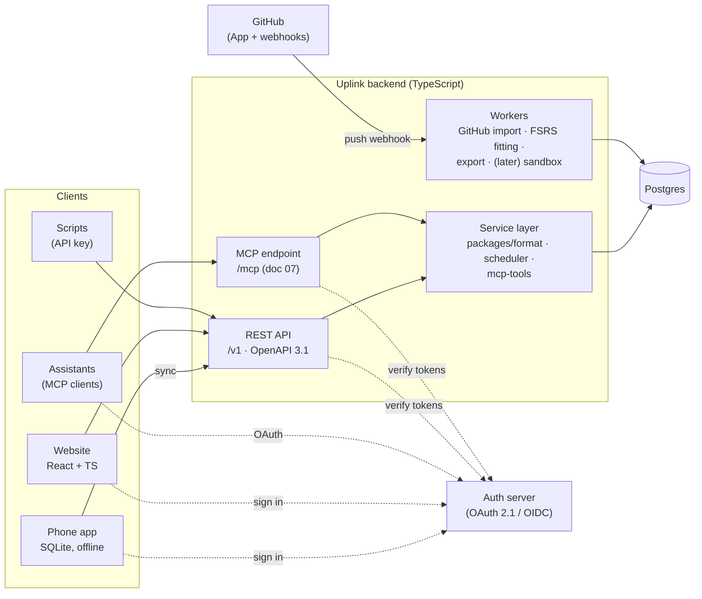
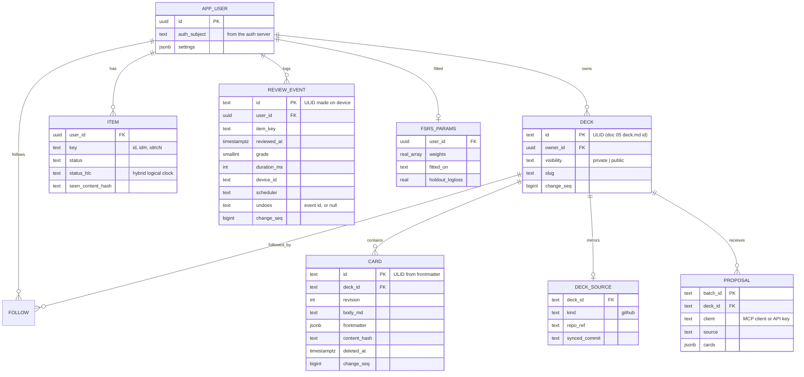
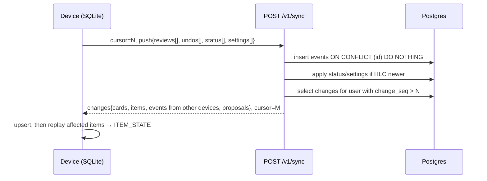

# 08 · Website and backend (v2)

Status: done · Updated: 2026-10-22

## Summary

v2 adds accounts, so a learner's decks and progress follow them across phone and web, and decks can be published and shared. The backend is a TypeScript service over one Postgres database, with a REST API described by OpenAPI. It reuses the same `packages/format`, scheduler, and `packages/mcp-tools` code as the app and the CLI. The hosted MCP server from doc 07 is a second front door onto the same service layer. Sync is simple by construction: the review log is append-only, so devices merge by union and recompute state, and the few mutable fields use last-writer-wins. The website is React and TypeScript, renders cards with the phone's `packages/card-render`, and serves public deck pages for sharing.

## Problem

v1 (doc 06) is deliberately single-device: progress lives in one phone's SQLite, and decks come from GitHub, files, or paste. Three things need a server:

1. **Progress across devices.** A new phone, or a second device, should not reset months of review history.
2. **Cards from chat assistants.** Doc 07's remote MCP server needs an account to write into and a way to reach the phone.
3. **Managing and sharing decks.** Editing forty cards is easier on a laptop than on a phone, and a deck worth sharing needs a link that works for someone without git.

The backend must add these without breaking v1's properties: offline review, the review log as the source of truth (doc 02), content kept separate from review state (doc 05), and the learner's notes and lapses staying private (doc 04).

## Goals

- Accounts and sign-in that also serve as the OAuth authorization server for the MCP server (doc 07).
- Offline-first sync of review history and deck content between any number of devices, with no lost reviews.
- A website to create, edit, check, import, publish, and follow decks, with the same card rendering as the phone.
- A typed, documented API that the app, the website, scripts, and the MCP adapter all sit on.
- A design a strong full-stack team would recognise and could run cheaply: one service, one database, a few workers.

## Non-goals

- Reviewing on the website (Later; the scheduler package makes it possible).
- Social features beyond publish, follow, and fork: comments, ratings, leaderboards.
- Teams, classrooms, or enterprise SSO.
- A hosted LLM pipeline (doc 04's "v2, hosted" row) beyond leaving room for it.
- Native mobile rewrites (a later stage).

## Users and use cases

| Learner | Moment | What v2 must do |
|---|---|---|
| A software engineer preparing for interviews | Gets a new phone | Sign in; decks and full history arrive; due dates match the old phone |
| The same engineer, phone and tablet | Reviews on both, one of them offline on a flight | Both logs merge; no review lost or double-counted |
| A developer in Claude on the web | Proposes cards through the MCP connector (doc 07) | Cards appear in the phone's to-review inbox within a minute |
| A deck author | Has a good TypeScript deck in GitHub | Connect the repo; the site mirrors it on push; publish a public page |
| A Spanish learner | Gets a link to a friend's deck | Opens the page, taps "follow"; updates arrive; their progress stays private |
| Any learner | Leaves | Export everything (deck folders and review log); delete the account |

## Architecture



- **One deployable service** with two front doors: `/v1` (REST) and `/mcp` (Streamable HTTP, stateless per MCP 2026-07-28). Both call the service layer directly. The MCP endpoint does not call the public REST API, which avoids a second network hop and a second token. Tokens are audience-bound: an MCP token is valid only at `/mcp`, and an API token only at `/v1` (RFC 8707, as doc 07 requires).
- **Workers** are the same codebase run as background jobs, using a Postgres-backed queue (for example `pg-boss` or Graphile Worker). With one database, nothing else needs operating.
- **One Postgres**, single region. The expected load is small: thousands of learners, each with tens of thousands of review events. Partition `review_event` by user later if it ever matters.

### Language: TypeScript, with Python only if it earns a place

The brief asks for Python or TypeScript services. The case for TypeScript is concrete. Doc 05 makes "one parser shared by the CLI and the app" a Must, and doc 02 builds on `ts-fsrs`. A TypeScript backend runs exactly the same `packages/format`, `packages/scheduler`, and `packages/mcp-tools` code as the phone, so a card that parses on the server parses on the device, and a replayed state matches. A Python service would need a second parser and a second scheduler kept in lockstep.

Python's real strengths here are FSRS parameter fitting and data analysis. Fitting is reachable from Node through `@open-spaced-repetition/binding` over `fsrs-rs` (doc 02). **Proposal:** TypeScript everywhere. The binding is MIT (checked in doc 02). Add a single Python worker only if its fits disagree with `py-fsrs` on golden data, or when a hosted LLM pipeline (doc 04) wants Python's tooling. The worker interface (read a user's log, write fitted parameters) stays language-neutral either way.

Framework: Fastify or Hono, with request and response schemas in Zod that generate the OpenAPI document. The specific choice is not load-bearing.

## The API: REST with OpenAPI, not GraphQL

Both are defensible. The deciding question is what the API's consumers actually need.

| Consumer | Shape of what it needs | REST + OpenAPI | GraphQL |
|---|---|---|---|
| Phone app | One sync call: push my changes, give me everything since cursor N | A single `POST /v1/sync`; trivially cacheable cursor semantics | A mutation plus a query; sync is not graph-shaped, so GraphQL adds little |
| Website | Deck page (deck + cards + stats), editor, account pages | A handful of composite endpoints | Its strength: each page asks for exactly its fields |
| Public deck pages | Anonymous `GET`, shared links | HTTP caching and a CDN for free | Needs persisted queries for CDN caching |
| Scripts and agents (doc 07) | Propose cards, list decks | OpenAPI is what code generators, API tools, and LLM tool-callers consume directly | Introspection works, but tooling for agents and scripts is thinner |
| MCP adapter | Calls the service layer in process | Not an API consumer | Not an API consumer |

**Recommendation: REST, versioned under `/v1`, described by OpenAPI 3.1 generated from Zod schemas, with a generated TypeScript client for the app and the website.** This gives the same end-to-end typing GraphQL codegen would. GraphQL's advantage, flexible field selection for many clients over a rich graph, would mostly help the website, and a few composite endpoints cover it. Its costs (per-field authorisation, query cost limits, N+1 batching, and caching through persisted queries) would be paid everywhere. tRPC was also considered: it gives excellent typing inside a TypeScript monorepo, but it publishes no language-neutral contract, and scripts and agents need one.

Main resources:

```text
POST   /v1/sync                          push events, pull changes since cursor
GET    /v1/decks                         my decks (owned and followed)
POST   /v1/decks                         create; or connect a GitHub repo
GET    /v1/decks/{deck}                  deck + card summaries
PUT    /v1/decks/{deck}/cards/{id}       create or edit a card (hosted decks only)
POST   /v1/decks/{deck}/check            run packages/format on markdown, no write
POST   /v1/decks/{deck}/proposals        doc 07's propose_cards over HTTP
POST   /v1/decks/{deck}/publish          make public; returns share URL
POST   /v1/decks/{deck}/follow | /fork   subscribe to or copy a public deck
GET    /v1/public/decks/{slug}           anonymous, cacheable
GET    /v1/me/stats                      aggregates for the website
POST   /v1/me/export                     async; deck folders + review log (JSONL)
DELETE /v1/me                            delete account and all data
```

Errors use RFC 9457 problem details. Writes accept an `Idempotency-Key` header, the same idea as doc 07's `batch_id`.

## Data model



Content and progress stay separate, exactly as in doc 05. `CARD` belongs to a deck, which may be public and shared. `ITEM` and `REVIEW_EVENT` belong to a user and are never readable by anyone else, including the deck's author. Following a deck creates items for the follower; it never copies the author's progress.

Every user-scoped query filters by `user_id` in the service layer, with Postgres row-level security as a second line of defence.

## Sync

The design follows from doc 02's decision that the review log is the source of truth. Each kind of data gets the simplest rule that is correct for it:

| Data | Who writes it | Merge rule | Why it is safe |
|---|---|---|---|
| Review events | Devices, offline | **Union** by event id (ULID made on the device) | Insert-only. Two devices reviewing the same card offline produce two real reviews; replaying the merged log in `reviewed_at` order gives the state both would agree on |
| Undo | Devices | A new event with `undoes: <id>`; replay skips the undone event | Deleting a synced event would resurrect it on the next pull. A tombstone merges by union like any other event, and doc 06 records undo this way from v1 |
| Scheduler state | Nobody: derived | Recomputed by `replay` on each device and on the server | It is a cache (doc 02) |
| Item status, settings | Devices, website | Last writer wins per field, ordered by a hybrid logical clock | Rare, small, human-paced edits; losing the older of two conflicting "suspend" taps is acceptable |
| Hosted deck content | Website, MCP proposals the learner kept, API | Server-authoritative; edits carry the base `revision`, and a stale edit is rejected with the current version | Card edits are deliberate and rare; showing "this card changed, reapply?" beats a silent merge |
| GitHub-mirrored decks | GitHub | Read-only on Uplink; the repo is the source (as in doc 06) | No two-way merge with git |



- Push and pull happen in one call, so a sync is one round trip. Retries are safe because every push is idempotent by id.
- `change_seq` is a per-row sequence number taken from one Postgres sequence, so "everything since N" is a single indexed range scan per table.
- The first sync of an account that already has v1 data on the phone uploads the whole local log. It is the same code path with cursor 0, which is how v1 users migrate.
- Fitted FSRS parameters arrive as a settings change. Devices then replay every item with the new weights (doc 02).

**Sync engines considered.** PowerSync, ElectricSQL, and Zero all sync Postgres to client-side storage and are mature options in 2026 (Zero reached 1.0 this year and supports React Native and Expo). They solve harder problems than Uplink has: arbitrary relational data, partial replication, and live multi-user queries. They bring their own client storage adapters, which overlap with doc 06's `expo-sqlite` choice (PowerSync's recommended adapter is `op-sqlite`), and a service to run or pay for. Uplink's data is an append-only log, a few last-writer-wins fields, and server-authoritative content: about two hundred lines of sync code with a property test. **Proposal: custom sync.** Revisit if real-time collaborative deck editing ever becomes a goal.

## Accounts and auth

The auth server does double duty: it signs learners into the app and the website, and it is the OAuth 2.1 authorization server for MCP clients (doc 07). MCP-grade requirements include Protected Resource Metadata, PKCE, resource indicators, `iss` in responses, Client ID Metadata Documents, and Dynamic Client Registration as a fallback.

| Option | What it is | For | Against |
|---|---|---|---|
| **WorkOS AuthKit** | Hosted auth with documented MCP support | CIMD and DCR both supported; hosted login, passkeys, social sign-in; free up to 1 million monthly active users | An external dependency for the most critical path; user records live in two places |
| **Better Auth** (self-hosted, open source) | A TypeScript auth library in our service and our Postgres | Everything in one database; MCP/OAuth provider plugins, with a CIMD profile for MCP 2026-07-28 in its 1.8 beta | We own an OAuth authorization server, the most security-sensitive code in the system; the MCP plugin was mid-transition to a new OAuth provider package in 2026 |
| Auth0, Clerk, Stytch, Descope | Hosted identity providers | Mature | MCP-specific support (CIMD) varies; check each at build time |

**Proposal: AuthKit for v2**, with our `APP_USER` table keyed by the auth subject so that moving to Better Auth later is a migration of credentials, not of data. **Decision needed** if owning everything in one database matters more than not writing an OAuth server.

Sign-in methods: email magic link, passkeys, Google, and Sign in with Apple. Apple's guideline 4.8 requires a privacy-focused equivalent login option when an app offers third-party social sign-in, and Sign in with Apple satisfies it. The phone uses the system browser with PKCE, never an embedded web view.

## Website

- **Stack:** React and TypeScript, with server rendering for public deck pages so shared links preview well and load fast (Next.js or React Router in framework mode; either is fine). Signed-in pages behave like a client app over the generated API client.
- **Card rendering:** `packages/card-render`, the same component the phone shows in its web view (doc 06, option B) and the MCP Apps preview uses (doc 07). One renderer, three places.
- **Pages:** decks (owned, followed); deck (cards with filters, stats, settings, sync source); card editor (markdown with a live preview, running `packages/format` in the browser as you type and `/check` for code execution later); import (GitHub repo, `.zip`, paste); publish and share; connected clients (MCP connections and API keys, with revoke, from doc 07); account (export, delete).
- **GitHub-mirrored decks** are read-only on the site, with "edit on GitHub" links, matching doc 06. Connecting a repo installs a GitHub App with read access to that repo only. Pushes trigger a webhook, and the import worker fetches changed blobs, the same algorithm as the phone.

## Sharing

- **Publish:** a deck becomes readable at `/d/{slug}`. Only content is published, never anyone's progress.
- **Follow:** the follower's account references the author's deck. New and edited cards flow to them, edits keep their history (doc 05's same-`id` rule), and removed cards retire on their device.
- **Fork:** copies the deck with new card ids, recording `x-forked-from` in each card's frontmatter. New ids are required because item keys are card ids, and a learner may hold both the original and the fork.
- **Licence:** published decks carry a licence chosen by the author (default CC BY 4.0), shown on the page.

## Privacy and security

- Practice notes never reach the server unless a hosted pipeline is added later. Doc 04's v1 flow keeps them in the learner's files and their own LLM. `source` fields can name files, so they are stripped from published copies of cards.
- Review logs and stats are visible only to their owner. MCP access to stats needs the separate `stats:read` scope (doc 07).
- Export gives deck folders in doc 05 format and the review log as JSON Lines. Deletion removes everything within 30 days, including backups on their normal rotation.
- Card content from public decks is untrusted. It is rendered in the sandboxed card renderer, with markdown HTML disabled and no remote images without a proxy. Doc 07's prompt-injection rules cover what it can make a model do.
- Rate limits per user, per API key, and per MCP client; audit log of writes by client.

## Requirements

**Must**
- TypeScript service with `/v1` REST (OpenAPI 3.1 generated from Zod) and `/mcp` (doc 07) on one service layer that shares `packages/format`, `packages/scheduler`, and `packages/mcp-tools`.
- Postgres schema as above; user-scoped data filtered in the service and protected by row-level security.
- Sync: one-call push and pull with cursor; union merge of review events by device-generated ULID; undo as a tombstone event; HLC last-writer-wins for status and settings; server-authoritative card revisions with stale-edit rejection; property test that random multi-device histories converge to the same state.
- v1 phone data migrates on first sign-in through the same sync path.
- Auth server meeting doc 07's MCP requirements; app sign-in through the system browser with PKCE.
- Website: deck list, deck page, card editor with live validation, GitHub and file import, publish, connected clients, export, delete.
- Public deck pages server-rendered and cacheable.

**Should**
- Follow and fork.
- FSRS fitting worker for users above the doc 02 threshold, shipping parameters only when they beat defaults on held-out reviews.
- Stats pages: retention achieved against target, reviews per day, pass rate by card type and by `mistake` (doc 03, doc 04).
- API keys for scripts (doc 07's HTTP path).

**Later**
- Sandboxed code execution for `/check` and hosted `check_cards` (doc 05's `run` fences on the server).
- Review on the website.
- Hosted practice-notes pipeline (doc 04), opt-in, with notes deleted after processing.
- Writing back to GitHub decks through the GitHub App.

## Open questions

- **AuthKit or Better Auth.** The proposal is AuthKit (above). **Decision needed.**
- Should a learner without an account keep v1's direct GitHub pull after v2 ships, or does every GitHub deck go through the server mirror? Proposal: keep both. No account remains a supported mode, which keeps the app useful offline and without sign-up.
- Is last-writer-wins right for "suspend" versus "keep" on two devices, or should suspend win? Proposal: last-writer-wins, and measure.
- Followed decks: should an author's edit that changes a card's meaning reset followers' progress? Only the author knows. Proposal: an optional "this is a new question" flag on publish that issues a new `id` (doc 05's rule).

## Sources

- MCP specification 2026-07-28: changelog and authorization (stateless HTTP, audience-bound tokens, CIMD, DCR deprecated). https://modelcontextprotocol.io/specification/2026-07-28/changelog ; https://modelcontextprotocol.io/specification/2026-07-28/basic/authorization
- WorkOS docs, AuthKit and MCP (authorization server, CIMD off by default, DCR retained). https://workos.com/docs/authkit/mcp ; https://workos.com/changelog/client-id-metadata-support-for-mcp-auth
- WorkOS pricing (User Management free to 1 million monthly active users). https://workos.com/pricing
- Better Auth, MCP plugin docs (v1.8 beta CIMD profile; deprecation in favour of the OAuth Provider plugin). https://better-auth.com/docs/beta/plugins/mcp ; https://better-auth.com/docs/plugins/mcp
- PowerSync, React Native and Expo SDK (op-sqlite recommended adapter; JS adapter for Expo Go). https://docs.powersync.com/client-sdks/frameworks/expo-go-support
- Expo blog, "What synced in-app SQLite brings to Expo apps". https://expo.dev/blog/what-synced-in-app-sqlite-brings-to-expo-apps
- PowerSync, "ElectricSQL vs PowerSync" (vendor comparison; read with that in mind). https://www.powersync.com/blog/electricsql-vs-powersync
- InfoQ, "Zero version 1" (2026), and Zero docs, React Native. https://infoq.com/news/2026/06/zero-version-1 ; https://zero.rocicorp.dev/docs/react-native
- OpenAPI Specification 3.1. https://spec.openapis.org/oas/v3.1.0
- GraphQL specification and best practices (persisted queries, authorisation). https://spec.graphql.org/ ; https://graphql.org/learn/best-practices/
- RFC 9457, Problem Details for HTTP APIs. https://www.rfc-editor.org/rfc/rfc9457
- RFC 8707, Resource Indicators for OAuth 2.0. https://www.rfc-editor.org/rfc/rfc8707
- Kulkarni et al. (2014), "Logical Physical Clocks and Consistent Snapshots in Globally Distributed Databases" (hybrid logical clocks). https://cse.buffalo.edu/tech-reports/2014-04.pdf
- Apple App Store Review Guidelines 4.8, Login Services. https://developer.apple.com/app-store/review/guidelines/#login-services
- GitHub Docs, About GitHub Apps and webhooks. https://docs.github.com/en/apps/overview ; https://docs.github.com/en/webhooks
- Docs 02 (review log, replay, fitting), 04 (privacy of notes), 05 (identity, state separation), 06 (app storage, GitHub sync, renderer), and 07 (MCP tools, scopes, auth) in this folder.
