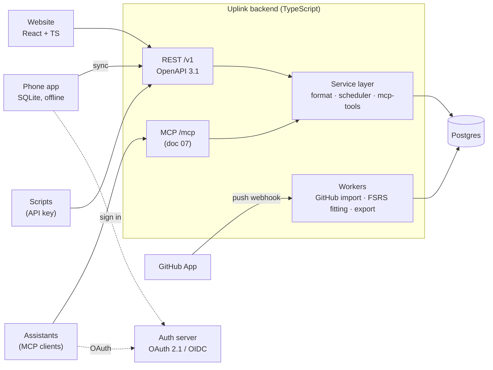
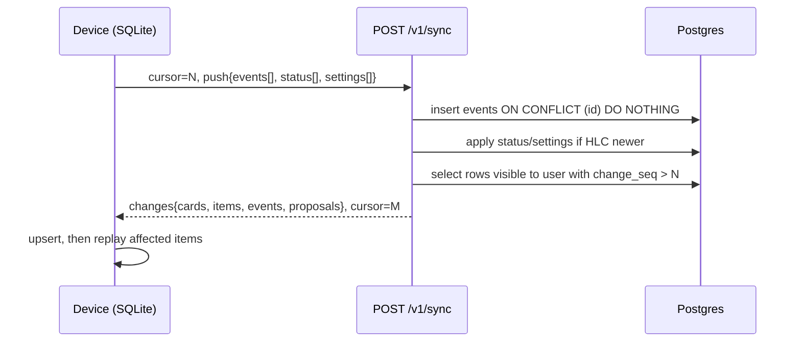

# 08 · Website and backend (v2)

Status: done · Updated: 2026-10-22

## Summary

v2 adds accounts, so decks and progress follow a learner across devices, and decks can be published, followed, and forked.
The backend is one TypeScript service over one Postgres, with a REST API described by OpenAPI. It shares `packages/format`, the scheduler, and `packages/mcp-tools` with the app, and hosts doc 07's MCP server as a second front door.
Sync is simple by construction: review events merge by union and state is replayed, a few fields use last-writer-wins, and card content is server-authoritative.

## Problem

v1 (doc 06) is single-device: progress lives in one phone's SQLite. Three things need a server:

1. **Progress across devices.** A new phone should not reset months of review history.
2. **Cards from chat assistants.** Doc 07's remote MCP server needs an account to write into and a way to reach the phone.
3. **Managing and sharing decks.** Editing forty cards is easier on a laptop, and a shared deck needs a link that works without git.

The backend must keep v1's properties: offline review, the review log as the source of truth (doc 02), content separate from review state (doc 05), and the learner's notes and lapses private (doc 04).

## Goals and non-goals

**Goals**
- Accounts and sign-in that also act as the OAuth authorization server for MCP (doc 07).
- Offline-first sync of review history and deck content across any number of devices, with no lost reviews.
- A website to create, edit, check, import, publish, and follow decks, rendering cards as the phone does.
- One typed, documented API under the app, the website, scripts, and the MCP adapter.
- Cheap to run: one service, one database, a few workers.

**Non-goals:** reviewing on the website (Later); social features beyond publish, follow, and fork; teams, classrooms, SSO; a hosted LLM pipeline (doc 04) beyond leaving room for it; native mobile rewrites (stage 5).

## Use cases

| Learner | Moment | What v2 must do |
|---|---|---|
| Engineer preparing for interviews | Gets a new phone | Sign in; decks and full history arrive; due dates match the old phone |
| The same engineer, phone and tablet | Reviews on both, one offline on a flight | Logs merge; no review lost or double-counted |
| Developer in Claude on the web | Proposes cards through the MCP connector (doc 07) | Cards reach the phone's to-review inbox on its next sync |
| Deck author | Has a TypeScript deck in GitHub | Connect the repo; the site mirrors it on push; publish a page |
| Spanish learner | Gets a link to a friend's deck | Follow it; updates arrive; their progress stays private |
| Any learner | Leaves | Export everything; delete the account |

## Architecture



- **One deployable service, two front doors:** `/v1` (REST) and `/mcp` (Streamable HTTP, stateless per MCP 2026-07-28). Both call the service layer in process, so MCP adds no network hop or second token. Tokens are audience-bound (RFC 8707, as doc 07 requires): an MCP token works only at `/mcp`, an API token only at `/v1`.
- **Workers** are the same codebase run as jobs on a Postgres-backed queue (for example `pg-boss` or Graphile Worker), so there is nothing else to operate.
- **One Postgres, one region.** Expected load is thousands of learners with tens of thousands of review events each (estimate). Partition `review_event` by user if it ever matters.

**Language: TypeScript.** Doc 05 requires one parser shared by the CLI and the app, and doc 02 builds on `ts-fsrs`. A TypeScript backend runs the same packages as the phone, so a card that parses on the server parses on the device and a replayed state matches; a Python service would need a second parser and scheduler kept in lockstep. Python's strength here is FSRS fitting, which Node reaches through `@open-spaced-repetition/binding` over `fsrs-rs` (MIT, doc 02). Add one Python worker only if its fits disagree with `py-fsrs` on golden data, or a hosted LLM pipeline wants Python tooling; the worker interface (read a log, write parameters) is language-neutral.

Framework: Fastify or Hono, with Zod request and response schemas generating the OpenAPI document. The choice is not load-bearing.

## The API: REST with OpenAPI, not GraphQL

| Consumer | Needs | REST + OpenAPI | GraphQL |
|---|---|---|---|
| Phone app | One sync call: push mine, pull since cursor N | One `POST /v1/sync` | A mutation plus a query; sync is not graph-shaped |
| Website | Deck page, editor, account pages | A few composite endpoints | Its strength: each page asks for exactly its fields |
| Public deck pages | Anonymous `GET`, shared links | HTTP and CDN caching for free | Needs persisted queries to cache |
| Scripts and agents | Propose cards, list decks | Code generators and LLM tool-callers consume OpenAPI directly | Introspection works; tooling is thinner |

**Recommendation: REST under `/v1`, OpenAPI 3.1 generated from Zod, and a generated TypeScript client for the app and the website.** That gives the end-to-end typing GraphQL codegen would. GraphQL's flexible field selection mostly helps the website, and a few composite endpoints cover that, while its costs (per-field authorisation, query cost limits, N+1 batching, persisted queries for caching) would be paid everywhere. tRPC types well inside a TypeScript monorepo but publishes no language-neutral contract, which scripts and agents need.

```text
POST   /v1/sync                          push events, pull changes since cursor
GET    /v1/decks                         my decks (owned and followed)
POST   /v1/decks                         create; or connect a GitHub repo
GET    /v1/decks/{deck}                  deck + card summaries
PUT    /v1/decks/{deck}/cards/{id}       create or edit a card (hosted decks only)
POST   /v1/decks/{deck}/check            run packages/format on markdown, no write
POST   /v1/decks/{deck}/proposals        doc 07's propose_cards over HTTP
POST   /v1/decks/{deck}/publish          make public; returns share URL
POST   /v1/decks/{deck}/follow | /fork   subscribe to or copy a public deck
GET    /v1/public/decks/{slug}           anonymous, cacheable
GET    /v1/me/stats                      aggregates for the website
POST   /v1/me/export                     async; deck folders + review log (JSONL)
DELETE /v1/me                            delete account and all data
```

Errors are RFC 9457 problem details. Writes accept an `Idempotency-Key` header, the same idea as doc 07's `batch_id`.

## Data model

Columns are in the [appendix](#appendix-schema).

| Table | Owner | Holds |
|---|---|---|
| `app_user` | — | Auth subject, settings |
| `deck` | A user | Server id, the `deck.md` id, visibility, slug, GitHub source if mirrored |
| `card` | A deck | Key `(deck_id, id)`; markdown body, frontmatter, revision, content hash, soft delete |
| `proposal` | A deck | doc 07 batches waiting in the owner's inbox |
| `item` | A user | Item key (`id`, `id#r`, `id#cN`), status with its HLC |
| `review_event` | A user | Device-made ULID, item key, time, grade, `undoes` |
| `fsrs_params` | A user | Fitted weights and their held-out log loss |

**Content and progress stay separate**, as in doc 05. Cards belong to decks, which may be public. Items and review events belong to one user and are never readable by anyone else, including the deck's author; following a deck creates the follower's own items. Every user-scoped query filters by `user_id` in the service layer, with Postgres row-level security as a second line.

**Ids are keyed per deck on the server.** Two users can hold decks with the same card ids, for example a GitHub fork and its original. So `card` is keyed by `(deck_id, id)`, and `deck` has its own server id. For one learner, item keys stay globally unique: if an imported card's `id` already belongs to one of their other decks, the importer maps that path to a new local id, the same mechanism doc 05 uses for read-only decks (doc 06 applies the same rule).

## Sync

Doc 02 makes the review log the source of truth. Each kind of data gets the simplest correct rule:

| Data | Written by | Merge rule | Why it is safe |
|---|---|---|---|
| Review events | Devices, offline | **Union** by event id (device-made ULID) | Insert-only. Two offline reviews of one card are two real reviews; replay orders by `(reviewed_at, id)` so every device gets the same state |
| Undo | Devices | A new event with `undoes: <id>`; replay skips the undone one | A deleted event would return on the next pull; a tombstone merges like any event (doc 06 does this from v1) |
| Scheduler state | Nobody: derived | Recomputed by `replay` on each device and the server | A cache (doc 02) |
| Item status, settings | Devices, website | Last writer wins per field, by hybrid logical clock | Rare, human-paced; losing the older of two "suspend" taps is acceptable |
| Hosted deck content | Website, kept proposals, API | Server-authoritative; an edit carries its base `revision`, and a stale one is rejected with the current version | Card edits are deliberate; "this card changed, reapply?" beats a silent merge |
| GitHub-mirrored decks | GitHub | Read-only on Uplink (as in doc 06) | No two-way merge with git |



- Push and pull are one round trip. Retries are safe because every push is idempotent by id.
- **The cursor must not skip rows.** `change_seq` comes from one Postgres sequence, but values are taken at insert and become visible at commit, so a sync could return cursor M while a transaction holding M−1 is still open, and that row would never be pulled. Proposal: take a transaction-scoped advisory lock just before assigning `change_seq`, so sequence order equals commit order; at Uplink's write rate the cost should be negligible (estimate, measure it). If it ever is not, switch to a cursor capped at the oldest in-flight transaction (`pg_snapshot_xmin`). The convergence property test must include concurrent writers.
- Replay order uses the device's clock for `reviewed_at`. A skewed clock only misorders that device's own reviews of an item, and every device still converges because the order is deterministic.
- The app syncs on open, on pull-to-refresh, and after a review session; push-triggered sync is Later. A v1 user's first sync uploads the whole local log with cursor 0, which is the migration.
- Fitted FSRS parameters arrive as a settings change, and devices replay with the new weights (doc 02).

**Sync engines considered.** PowerSync, ElectricSQL, and Zero sync Postgres to client storage; Zero reached 1.0 in June 2026 and documents React Native and Expo support. They solve harder problems than Uplink has (arbitrary relational data, partial replication, live multi-user queries), bring client storage that overlaps with doc 06's `expo-sqlite` (PowerSync recommends an `op-sqlite` adapter, with a JS adapter for Expo Go), and add a service to run or pay for. Uplink's data is an append-only log, a few LWW fields, and server-authoritative content: a few hundred lines of sync code with a property test (estimate). **Proposal: custom sync**, revisited if real-time collaborative editing becomes a goal.

## Accounts and auth

The auth server signs learners into the app and website, and is the OAuth 2.1 authorization server for MCP clients (doc 07): Protected Resource Metadata, PKCE, resource indicators, `iss` in responses, Client ID Metadata Documents (CIMD), and Dynamic Client Registration (DCR) only as a fallback.

| Option | For | Against |
|---|---|---|
| **WorkOS AuthKit** (hosted) | Documented MCP support with CIMD (off by default, enabled in the dashboard) and DCR; hosted login, passkeys, social sign-in; first 1 million monthly active users free | External dependency on the most critical path; user records in two places |
| **Better Auth** (open-source library, our Postgres) | Everything in one database; its MCP plugin is an OAuth 2.1 provider, with a `cimd()` plugin and an MCP 2026-07-28 metadata profile (documented for v1.8, in beta as checked) | We own an OAuth authorization server, the most security-sensitive code in the system; the 2026-07-28 profile is beta |
| Auth0, Clerk, Stytch, Descope | Mature hosted identity | CIMD support varies; check at build time |

**Proposal: AuthKit**, with `app_user` keyed by the auth subject so a later move to Better Auth migrates credentials, not data. **Decision needed** if one database matters more than not running an OAuth server.

Sign-in: email magic link, passkeys, Google, and Sign in with Apple. App Store guideline 4.8 requires apps offering third-party social login to also offer an equivalent login that limits data to name and email, lets users hide their email, and does not track for ads without consent; Sign in with Apple meets it. The phone signs in through the system browser with PKCE, never an embedded web view.

## Website

- **Stack:** React and TypeScript, server-rendering public deck pages so shared links preview and load fast (Next.js or React Router framework mode). Signed-in pages are a client app over the generated API client.
- **Rendering:** `packages/card-render`, the same component the phone's web view (doc 06) and the MCP Apps preview (doc 07) use.
- **Pages:** decks; deck (cards, stats, settings, sync source); card editor with live preview and `packages/format` validation as you type; import (GitHub, `.zip`, paste); publish; connected clients (MCP connections and API keys, with revoke); account (export, delete).
- **GitHub-mirrored decks** are read-only on the site with "edit on GitHub" links. Connecting a repo installs a GitHub App with read access to that repo only; a push webhook makes the import worker fetch changed blobs, the same algorithm as the phone.

## Sharing

- **Publish:** the deck becomes readable at `/d/{slug}`. Only content is published, never progress.
- **Follow:** new and edited cards flow to the follower, edits keep their history (doc 05's same-`id` rule), and removed cards retire on their devices.
- **Fork:** copies the deck with new card ids and `x-forked-from` in each card's frontmatter (doc 05 preserves unknown keys), so a learner can hold both.
- **Licence:** chosen by the author (default CC BY 4.0) and shown on the page.

## Privacy and security

- Practice notes never reach the server unless a hosted pipeline is added later; doc 04's flow keeps them in the learner's files and their own LLM. `source` fields can name files, so they are stripped from published cards.
- Review logs and stats are visible only to their owner; MCP access to stats needs the `stats:read` scope (doc 07).
- Export: deck folders in doc 05 format and the review log as JSON Lines. Deletion removes live data within 30 days; backups age out on their rotation, which must be stated in the privacy policy.
- Public deck content is untrusted: rendered in the sandboxed renderer, markdown HTML disabled, remote images only through a proxy. Doc 07's prompt-injection rules cover what it can make a model do.
- Rate limits per user, API key, and MCP client; an audit log of writes by client.

## Requirements

**Must**
- TypeScript service with `/v1` REST (OpenAPI 3.1 from Zod) and `/mcp` (doc 07) on one service layer sharing `packages/format`, `packages/scheduler`, and `packages/mcp-tools`.
- The schema above; cards keyed by `(deck_id, id)`; user-scoped data filtered in the service and protected by row-level security.
- Sync: one-call push and pull with a cursor that never skips a committed row; union merge of review events by device ULID; undo as a tombstone; HLC last-writer-wins for status and settings; server-authoritative card revisions with stale-edit rejection; a property test that random multi-device, concurrent histories converge.
- v1 phone data migrates on first sign-in through the same sync path.
- Auth meeting doc 07's MCP requirements; app sign-in through the system browser with PKCE.
- Website: deck list, deck page, card editor with live validation, GitHub and file import, publish, connected clients, export, delete. Public deck pages server-rendered and cacheable.

**Should:** follow and fork; an FSRS fitting worker for users above doc 02's threshold, shipping parameters only when they beat defaults on held-out reviews; stats (retention against target, reviews per day, pass rate by card type and by `mistake`, docs 03 and 04); API keys for scripts.

**Later:** sandboxed code execution for `/check` and hosted `check_cards`; review on the website; an opt-in hosted practice-notes pipeline that deletes notes after processing; writing back to GitHub decks; push-triggered sync.

## Open questions

- **AuthKit or Better Auth.** Proposal: AuthKit. **Decision needed.**
- Keep v1's direct GitHub pull for learners without an account? Proposal: yes; no account stays a supported mode.
- Last-writer-wins for "suspend" versus "keep" on two devices, or should suspend win? Proposal: LWW, and measure.
- Should an author's edit that changes a card's meaning reset followers' progress? Proposal: an optional "this is a new question" flag on publish that issues a new `id` (doc 05's rule).

## Sources

Checked 2026-10-22 unless noted.

- MCP specification 2026-07-28, changelog and authorization. https://modelcontextprotocol.io/specification/2026-07-28/changelog ; https://modelcontextprotocol.io/specification/2026-07-28/basic/authorization
- WorkOS: AuthKit and MCP (CIMD off by default, DCR available); pricing (first 1M MAUs free). https://workos.com/docs/authkit/mcp ; https://workos.com/pricing
- Better Auth MCP plugin, stable and v1.8 beta docs (`mcp()` is the OAuth provider; `cimd()`; `metadataProfile: "mcp-2026-07-28"`; DCR opt-in only). https://better-auth.com/docs/plugins/mcp ; https://better-auth.com/docs/beta/plugins/mcp
- PowerSync, Expo Go support (OP-SQLite recommended; `@powersync/adapter-sql-js` alpha for Expo Go). https://docs.powersync.com/client-sdks/frameworks/expo-go-support
- Zero: InfoQ, "Zero version 1" (8 June 2026); Zero docs, React Native (expo-sqlite or op-sqlite key-value store). https://infoq.com/news/2026/06/zero-version-1 ; https://zero.rocicorp.dev/docs/react-native
- PowerSync, "ElectricSQL vs PowerSync" (vendor comparison; not re-checked). https://www.powersync.com/blog/electricsql-vs-powersync
- PostgreSQL docs, advisory locks and snapshot functions (`pg_advisory_xact_lock`, `pg_snapshot_xmin`). https://www.postgresql.org/docs/current/functions-admin.html ; https://www.postgresql.org/docs/current/functions-info.html
- OpenAPI 3.1; GraphQL best practices; RFC 9457 (problem details); RFC 8707 (resource indicators). https://spec.openapis.org/oas/v3.1.0 ; https://graphql.org/learn/best-practices/ ; https://www.rfc-editor.org/rfc/rfc9457 ; https://www.rfc-editor.org/rfc/rfc8707
- Kulkarni et al. (2014), "Logical Physical Clocks and Consistent Snapshots in Globally Distributed Databases" (hybrid logical clocks). https://cse.buffalo.edu/tech-reports/2014-04.pdf
- Apple App Store Review Guidelines 4.8, Login Services. https://developer.apple.com/app-store/review/guidelines/#login-services
- GitHub Docs, GitHub Apps and webhooks. https://docs.github.com/en/apps/overview ; https://docs.github.com/en/webhooks

## Appendix: schema

Sketch, not executed.

```text
app_user      id UUID PK · auth_subject TEXT UNIQUE · settings JSONB
deck          id UUID PK · deck_md_id TEXT (doc 05 deck.md id) · owner_id FK · visibility (private|public)
              · slug TEXT UNIQUE · source_kind (github|null) · repo_ref · synced_commit · change_seq BIGINT
follow        user_id FK · deck_id FK · PK (user_id, deck_id)
card          deck_id FK · id TEXT (ULID from frontmatter) · PK (deck_id, id) · revision INT · body_md TEXT
              · frontmatter JSONB · content_hash TEXT · deleted_at TIMESTAMPTZ · change_seq BIGINT
proposal      batch_id TEXT · deck_id FK · PK (deck_id, batch_id) · client TEXT · source TEXT · cards JSONB
              · change_seq BIGINT
item          user_id FK · key TEXT (id | id#r | id#cN) · PK (user_id, key) · deck_id FK · status
              · status_hlc TEXT · seen_content_hash TEXT · change_seq BIGINT
review_event  id TEXT PK (device ULID) · user_id FK · item_key TEXT · reviewed_at TIMESTAMPTZ · grade SMALLINT
              · duration_ms INT · device_id TEXT · scheduler TEXT · undoes TEXT NULL · change_seq BIGINT
fsrs_params   user_id PK FK · weights REAL[] · fitted_on TEXT · holdout_logloss REAL
```

`change_seq` on every synced table comes from one sequence, assigned under the advisory lock described in [Sync](#sync). Indexes: `(user_id, change_seq)` on user tables and `(deck_id, change_seq)` on deck tables.
