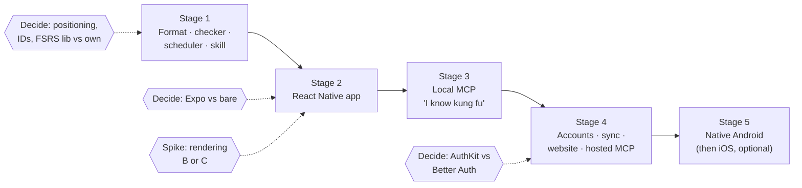

# 09 · Roadmap

Status: done · Updated: 2026-10-22

## Summary

Five stages, each finished and demoable before the next starts: (1) the card format, checker, and scheduler as plain TypeScript packages; (2) the React Native app; (3) a local MCP server, the "I know kung fu" demo; (4) accounts, sync, the website, and the hosted MCP server; (5) a native Android app, then optionally iOS. Each stage opens with a spike that retires its largest risk. Seven decisions are open. Three of them (positioning, IDs, Expo or bare) block early milestones and should be made first.

## Problem

Docs 01–08 say what Uplink is. They do not say in what order to build it, what each step proves, or which decisions block which work. Without that order, the likely failure is a half-built v2 backend behind an app that cannot yet review a card. This doc puts the stages in order, defines the demo that ends each one, lists the risks, and collects every open decision with the milestone it blocks.

## Goals

- An ordered set of stages and milestones, each sized in sessions of about an hour.
- For every stage, a concrete demo that proves it is done.
- The risks that could sink a stage, with the spike or fallback that handles each.
- One table of open decisions, each with a recommendation and a "needed by" milestone.

## Non-goals

- Dates. Pace depends on how many sessions a week go to Uplink, so milestones are sized in sessions, not placed on a calendar.
- Re-arguing decisions the earlier docs made. This doc links to them.
- Publishing to app stores, launching a hosted service, or listing in an assistant's directory. Those are a person's decisions, taken when a stage is done, and are not milestones here.

## Terms

The earlier docs use "v1" and "v2". They map onto stages like this:

| Term in docs 01–08 | Stages | What it means |
|---|---|---|
| **v1** | 1 and 2 | Single user, offline, no Uplink server. Decks come from GitHub, files, paste. |
| **stage 3** | 3 | Local MCP server over stdio, writing into a deck folder. Still no Uplink server. |
| **v2** | 4 and 5 | Accounts, sync, website, hosted MCP; then native apps. |

## Principles

1. **Each stage is demoable before the next starts.** A stage is done when its demo runs end to end on real hardware, not when its task list is empty. Unfinished extras move to "Later".
2. **Spike first.** Every stage opens with the cheapest experiment that could prove the stage's plan wrong (rendering in stage 2, the SDK in stage 3, auth in stage 4).
3. **Packages before apps.** `packages/format`, `packages/scheduler`, and `packages/card-render` are plain TypeScript with tests in Node. The app, the CLI, the website, and the MCP server are thin shells over them (docs 05, 06, 08).
4. **Keep reversible things reversible.** The append-only review log (doc 02) and stable card IDs (doc 05) are in from the first commit, because they are what make later changes (FSRS-7, sync, a native rewrite) cheap.
5. **Directed AI, reviewed by a person.** Code is written in sessions where a person directs an AI coding agent and reviews its output. Each milestone ends with a short build note: what was asked, what the AI got wrong or merely plausible, how it was caught. Stage 5's migration log is the same habit at larger scale.

## The stages

Session counts are estimates for AI-assisted sessions of about an hour, including review and tests. Re-estimate after stage 1 using its actual counts.

### Stage 1 · Format, checker, scheduler (docs 01, 02, 03, 05, 07)

Goal: a deck of cards in a git repo that a machine can validate and schedule, and that an agent can write correctly.

| # | Milestone | Done when | Sessions |
|---|---|---|---|
| 1.0 | Monorepo scaffold | `packages/` and `apps/` layout from doc 06, TypeScript strict, test runner, CI running tests and lint on `agent` | 1 |
| 1.1 | `packages/format` parser | Doc 05 grammar: frontmatter, side separator, multi-card files, cloze, item keys; JSON Schema published; fixture tests including every doc 05 example | 3 |
| 1.2 | `uplink check` | Schema and grammar errors as `file:line`, rule, fix; duplicate IDs; `--fix` assigns ULIDs; Mermaid syntax check | 2 |
| 1.3 | Code checks | `run`, `output`, `expect-error`, `cloze` fences for Java, Python, TypeScript (doc 05 table); lint as warnings | 2 |
| 1.4 | `packages/scheduler` | Doc 02's `Scheduler` interface over `ts-fsrs` 5.x; review events with ULIDs and undo as a tombstone (doc 08); golden vectors from `py-fsrs`; replay test | 2 |
| 1.5 | Card guide and Agent Skill | `CARD-GUIDE.md` (doc 03's card types and lenses), the practice-to-cards prompt (doc 04), and a `SKILL.md` folder (doc 07) | 1 |
| 1.6 | Seed decks | A small demo deck per doc 03's first use: DSA patterns, Java, Python, TypeScript, one system-design deck, one Spanish deck; all pass `uplink check` | 1 |

**Demo (five minutes, laptop).** An agent with the skill turns a page of practice notes into five cards. `uplink check` catches one wrong `output` block. The agent fixes it and the check passes. A script replays a review history through the scheduler and prints the next intervals.

### Stage 2 · React Native app (docs 02, 03, 06)

Goal: a learner reviews due cards on a phone, offline, with code and diagrams that look right, and gets new cards from their agent within a minute.

| # | Milestone | Done when | Sessions |
|---|---|---|---|
| 2.0 | Rendering spike | Doc 06's spike run on a mid-range Android phone and an iPhone; numbers written up; option B or C chosen | 1–2 |
| 2.1 | App shell and storage | Expo or bare (decision D5); SQLite schema from doc 06; `ts-fsrs` golden vectors pass under Hermes on a device | 2 |
| 2.2 | Import: paste and files | Parse with `packages/format`, show errors per file, write cards and items | 2 |
| 2.3 | Review screen | Reveal, key-point checklist, Again/Good with interval labels, four buttons as a setting, undo, mixed queue, 04:00 rollover | 4 |
| 2.4 | `packages/card-render` | Shiki highlighting for Java, Python, TypeScript; cloze gaps; Mermaid (four types, cached SVG); light and dark; bundled offline | 3 |
| 2.5 | GitHub import and inbox | Tree plus changed-blob sync (doc 06); to-review inbox grouped by `source`; keep, delete, open on GitHub | 3 |
| 2.6 | Demo polish | "Why is this due?" sheet; seeded deck with weeks of history; basic stats; deck settings | 2 |
| 2.7 | End-to-end tests | Doc 06's three flows in a mobile UI test runner | 1 |

**Demo (five minutes, phone).** Open the app offline; review six mixed cards (Java `predict`, Python `bug`, a Mermaid `explain`, a Spanish cloze) with interval labels visible; open "why is this due?". Then, on a laptop, an agent commits cards from a practice session; pull on the phone; five cards wait in the inbox, grouped under that session; keep four, delete one.

### Stage 3 · Local MCP server (doc 07)

Goal: "I know kung fu". A learner names what they want to learn, their agent writes the cards through Uplink's tools, and the cards are on the phone a minute later.

| # | Milestone | Done when | Sessions |
|---|---|---|---|
| 3.0 | SDK spike | A one-tool server on the MCP TypeScript SDK that targets 2026-07-28 (v2 if stable, otherwise beta behind a wrapper), working in MCP Inspector and Claude Code | 1 |
| 3.1 | `packages/mcp-tools` | `DeckStore` interface; `uplink_guide`, `list_decks`, `search_cards`, `check_cards`, `propose_cards`, `revise_proposed`; contract tests | 3 |
| 3.2 | `@uplink/mcp` stdio server | `FileDeckStore`, deck path from configuration, all-or-nothing idempotent `propose_cards`, structured errors | 1 |
| 3.3 | `cards_from_notes` prompt | Doc 04's flow as an MCP prompt; tested on three real practice notes | 1 |

**Demo (five minutes).** In Claude Code: "I want to understand Python generators; I keep confusing them with iterators." The agent calls the guide, searches the deck for duplicates, proposes eight cards of mixed types, and gets one error back ("blank line before `---`"). It fixes the card in one retry and commits. On the phone: pull, and the eight cards are in the inbox.

**Exit check.** Doc 07 asks whether local MCP earns its place beside the skill. Answer it here with evidence: retry counts, share of cards kept, and whether the skill alone produced the same result.

### Stage 4 · Accounts, sync, website, hosted MCP (docs 07, 08)

Goal: progress follows the learner across devices, and a chat assistant on the web or phone can put cards in their inbox.

| # | Milestone | Done when | Sessions |
|---|---|---|---|
| 4.0 | Auth spike | Decision D7 made; a test MCP client completes OAuth (PRM, PKCE, resource indicator, CIMD) against the chosen provider | 2 |
| 4.1 | Service, schema, API skeleton | TypeScript service, Postgres schema from doc 08, `/v1` with OpenAPI from Zod, generated client, row-level security | 4 |
| 4.2 | Sync | `POST /v1/sync`; union of review events, tombstone undo, HLC last-writer-wins; v1 data migrates with cursor 0; multi-device convergence property test | 4 |
| 4.3 | App sign-in and sync | System-browser PKCE sign-in; background sync; "no account" mode still works | 2 |
| 4.4 | Website core | Deck list, deck page, card editor with live validation, import, export, delete, all on `packages/card-render` | 5 |
| 4.5 | Hosted MCP | `/mcp` with `ServiceDeckStore`, scopes, rate limits, connected-clients page | 3 |
| 4.6 | GitHub mirror | GitHub App, webhook, import worker | 2 |
| 4.7 | Publish, follow, fork | Public deck pages, server-rendered and cacheable | 3 |

**Demo (five minutes).** On the phone, in the Claude app, using a connector added on the web: debrief a mock interview by voice and say "propose cards for the two things I got wrong". The cards appear in the Uplink app's inbox. Keep them, review one, open the website on a laptop, and show the same review in the history.

Hosting this stage publicly is a decision for a person when the stage is ready. It brings real costs: a domain, a database, an auth provider account, and responsibility for other people's data.

### Stage 5 · Native Android, then optional iOS

Goal: the same product as a Kotlin app, with a migration log that records every decision, trade-off, and place where AI tooling helped or hurt.

| # | Milestone | Done when | Sessions |
|---|---|---|---|
| 5.0 | Migration plan | Its own doc: rewrite in one go vs screen by screen inside the React Native app (brownfield), and what is reused | 1 |
| 5.1 | Kotlin scheduler | FSRS-6 core ported (doc 01's forty lines plus learning steps and fuzz) and passing the same golden vectors as `packages/scheduler` | 2 |
| 5.2 | Kotlin format parser | Passes the same fixture suite as `packages/format` | 3 |
| 5.3 | Storage | Room over the same SQLite schema; a v1 database opens unchanged | 2 |
| 5.4 | Review screen in Compose | Native UI, with card bodies in a WebView running `packages/card-render` (doc 06 option B pays off here) | 4 |
| 5.5 | Import and inbox | Paste, files, GitHub, account sync | 4 |

**Demo.** The React Native and Kotlin apps side by side on two Android phones, signed in to the same account: grade a card on one, sync, see the same next interval on the other. Then walk through three entries from the migration log.

Notes found while planning this stage:

- **No permissive Kotlin FSRS library was found.** The open-spaced-repetition list includes a Kotlin FSRS-6 scheduler and an older FSRS-4 Android one. A Kotlin Multiplatform FSRS-6 library on Maven Central is GPL-3.0, which would force GPL terms on an app that links it. Porting the FSRS-6 core and testing it against golden vectors is a known two-session task (doc 02 sized the same work for TypeScript). Check the licence of each listed port before adopting one.
- **Card rendering is the hardest part of a native rewrite**, as it was in React Native. Compose has markdown renderers and highlight.js-based code highlighting, but Mermaid needs a web view on any platform. Reusing `packages/card-render` in a WebView keeps cards identical across apps. A fully native renderer is a later, optional step.
- Google's guidance for moving to Compose is incremental: new screens in Compose, shared components extracted, one screen replaced at a time. Whether that applies to a React Native host (native screens inside the RN app) or argues for a clean rewrite is 5.0's question.

iOS (SwiftUI) follows the same pattern only if Android has shown the migration story is worth telling twice. There is an open-spaced-repetition Swift port at FSRS-5; check it before porting.

## Totals

| Stage | Sessions (estimate) | Demo |
|---|---|---|
| 1 | ~12 | Agent writes cards; checker catches a wrong output |
| 2 | ~19 | Offline review with code and diagrams; agent's cards reach the inbox |
| 3 | ~6 | "I know kung fu" through local MCP |
| 4 | ~25 | Claude on the phone proposes cards; progress on two devices |
| 5 | ~16 | RN and Kotlin apps agree on one account |

Stages 1–3 are about 37 sessions and need no server, no accounts, and no money. That is the core of the product and the most valuable demo. Stage 4 is the biggest, and it is the first stage that is optional in a strict sense: if stages 1–3 are enough, stopping there is a legitimate outcome.

## Risks

| Risk | Stage | Likelihood | Impact | Mitigation |
|---|---|---|---|---|
| Web-view card rendering is too slow or janky on mid-range Android | 2 | Medium | High | Spike 2.0 before the review screen; fallback is option C (doc 06) |
| `ts-fsrs` misbehaves under Hermes | 2 | Low | Medium | Golden vectors on device in 2.1; fallback is an own FSRS-6 core against the same vectors (doc 02) |
| Agent-written cards are plausible but wrong, and learners memorise errors | 1–3 | High | High | Checker runs code; traceability to a named mistake; to-review inbox; "this card is wrong" measured (doc 04) |
| Agent-written cards stay on the surface (term ↔ definition) | 1–3 | High | Medium | Card guide with types and lenses; cards from the learner's own mistakes (doc 03); measure deletion rate per type |
| MCP spec, SDK, or host support moves (SDK v2 in beta; ChatGPT availability unclear) | 3–4 | High | Medium | Thin wrapper over the SDK; local first; paste stays a supported path (doc 07) |
| Stage 4 scope swallows the project | 4 | High | High | Stages 1–3 are complete without it; 4.0–4.3 (sync) deliver value before the website |
| Owning an OAuth server or user data badly | 4 | Medium | High | Hosted auth recommended (doc 08); no public launch without a person's decision; export and delete from day one |
| Expo SDK or React Native upgrades break native modules | 2, 5 | Medium | Low | Few native dependencies; Expo modules; pin SDK per stage |
| FSRS-7 changes the `ts-fsrs` API | Any | High | Low | Own `Scheduler` interface; review log lets `replay` recompute (doc 02) |
| Licence surprises (Kotlin FSRS ports, the optimiser binding) | 4–5 | Medium | Medium | Check licences at adoption; own ports where needed |

## Open decisions

Every "decision needed" in docs 01–08, in the order they block work. Recommendations are the docs' own.

| # | Decision | Doc | Options | Recommendation | Needed by |
|---|---|---|---|---|---|
| D1 | Positioning | 03 | A: general tool, technical first · B: interview-prep tool | A | 1.5 (guide) and 1.6 (seed decks) |
| D2 | Card ID scheme | 05 | ULID · shorter random ID | ULID | 1.1 |
| D3 | Scheduler implementation | 02 | `ts-fsrs` library · own FSRS-6 core tested against it | Library | 1.4 |
| D4 | Default grade buttons | 03 | Two (Again/Good) · four | Two, four as a setting | 1.4 (confirm) |
| D5 | Expo or bare React Native | 06 | Expo with CNG · bare | Expo, a lean rather than a firm call (see [doc 00](00-start-here.md#decisions-to-make)) | 2.1 |
| D6 | Card rendering | 06 | B (one web view) · C (native, web view for diagrams) | B, decided by the spike's numbers | 2.0 |
| D7 | Auth provider | 08 | WorkOS AuthKit · Better Auth | AuthKit | 4.0 |

Two more choices are not in the table because they are not engineering decisions: whether to publish the app to stores, and whether to run the hosted service in public. Both belong to a person, at the end of the relevant stage.

## Requirements

**Must**
- Stages built in order; each ends with its demo recorded (a screen recording is enough) before the next starts.
- Each stage opens with its spike, written up in the repo.
- D1–D3 made before stage 1 code; D5 before stage 2; D7 before stage 4.
- A build note per milestone (what was asked of the AI, what it got wrong, how it was caught).

**Should**
- Re-estimate sessions at the end of each stage from actuals.
- Keep this doc's decision table current as decisions are made.

**Later**
- A roadmap for the "Later" items across docs 02–08: deadline mode, audio, parameter fitting, LLM grading, sandboxed execution, Anki import and export.

## Open questions

- Should the Agent Skill (1.5) ship before the app, as the first thing others can use? It needs only the checker. Proposal: yes; it is a small, real deliverable at the end of stage 1.
- Is stage 4 worth building before stage 5, or would a native Android client of the v1 app tell the migration story sooner? The stage order puts the backend first because sync is what makes two apps on one account a convincing demo. If the migration story matters more than sync, swap them, and stage 5's demo becomes "one deck, the same intervals, two apps".

## Sources

- Docs 01–08 in this folder: every decision, requirement, and open question collected here.
- open-spaced-repetition, awesome-fsrs (implementations by language and FSRS version). https://github.com/open-spaced-repetition/awesome-fsrs
- Maven Central, `one.felsen.fsrskt:fsrskt` 1.0.1 (Kotlin Multiplatform FSRS-6, GPL-3.0). https://central.sonatype.com/artifact/one.felsen.fsrskt/fsrskt
- Android Developers, "Migrating to Jetpack Compose" codelab (incremental, screen-by-screen migration). https://developer.android.com/codelabs/jetpack-compose-migration
- compose-markdown (TextView-based markdown in Compose) and compose-highlight (highlight.js-based code highlighting for Compose). https://github.com/jeziellago/compose-markdown ; https://central.sonatype.com/artifact/dev.hossain/compose-highlight
