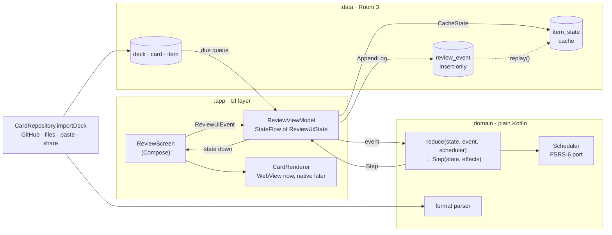

# 10 · Android architecture: Compose, unidirectional data flow, and the pattern family

Status: draft · Updated: 2026-10-26

## Summary

Stage 5's Kotlin app should be unidirectional data flow: one immutable `ReviewUiState`, a sealed `ReviewUiEvent`, and a pure `reduce` in a plain-Kotlin domain module beside the FSRS-6 port and the format parser; a `ViewModel` runs the loop and appends to the review log.
Storage is Room 3 over doc 06's schema, dependency injection is a hand-written container, navigation is Navigation 3, and the card body stays in a `WebView` behind a `CardRenderer` interface.
Versions were checked on 2026-10-26. Appendix A's reducer compiles and runs; appendix B's Compose snippets are illustrative and were not compiled.

## Problem

Doc 09 puts a native Android app at stage 5 with a migration plan (5.0) but no architecture, and a Compose app can be organised half a dozen ways. The earlier docs fix the constraints: a pure scheduler (doc 02), an append-only log with undo as a tombstone (docs 02, 06), review state never in card files (doc 05), and a web-view renderer if the spike passes (doc 06). This doc derives the architecture from those constraints and from what Compose requires.

## Goals and non-goals

- **Goals:** the Compose facts that constrain architecture; unidirectional data flow (UDF) as Android documents it; the pattern family with current versions; what each piece of Uplink maps onto; one recommendation.
- **Not here:** the migration order (5.0), the rendering spike (2.0), screens (doc 06), sync (doc 08), iOS.

## Compose facts that shape architecture

**Declarative UI.** A composable is a function from state to UI: "In Compose the UI is immutable—there's no way to update it after it's been drawn. What you can control is the state of your UI." So architecture is about where state lives and who may change it.

**Recomposition and skipping.** Compose re-runs the composables that read a changed `State` and skips one "if all the inputs are stable and haven't changed". A `data class` of `val` fields of stable types is stable; `var` fields, `List`, `Map`, and classes from modules without the Compose compiler are not. Strong skipping, the default since Kotlin 2.0.20, skips unstable parameters on instance equality and memoises lambdas. UI state is therefore an immutable data class, and a new instance means a real change.

**Hoisting and state holders.** "The state goes down, and events go up." Hoist state to the lowest common ancestor of its readers and writers: screen state in a `ViewModel`, which survives activity recreation; element state in the composable or a plain class with the UI's lifetime. Never pass a `ViewModel` into a plain state holder.

**`remember` vs `rememberSaveable`.** `remember` survives recomposition; `rememberSaveable` also survives activity and process recreation through saved instance state. What must outlive a rotation goes there or in the `ViewModel`; what must outlive the process goes in SQLite, which for a session is the log itself.

**Side effects.** `LaunchedEffect` runs a coroutine while the composable is in the composition and restarts it when its keys change: a snackbar from state, or leaving the screen when `finished` turns true. `DisposableEffect` is for cleanup, `snapshotFlow` turns `State` into a cold `Flow`, and `SideEffect` pushes Compose state into objects Compose does not manage.

**`AndroidView` interop.** `factory` creates the `View`; `update` runs on inflation and whenever state it reads changes; a lazy-list overload adds `onReset` and `onRelease`. There is no Compose `WebView`, so doc 06's option B is an `AndroidView`, with the documented constraints: destroy it when it leaves the composition or it leaks, save its history in a `Bundle`, and never nest it in a `LazyColumn`. One `WebView` per review screen, created in `factory`, fed by `update`.

## Unidirectional data flow, as Android documents it

Android names two mandatory layers and one optional one. The **UI layer** is composables plus state holders. The **data layer** is repositories over data sources: it owns business logic, exposes immutable data and `Flow`s, is main-safe, and offline-first "a local data source—such as a database—is the recommended source of truth". The **domain layer** holds use cases and "is optional because not all apps have these requirements. Use it only when needed".

UDF is "the pattern where the state flows down and the events flow up": the `ViewModel` holds and exposes state, the UI sends events, the `ViewModel` updates the state, the UI renders it. UI state is an immutable `data class` named *functionality* + `UiState`, one per screen, exposed as a `StateFlow` and collected with `collectAsStateWithLifecycle()`.

On one-shot effects the guidance is firm: "ViewModel events should always result in a UI state update." Channels and other event streams from a `ViewModel` "don't guarantee the delivery and processing of those events" when the producer outlives the consumer. So a message is a field, `userMessage: String?`, shown by the UI in `LaunchedEffect(userMessage)`, which then tells the `ViewModel` it was shown; navigation driven by business state is likewise state the UI observes.

## The pattern family

| Pattern | How it works | Fit for Uplink's Android app |
|---|---|---|
| **MVVM as Android practises it** (Now in Android) | A `ViewModel` per screen combines repository `Flow`s with `stateIn` into a `UiState`, "a sealed hierarchy using interfaces and immutable data classes"; actions are method calls | The default; transitions spread over methods. Fine for the deck and inbox screens, loose for a state machine |
| **MVI** | One immutable model, sealed intents, a reducer. Staltz (2015): functions between event streams; Dorfmann (2017): state split across business logic, presenter, and view is what lets a screen contradict itself | Natural for the review session; effects come back from the reducer as data. No library needed |
| **Redux-style store** | One store for the app; "the only way to change the state is to emit an action"; pure reducers | More than four screens need; one store per screen is MVI |
| **Clean Architecture** | Entities, use cases, adapters, frameworks; "source code dependencies can only point inwards" | Keep the rule, not the rings: a domain module with no Android imports |
| **Presenter as composable** | Circuit 0.39.0 (2026-09-15, pre-1.0): a `Presenter` composable returns state, a `Ui` composable takes it; they "can only communicate through state and event emissions". Molecule 2.2.0 (2025-09-24): `launchMolecule` turns a composable into a `StateFlow` | The reducer idea with better async ergonomics, at the price of a framework. Over-tooling for one real screen; Molecule is the upgrade path |

**Storage.** Room 3.0.3 (2026-09-09) is a Kotlin Multiplatform rewrite in the `androidx.room3` package: Kotlin-only, KSP-only, `suspend` DAOs and `Flow`, a `SQLiteDriver`; Room 2.x (2.8.5) "enters maintenance mode" per the March 2026 announcement. SQLDelight 2.4.1 (2026-10-06) is SQL-first: `.sq` files generate typesafe Kotlin, it "verifies your schema, statements, and migrations at compile-time", and `asFlow` notifies of change; also multiplatform. The difference for stage 5 is schema ownership: Room derives the schema from entities and validates the database on open (doc 09, 5.3; unverified for Room 3); SQLDelight takes doc 06's schema as written.

**Dependency injection.** Hilt (Dagger 2.60.1, 2026-07-06) is Android's recommended library: compile-time graphs, `@HiltViewModel`, Android only. Koin 4.2.2 (2026-06-15) resolves at runtime and is multiplatform. Metro 1.5.0 (2026-10-26) is a multiplatform compiler-plugin framework in the Dagger, Anvil, and kotlin-inject line. Manual DI is a container in `Application` with factories; Android warns the boilerplate "can be error-prone" as an app grows and recommends Hilt "when possible".

**Navigation.** Navigation 3 1.2.0 is stable (2026-09-23): the back stack is a list of serialisable keys you own, `NavDisplay` renders it, and the runtime is multiplatform. Navigation 2 (2.10.2) "is in maintenance mode and will only receive critical fixes".

**Platform.** Compose BOM 2026.09.00 (Compose 1.12.1, Material 3 1.4.0); Kotlin 2.4.21 (2026-10-08), which ships the Compose compiler; Lifecycle 2.11.0 (2026-06-17), with `ViewModel`-Compose on every multiplatform target; Compose Multiplatform 1.12.2 (2026-10-15), stable on Android, iOS, and desktop, beta on Wasm.

## What this means for Uplink

**The review session is a state machine.** Due items are filtered and shuffled once a day (doc 06); then front, reveal, grade with two buttons by default (D4), next card, and undo of the last grade as a tombstone. Four events cover it (`Reveal`, `Answer`, `UndoLast`, `MessageShown`), a reducer states the machine in forty lines (appendix A), and a JVM test walks every path without Android.

**The scheduler is pure, so it is domain code.** `packages/scheduler` is `review(state, grade, now)` with no clock or randomness, returning state only; the app makes the log event. The Kotlin port (5.1) keeps that shape behind a `Scheduler` interface, passes the same py-fsrs golden vectors as JVM tests, and is a parameter of `reduce`.

**The review log is an event store.** State on the device only (doc 05), `review_event` insert-only with `undoes` (doc 06), and `replay(log)` rebuilding `item_state`: that is Fowler's event sourcing, "capture all changes to an application state as a sequence of events", with `item_state` as the cache. The reducer's effects are exactly those two writes, `AppendLog` and `CacheState`.

**Import is data-layer work.** Doc 06's four paths are data sources behind one `CardRepository`; the parser is the Kotlin port of `packages/format` (5.2), pure Kotlin, on the same fixtures. The UI never sees markdown.

**The renderer sits behind an interface.** `CardRenderer` has one composable, `Card(view, face, modifier)`; the first implementation wraps a `WebView` running the bundled `packages/card-render`, and a native one can replace it without touching the session.

**Multiplatform.** The domain module has no Android imports from the first commit, which costs nothing and is what an iOS or web build would share. Room 3, SQLDelight, `ViewModel`-Compose, and Navigation 3's runtime are multiplatform; Hilt is not.

## Recommendation

**MVI-flavoured UDF without a framework.** One `ReviewUiState`, a sealed `ReviewUiEvent`, and a pure `reduce(state, event, scheduler)` that returns the next state plus a list of effects, all in the domain module; a `ReviewViewModel` owns a `MutableStateFlow`, calls `reduce`, runs the effects through `ReviewLogRepository`, and exposes `StateFlow<ReviewUiState>`. Why: the session is a state machine and the scheduler is pure, so a reducer is the shortest honest description, tested on the JVM in milliseconds. The deck, inbox, and detail screens are plain MVVM.

**Layering: three Gradle modules.** `:domain` (plain Kotlin: types, the FSRS-6 port, the parser, the reducer), `:data` (repository interfaces and their Room implementations, the GitHub client, the importers), `:app` (Compose screens, `ViewModel`s, navigation, the renderer, the container). Why: Android's two mandatory layers plus the one domain rule that pays for itself; no use-case classes until two screens share logic.

**Storage: Room 3** (`androidx.room3`, `BundledSQLiteDriver`), entities written to doc 06's columns. Why: first-party, `Flow`-native, multiplatform-ready, and invalidation drives Home's due counts for free. If 5.3 cannot open the React Native app's database unchanged, switch to SQLDelight.

**Dependency injection: manual.** An `AppContainer` built in `Application` and a `ViewModelProvider.Factory`. Why: six objects, one scope, no annotation processing; Hilt or Metro once the graph passes about ten bindings or needs a second scope.

**Navigation: Navigation 3** with `rememberNavBackStack` and serialisable keys. Why: the back stack is state we own, and Navigation 2 is in maintenance mode.



## Open questions

- **Storage, 5.3.** Whether Room 3 validates an existing database's schema on open is unverified. Proposal: 5.3 opens with a thirty-minute test against a database the React Native app wrote; if it fails, SQLDelight takes doc 06's schema verbatim. **Decision needed at 5.3.**
- **Renderer, D6 and 5.4.** If spike 2.0 picks option C (native text, web view for diagrams), `CardRenderer` still holds, but 5.4 would need a native markdown renderer sooner. Proposal: 5.4 ships the `WebView` renderer regardless, so both apps render cards identically for the stage 5 demo.
- **Domain module as Kotlin Multiplatform, 5.1 and 5.2.** JVM-only costs nothing; a multiplatform module adds the plugin and build time before a second platform exists. Proposal: JVM-only, converted when iOS starts (doc 09's "iOS optional").
- **The same reducer in the React Native app, 2.3.** Both apps could share the state, events, and reducer shape, and session transcripts as test vectors. It adds a small `packages/session` to doc 06's layout: a roadmap change proposed here, not made.
- **Stage order, doc 09 § Open questions.** Nothing in this architecture needs sync, so stage 5 could follow stage 3 directly; 5.5's "account sync" row would wait for stage 4.
- **Hilt at 5.5?** Manual DI is right for six objects. If the migration log should record a Hilt setup, 5.5 (import, background sync) is where the graph first grows.

## Sources

Checked 2026-10-26 unless noted. GitHub release pages show day and month only; years were inferred from the surrounding releases.

Android guidance:
- Guide to app architecture (layers, UDF, single source of truth). https://developer.android.com/topic/architecture
- UI layer (UI state, immutability, `StateFlow`, naming). https://developer.android.com/topic/architecture/ui-layer
- UI events (ViewModel events as state; channels and delivery). https://developer.android.com/topic/architecture/ui-layer/events
- State holders and UI state (ViewModel vs plain class). https://developer.android.com/topic/architecture/ui-layer/stateholders
- Domain layer (optional; use cases). https://developer.android.com/topic/architecture/domain-layer
- Data layer (repositories, flows, main-safety, local source of truth). https://developer.android.com/topic/architecture/data-layer
- Compose: State; Where to hoist state; Side-effects; Lifecycle; Stability; Strong skipping mode; Compose UI architecture. https://developer.android.com/develop/ui/compose/state ; https://developer.android.com/develop/ui/compose/state-hoisting ; https://developer.android.com/develop/ui/compose/side-effects ; https://developer.android.com/develop/ui/compose/lifecycle ; https://developer.android.com/develop/ui/compose/performance/stability ; https://developer.android.com/develop/ui/compose/performance/stability/strongskipping ; https://developer.android.com/develop/ui/compose/architecture
- Using Views in Compose (`AndroidView`, `onReset`/`onRelease`) and Wrap a WebView in Compose. https://developer.android.com/develop/ui/compose/migrate/interoperability-apis/views-in-compose ; https://developer.android.com/develop/ui/compose/migrate/interoperability-apis/wrap-webview-in-compose
- Navigation 3 guide. https://developer.android.com/guide/navigation/navigation-3
- Hilt; Manual dependency injection. https://developer.android.com/training/dependency-injection/hilt-android ; https://developer.android.com/training/dependency-injection/manual
- Now in Android, Architecture Learning Journey. https://github.com/android/nowinandroid/blob/main/docs/ArchitectureLearningJourney.md
- Vivo, "ViewModel: One-off event antipatterns" (2022), cited through the UI events page; not re-read today (Medium returned 403). https://medium.com/androiddevelopers/viewmodel-one-off-event-antipatterns-16a1da869b95

Versions:
- Compose releases and BOM mapping (BOM 2026.09.00 → 1.12.1 / Material 3 1.4.0; 1.13.0-beta02 on 2026-10-21). https://developer.android.com/jetpack/androidx/releases/compose ; https://developer.android.com/develop/ui/compose/bom/bom-mapping
- Kotlin releases (2.4.21, 2026-10-08). https://kotlinlang.org/docs/releases.html
- Lifecycle releases (2.11.0, 2026-06-17; 2.12.0-alpha05). https://developer.android.com/jetpack/androidx/releases/lifecycle
- Navigation 3 releases (1.2.0, 2026-09-23; 1.3.0-alpha03) and Navigation releases (2.10.2; maintenance mode). https://developer.android.com/jetpack/androidx/releases/navigation3 ; https://developer.android.com/jetpack/androidx/releases/navigation
- Room 3 releases (3.0.3; 3.1.0-alpha03), Room releases (2.8.5), Room on KMP, and "Room 3.0: modernizing Room" (2026-03-13). https://developer.android.com/jetpack/androidx/releases/room3 ; https://developer.android.com/jetpack/androidx/releases/room ; https://developer.android.com/kotlin/multiplatform/room ; https://android-developers.googleblog.com/2026/03/room-30-modernizing-room.html
- SQLDelight releases (2.4.1, 2026-10-06) and docs. https://github.com/sqldelight/sqldelight/releases ; https://sqldelight.github.io/sqldelight/latest/
- Circuit releases (0.39.0) and docs. https://github.com/slackhq/circuit/releases ; https://slackhq.github.io/circuit/
- Molecule releases (2.2.0) and README. https://github.com/cashapp/molecule/releases ; https://github.com/cashapp/molecule
- Dagger and Hilt releases (2.60.1). https://github.com/google/dagger/releases
- Koin releases (4.2.2) and Compose docs. https://github.com/InsertKoinIO/koin/releases ; https://insert-koin.io/docs/reference/koin-compose/compose
- Metro releases (1.5.0) and docs. https://github.com/ZacSweers/metro/releases ; https://zacsweers.github.io/metro/latest/
- Compose Multiplatform releases (1.12.2) and Kotlin Multiplatform supported platforms (stability tiers). https://github.com/JetBrains/compose-multiplatform/releases ; https://kotlinlang.org/docs/multiplatform/supported-platforms.html

Patterns:
- Staltz, "Unidirectional User Interface Architectures" (2015). https://staltz.com/unidirectional-user-interface-architectures.html
- Dorfmann, "Reactive Apps with Model-View-Intent, Part 1: Model" (2017). http://hannesdorfmann.com/android/mosby3-mvi-1/
- Redux, Three Principles. https://redux.js.org/understanding/thinking-in-redux/three-principles
- Martin, "The Clean Architecture" (2012). https://blog.cleancoder.com/uncle-bob/2012/08/13/the-clean-architecture.html
- Fowler, "Event Sourcing" (2005). https://martinfowler.com/eaaDev/EventSourcing.html
- Docs 02, 05, 06, and 09 in this folder; `packages/scheduler/README.md`.

Not checked: Orbit and Mavericks (Android MVI libraries) and `kotlin-inject`.

## Appendix A · The reducer (compiled)

Plain Kotlin, no Android, Compose, or coroutine imports. Compiled with Kotlin 2.2.0 on JDK 17 and run on 2026-10-26; every `check` passes. In the app, `main` becomes a unit test and the stub becomes the FSRS-6 port.

```kotlin
// Uplink review session: state, UI events, and a pure reducer.
// Plain Kotlin only (no Android, Compose, or coroutine imports): this is the
// domain layer. The ViewModel owns the loop around it (plan 10).

package uplink.domain.review

// ---- Scheduler port: the Kotlin port of packages/scheduler sits behind this ----

enum class Grade(val value: Int) { AGAIN(1), HARD(2), GOOD(3), EASY(4) }

/** Scheduling state of one item. A new, unseen item has no state: null. */
data class ItemState(
    val stabilityDays: Double,
    val difficulty: Double,
    val dueEpochMs: Long,
    val lastReviewEpochMs: Long,
    val reps: Int,
    val lapses: Int,
)

/** A pure function of (state, grade, time). FSRS-6 implements it; a stub does in tests. */
fun interface Scheduler {
    fun review(state: ItemState?, grade: Grade, nowEpochMs: Long): ItemState
}

// ---- The append-only review log (plan 02). Undo is a tombstone, never a delete ----

data class ReviewEvent(
    val id: String,              // ULID made by the ViewModel, not here
    val itemKey: String,         // id, id#r, or id#cN (plan 05)
    val reviewedAtEpochMs: Long,
    val grade: Grade?,           // null on an undo
    val undoes: String? = null,  // the id of the cancelled event; replay skips both
)

// ---- Screen state: one immutable value, the whole truth about the screen ----

data class CardView(val itemKey: String, val frontMd: String, val backMd: String)

enum class Face { FRONT, BACK }

data class LastAnswer(val eventId: String, val itemKey: String, val previous: ItemState?, val position: Int)

data class ReviewUiState(
    val queue: List<CardView>,                        // due items, shuffled once per day (plan 06)
    val position: Int = 0,
    val face: Face = Face.FRONT,
    val states: Map<String, ItemState?> = emptyMap(), // item key -> scheduler state; null = new
    val lastAnswer: LastAnswer? = null,               // what Undo cancels; null = nothing to undo
    val userMessage: String? = null,                  // a transient message, modelled as state
) {
    val current: CardView? get() = queue.getOrNull(position)
    val finished: Boolean get() = position >= queue.size
}

// ---- UI events (events up) and effects (what the ViewModel must do after a step) ----

sealed interface ReviewUiEvent {
    data object Reveal : ReviewUiEvent
    data class Answer(val grade: Grade, val nowEpochMs: Long, val eventId: String) : ReviewUiEvent
    data class UndoLast(val nowEpochMs: Long, val eventId: String) : ReviewUiEvent
    data object MessageShown : ReviewUiEvent
}

sealed interface ReviewEffect {
    data class AppendLog(val event: ReviewEvent) : ReviewEffect
    data class CacheState(val itemKey: String, val state: ItemState?) : ReviewEffect
}

data class Step(val state: ReviewUiState, val effects: List<ReviewEffect> = emptyList())

/** Pure: same inputs, same Step. Time and ids arrive inside the event. */
fun reduce(s: ReviewUiState, e: ReviewUiEvent, scheduler: Scheduler): Step = when (e) {
    ReviewUiEvent.Reveal ->
        if (s.current == null || s.face == Face.BACK) Step(s) else Step(s.copy(face = Face.BACK))

    is ReviewUiEvent.Answer -> {
        val card = s.current
        if (card == null || s.face != Face.BACK) Step(s) // grade buttons only exist on the back
        else {
            val previous = s.states[card.itemKey]
            val next = scheduler.review(previous, e.grade, e.nowEpochMs)
            val logged = ReviewEvent(e.eventId, card.itemKey, e.nowEpochMs, e.grade)
            Step(
                s.copy(
                    position = s.position + 1,
                    face = Face.FRONT,
                    states = s.states + (card.itemKey to next),
                    lastAnswer = LastAnswer(e.eventId, card.itemKey, previous, s.position),
                ),
                listOf(ReviewEffect.AppendLog(logged), ReviewEffect.CacheState(card.itemKey, next)),
            )
        }
    }

    is ReviewUiEvent.UndoLast -> {
        val last = s.lastAnswer
        if (last == null) Step(s.copy(userMessage = "Nothing to undo"))
        else {
            val tombstone = ReviewEvent(e.eventId, last.itemKey, e.nowEpochMs, grade = null, undoes = last.eventId)
            Step(
                s.copy(
                    position = last.position,
                    face = Face.BACK,
                    states = s.states + (last.itemKey to last.previous),
                    lastAnswer = null, // one level of undo, as in plan 06
                ),
                listOf(ReviewEffect.AppendLog(tombstone), ReviewEffect.CacheState(last.itemKey, last.previous)),
            )
        }
    }

    ReviewUiEvent.MessageShown -> Step(s.copy(userMessage = null))
}

// ---- A run with a stub scheduler, so the file is also a smoke test ----

fun main() {
    val day = 86_400_000L
    val stub = Scheduler { state, grade, now ->
        val reps = (state?.reps ?: 0) + 1
        val lapses = (state?.lapses ?: 0) + if (grade == Grade.AGAIN) 1 else 0
        val due = if (grade == Grade.AGAIN) now + 10 * 60_000L else now + day
        ItemState(stabilityDays = 1.0, difficulty = 5.0, dueEpochMs = due, lastReviewEpochMs = now, reps = reps, lapses = lapses)
    }
    val cards = listOf("a", "b", "c").map { CardView(it, "front $it", "back $it") }
    var s = ReviewUiState(queue = cards)
    val log = mutableListOf<ReviewEvent>()
    var t = 0L
    var n = 0
    fun send(e: ReviewUiEvent) {
        val step = reduce(s, e, stub)
        s = step.state
        step.effects.filterIsInstance<ReviewEffect.AppendLog>().forEach { log += it.event }
        println("${e::class.simpleName.orEmpty().padEnd(12)} pos=${s.position} face=${s.face} undo=${s.lastAnswer != null} msg=${s.userMessage}")
    }
    fun answer(g: Grade) = send(ReviewUiEvent.Answer(g, t++, "e${n++}"))

    send(ReviewUiEvent.Reveal)
    answer(Grade.GOOD)                                  // a: Good
    answer(Grade.GOOD)                                  // ignored: b is still face up
    check(s.position == 1 && s.face == Face.FRONT)
    send(ReviewUiEvent.Reveal)
    answer(Grade.AGAIN)                                 // b: Again
    check(s.states["b"]?.lapses == 1)
    send(ReviewUiEvent.UndoLast(t++, "e${n++}"))        // undo b
    check(s.position == 1 && s.face == Face.BACK && s.states["b"] == null && s.lastAnswer == null)
    send(ReviewUiEvent.UndoLast(t++, "e${n++}"))        // nothing to undo: a message, no log entry
    check(s.userMessage == "Nothing to undo")
    send(ReviewUiEvent.MessageShown)
    answer(Grade.GOOD)                                  // b again, this time Good
    send(ReviewUiEvent.Reveal)
    answer(Grade.GOOD)                                  // c
    check(s.finished && s.current == null)
    check(log.size == 5 && log.count { it.undoes != null } == 1)
    val undone = log.filter { it.undoes != null }.map { it.undoes }.toSet()
    val effective = log.filter { it.undoes == null && it.id !in undone }
    check(effective.map { it.itemKey } == listOf("a", "b", "c"))
    println("log: ${log.size} events, ${log.size - effective.size} undone or undoing; effective: ${effective.map { "${it.itemKey}:${it.grade}" }}")
    println("ok")
}
```

## Appendix B · Compose sketches (illustrative, not compiled)

Written against the APIs as documented on 2026-10-26; parameter names and overloads should be checked against the versions in use.

```kotlin
// :app — the ViewModel owns the loop; nothing else holds session state.
class ReviewViewModel(
    private val scheduler: Scheduler,
    private val cards: CardRepository,
    private val log: ReviewLogRepository,
    private val clock: () -> Long,
    private val newId: () -> String,               // ULID
) : ViewModel() {
    private val _state = MutableStateFlow(ReviewUiState(queue = emptyList()))
    val state: StateFlow<ReviewUiState> = _state.asStateFlow()
    private val effects = Channel<ReviewEffect>(Channel.UNLIMITED) // internal I/O queue, not UI events

    init {
        viewModelScope.launch { _state.value = ReviewUiState(queue = cards.dueQueue(now = clock())) }
        viewModelScope.launch {                      // one consumer: a grade and its undo cannot race
            for (effect in effects) when (effect) {
                is ReviewEffect.AppendLog -> log.append(effect.event)
                is ReviewEffect.CacheState -> log.cacheState(effect.itemKey, effect.state)
            }
        }
    }

    fun reveal() = send(ReviewUiEvent.Reveal)
    fun answer(grade: Grade) = send(ReviewUiEvent.Answer(grade, clock(), newId()))
    fun undo() = send(ReviewUiEvent.UndoLast(clock(), newId()))
    fun messageShown() = send(ReviewUiEvent.MessageShown)

    private fun send(event: ReviewUiEvent) {       // main thread: updates are serialised
        val step = reduce(_state.value, event, scheduler)
        _state.value = step.state                    // state first; the UI never waits on I/O
        step.effects.forEach { effects.trySend(it) }
    }
}
```

```kotlin
// :app — state down, events up; one-shot effects are fields in the state.
@Composable
fun ReviewScreen(vm: ReviewViewModel, renderer: CardRenderer, snackbar: SnackbarHostState, onFinished: () -> Unit) {
    val state by vm.state.collectAsStateWithLifecycle()
    val card = state.current

    LaunchedEffect(state.finished) { if (state.finished) onFinished() }        // navigation from state
    state.userMessage?.let { message ->
        LaunchedEffect(message) { snackbar.showSnackbar(message); vm.messageShown() }
    }

    Column(Modifier.fillMaxSize()) {
        if (card != null) {
            renderer.Card(card, state.face, Modifier.weight(1f).clickable(enabled = state.face == Face.FRONT) { vm.reveal() })
            if (state.face == Face.BACK) GradeBar(onAnswer = vm::answer)         // two buttons by default (D4)
        }
        UndoButton(enabled = state.lastAnswer != null, onClick = vm::undo)
    }
}
```

```kotlin
// :app — doc 06 option B on Android: one WebView per screen, created in factory, fed by update.
class WebViewCardRenderer : CardRenderer {
    @Composable
    override fun Card(view: CardView, face: Face, modifier: Modifier) {
        val payload = remember(view, face) { Json.encodeToString(RenderRequest(view, face)) }
        AndroidView(
            modifier = modifier,
            factory = { context ->
                WebView(context).apply {
                    settings.javaScriptEnabled = true
                    webViewClient = WebViewClient()      // the real one waits for onPageFinished before the first render
                    loadUrl("file:///android_asset/card-render/index.html")   // packages/card-render, bundled
                }
            },
            update = { webView -> webView.evaluateJavascript("uplink.render($payload)", null) },
            onRelease = { webView -> webView.destroy() },
        )
    }
}
```

```kotlin
// :app — Navigation 3: the back stack is state we own; manual DI hands ViewModels their dependencies.
@Serializable data object Home : NavKey
@Serializable data object Review : NavKey
@Serializable data class Deck(val id: String) : NavKey

@Composable
fun UplinkNav(container: AppContainer, snackbar: SnackbarHostState) {
    val backStack = rememberNavBackStack(Home)
    NavDisplay(
        backStack = backStack,
        onBack = { backStack.removeLastOrNull() },
        entryProvider = entryProvider {
            entry<Home> { HomeScreen(onReview = { backStack.add(Review) }, onDeck = { backStack.add(Deck(it)) }) }
            entry<Review> {
                val vm: ReviewViewModel = viewModel { container.reviewViewModel() }
                ReviewScreen(vm, container.renderer, snackbar, onFinished = { backStack.removeLastOrNull() })
            }
            entry<Deck> { key -> DeckScreen(key.id) }
        },
    )
}
```
